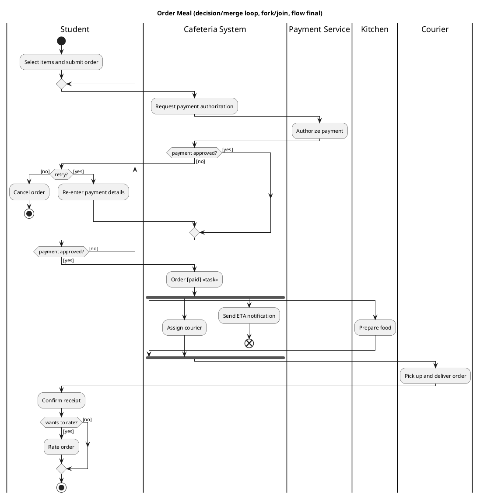
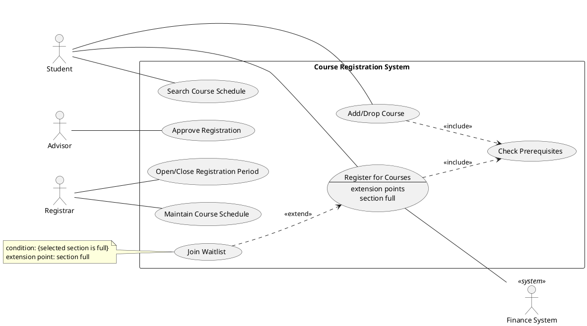

# Drill the diagrams and numbers that score

A top grade on the SOC3070 midterm comes from performing a short list of skills quickly and in the textbook's exact vocabulary, not from reading more. Those skills are sketching the development methodologies, computing ROI, break-even and NPV, scheduling with PERT/CPM and estimating effort, classifying requirements and matching elicitation techniques to situations, drawing UML use-case and activity diagrams that obey about a dozen notation rules, and naming Scrum, Kanban, XP and DevOps elements precisely. Quiz 1 asked for a waterfall, parallel or phased drawing plus a three-year ROI/break-even/NPV calculation. That signals that Prof. Dragunov grades what students can do, so at least half of the remaining study time belongs to timed, closed-book drills. Outside sources earn their place in three specific ways. Wiley's free excerpt of the 8th edition's Chapter 1 contains the course textbook's own formulas, plus a worked example in which ROI (10.14%) and break-even (about 2.7 years) accept a project that NPV (−$5,973) rejects ([Wiley DWR 8e Ch. 1](https://media.wiley.com/product_data/excerpt/80/11198037/1119803780-36.pdf)). Primary standards — the 2020 Scrum Guide, the 2025 Kanban Guide, OMG UML 2.5.1 and DORA's metrics — settle the questions where the textbook's wording is dated. A small body of research supports the syllabus's "AI in every SDLC phase" theme, and all of it points one way: AI drafts quickly but makes predictable errors, so a named human must check its output. The main hazard is edition mismatch, because this research could not see the 8th edition's Chapters 2–4 or the class slides; where the textbook and a standard disagree, learn both and answer in the wording the question uses. The exam falls between Saturday 24 and Friday 30 October, so the order of work is the Quiz 1 skills first, then project-management arithmetic, requirements, UML, and agile/DevOps, finishing with a timed mock exam.

## Four SDLC phases and five methodology sketches anchor the easy marks

The 8th edition defines the SDLC as "the process of determining how an information system (IS) can support business needs, designing the system, building it, and delivering it to users." It splits the SDLC into four phases, each answering one question ([Wiley DWR 8e Ch. 1](https://media.wiley.com/product_data/excerpt/80/11198037/1119803780-36.pdf)). **Planning** asks why to build the system and how to structure the project. **Analysis** asks who will use it, what it will do, and where and when. **Design** asks how it will work. **Implementation** delivers and supports it. Each phase is made of steps, steps use techniques, and techniques produce deliverables, "specific documents and files that explain various elements of the system." The book calls the SDLC "a process of gradual refinement," meaning each phase builds on the one before. Memorize which deliverable comes out of each phase, because matching deliverables to phases is the most common recall question.

| Phase | Deliverable |
|---|---|
| Planning | **System request, feasibility study and project plan** |
| Analysis | **System proposal** |
| Design | **System specification** |
| Implementation | **Installed system**, with test, migration, training and support plans |

There are three approval points: after the system request, after the system proposal, and at the end of design, where "the feasibility analysis and project plan are reexamined and revised." Three more lines recur in short answers (all from the same source). Implementation is "the longest and most expensive single part of the development process." Organizations "should spend more time and attention on testing than on writing the programs in the first place." And the case for following any method rests on failure data: studies put IT project failure rates "from 30 to 70%," and the Standish Group found that for projects over $100 million in labor costs, "only 2% are successful."

A methodology is "a formalized approach to implementing the SDLC (i.e., it is a list of steps and deliverables)." The OO sister textbook presents the methodologies as a chain in which each one fixes its predecessor's main weakness, which is the strongest structure for an essay answer ([Wiley DWT 6e Ch. 1](https://media.wiley.com/product_data/excerpt/1X/11195599/111955991X-156.pdf)). **Structured design** (1980s) replaced ad hoc coding with control and documentation but delivered slowly. **RAD** (1990s) got working pieces to users sooner, at the cost of the "subtle problem" of managing user expectations, which grow as users see the system. **Object-oriented** methods balanced data and process and produced reusable modules. **Agile** cut modeling and documentation overhead for small teams working in one place. **DevOps** added "the inclusion of operations personnel with the development team and continuous deployment." The same text describes the **Unified Process**, whose phases (inception, elaboration, construction, transition) map roughly to planning, analysis plus design, building and installation. It says any modern OO approach must be "use-case driven, architecture-centric, and iterative and incremental."

| Methodology | How it works | Strength | Weakness |
|---|---|---|---|
| Waterfall (structured) | Phases "in sequence from one phase to the next"; long deliverables approved before moving on | Requirements identified early; few changes along the way | Design must be complete before programming; long wait for delivery; going back is "extremely difficult" (a salmon swimming upstream) |
| Parallel (structured) | "a general design for the whole system," then subprojects "designed and implemented in parallel," joined together at the end | Shorter time to delivery, so less rework when the business changes | Subprojects are seldom fully independent; heavy integration work at the end |
| Phased (RAD) | "breaks an overall system into a series of versions that are developed sequentially" | A useful system reaches users quickly; extra requirements surface sooner | Users work with "intentionally incomplete" systems |
| Prototyping (RAD) | Analysis, design and implementation run "concurrently, and all three phases are performed repeatedly in a cycle"; the prototype becomes the system | Users get something to try very quickly | Fast releases undercut careful analysis; early design decisions fail in complex systems |
| Throwaway prototyping (RAD) | "relatively thorough analysis," then design prototypes that are thrown away | "more stable and reliable systems" | Takes longer than prototyping |
| XP (agile) | Communication, simplicity, feedback, courage; pair programming; continuous testing; user stories | Delivers results "sooner than even the RAD approaches" | Needs discipline; "no more than ten developers"; not for large mission-critical systems; leaves only code documentation |
| DevOps | Operations staff on the team; continuous deployment through an automated pipeline ("rolling upgrade") | Non-functional requirements such as security handled during design | Cost of the automated pipeline (my inference; the text lists no weakness) |

All rows come from [Wiley DWT 6e Ch. 1](https://media.wiley.com/product_data/excerpt/1X/11195599/111955991X-156.pdf).

### Drawing waterfall, parallel and phased the way graders expect

Quiz 1 asked for one of these three drawings, and the marks almost certainly depend on whether the sketch shows each methodology's defining mechanism. A **waterfall** sketch needs the four phases in a one-way cascade ending in a single delivered system. A **parallel** sketch needs one planning phase, one analysis and one *general* design, then a fan-out into subprojects that each do their own design and implementation at the same time, then an integration step and a single system. A **phased** sketch needs one planning phase and an overall analysis that sorts the requirements into versions. Then comes a repeated analysis–design–implementation cycle for each version, each ending in a delivered version, with arrows showing lessons from each version feeding the next ([Wiley DWT 6e Ch. 1](https://media.wiley.com/product_data/excerpt/1X/11195599/111955991X-156.pdf)). The sketches below show those mechanisms, plus the two prototyping variants. The 8th edition's own figures are in Chapter 2 (pp. 42–49) and may arrange the boxes differently, so copy the class slides' layout if it differs ([Wiley DWR 8e contents](https://media.wiley.com/product_data/excerpt/80/11198037/1119803780-53.pdf)).

```
WATERFALL  (strict sequence; each deliverable approved before the next phase; one delivery)
Planning
    +--> Analysis
             +--> Design
                      +--> Implementation
                                +--> SYSTEM

PARALLEL  (one general design; subprojects built at the same time; integrated; one delivery)
Planning --> Analysis --> Design (general design of the whole system)
                                |
             +------------------+------------------+
             v                  v                  v
       Subproject 1       Subproject 2       Subproject 3
       Design             Design             Design
         v                  v                  v
       Implementation     Implementation     Implementation
             +------------------+------------------+
                                v
                  Implementation (integration) --> SYSTEM

PHASED  (one system concept delivered as versions built one after another)
Planning --> Analysis (all requirements sorted into versions; most important in v1)
                 v
v1:  Design --> Implementation --> SYSTEM version 1
                                         |  (lessons and new ideas from using v1)
                                         v
v2:  Analysis --> Design --> Implementation --> SYSTEM version 2
                                                      |
                                                      v
v3:  Analysis --> Design --> Implementation --> SYSTEM version 3

PROTOTYPING  (A, D, I repeat together; the prototype evolves into the system)
Planning --> Analysis --> Design --> Implementation --> System prototype
               ^                                             |
               +------------- refine and repeat -------------+
                                                             v (when accepted)
                                                           SYSTEM

THROWAWAY PROTOTYPING  (thorough analysis; design prototypes explored, then discarded)
Planning --> Analysis ---------------------------> Design --> Implementation --> SYSTEM
               |   ^
               v   |
        Design prototype (mock-up or partial code; repeat until risky issues are resolved)
```

Two contrasts decide most methodology questions. Phased development delivers several systems in sequence, so users have version 1 early. Parallel development delivers once, after integration; its speed comes from doing the pieces at the same time, not from early delivery. Prototyping grows its prototype into the final system. Throwaway prototyping does a thorough analysis first and throws its design prototypes away before the real design. That is why throwaway gives more reliable systems but takes longer ([Wiley DWT 6e Ch. 1](https://media.wiley.com/product_data/excerpt/1X/11195599/111955991X-156.pdf)).

### Choosing a methodology is a six-criterion argument

Dennis rates each methodology Poor, Good or Excellent on six criteria: clarity of user requirements, familiarity with technology, system complexity, system reliability, short time schedule, and schedule visibility. The 8th edition puts this table in Chapter 2, at p. 49 ([Wiley DWR 8e contents](https://media.wiley.com/product_data/excerpt/80/11198037/1119803780-53.pdf)). The grid below comes from a third-party upload of Dennis-based instructor slides, checked against the textbook's descriptions. The least certain cell is throwaway prototyping on a short time schedule, so confirm the grid against 8e pp. 49–52 before memorizing it ([slidetodoc transcript](https://slidetodoc.com/system-development-methodologies-structured-design-waterfall-development-parallel/)).

| Ability to develop systems… | Waterfall | Parallel | Phased | Prototyping | Throwaway | Agile/XP |
|---|---|---|---|---|---|---|
| with unclear user requirements | Poor | Poor | Good | Excellent | Excellent | Excellent |
| with unfamiliar technology | Poor | Poor | Good | Poor | **Excellent** | Poor |
| that are complex | Good | Good | Good | Poor | **Excellent** | Poor |
| that are reliable | Good | Good | Good | Poor | **Excellent** | Good |
| with a short time schedule | Poor | Good | Excellent | Excellent | Good | Excellent |
| with schedule visibility | Poor | Poor | Excellent | Excellent | Good | Good |

A strong "choose and justify" answer makes four moves. It rates the case on all six criteria, picks the methodology with the most Good or Excellent ratings on the criteria the case makes critical, names the runner-up and the one criterion that rules it out, and adds one way to reduce the main risk. Take a bank building a loan-approval system around an AI document-reading service its team has never used, with partly unclear requirements, strict reliability demands and no hard deadline. The answer is **throwaway prototyping**, the only option rated Excellent on unfamiliar technology; prototyping is ruled out on reliability and XP on complexity. Now take a university replacing a large course-registration system. Its requirements are clear, reliability matters, and the rector wants something live next semester with visible progress. The answer is **phased development**, with version 1 limited to core enrollment. One point is worth a sentence in an essay: throwaway prototyping is rated at least as well as waterfall on every row. So waterfall survives because of things the table leaves out, such as auditability and management control.

### Six skills, six roles and one pairing trick

Dennis lists **six skill categories: technical, business, analytical, interpersonal, management and ethical**. Students most often forget ethical and management. The analyst's primary goal "is not to create a wonderful system. The primary goal is to create value for the organization" ([Wiley DWR 8e Ch. 1](https://media.wiley.com/product_data/excerpt/80/11198037/1119803780-36.pdf)). The two books list different roles. The 8th edition names the business analyst, systems analyst, infrastructure analyst, change management analyst and project manager, and adds a sixth, the **requirements analyst**, who focuses on "eliciting the requirements from the stakeholders." The OO text keeps five roles but says when each one is most active ([Wiley DWT 6e Ch. 1](https://media.wiley.com/product_data/excerpt/1X/11195599/111955991X-156.pdf)), which gives a reliable way to match roles to phases.

| Role | When most active |
|---|---|
| Business analyst | Analysis |
| Change management analyst | Implementation |
| Project manager | Every phase |
| Infrastructure analyst | Least active in planning and analysis |

### Placing AI in every SDLC phase

The syllabus theme asks students to place AI in every phase. The clearest way is to separate AI as a part of the system being built from AI as a tool that helps the team. The textbook already lists machine learning among the emerging technologies that create first-mover projects. It also warns that technical-feasibility risk "increases dramatically when the technology itself is new" ([Wiley DWR 8e Ch. 1](https://media.wiley.com/product_data/excerpt/80/11198037/1119803780-36.pdf)).

| Phase | AI inside the system being built | AI helping the analyst or team | Evidence to quote |
|---|---|---|---|
| Planning | Raises technical risk; value it beyond cost-cutting in economic feasibility; user distrust is an organizational-feasibility risk | Drafting system requests and business cases | Gartner: 75% of enterprise engineers will use AI code assistants by 2028; ROI metrics centered on cost reduction are a "narrow perspective" that "fails to capture the full value" ([Gartner](https://www.gartner.com/en/newsroom/press-releases/2024-04-11-gartner-says-75-percent-of-enterprise-software-engineers-will-use-ai-code-assistants-by-2028)); NIST AI RMF functions Govern, Map, Measure, Manage ([NIST](https://www.nist.gov/itl/ai-risk-management-framework)) |
| Analysis | Requirements must state ML performance measures and new qualities such as explainability and freedom from discrimination ([Vogelsang & Borg](https://arxiv.org/abs/1908.04674)) | Drafting interview questions, stories, use cases; classifying requirements | GPT-4 drafts requirements documents at entry-level-engineer quality ([Krishna et al.](https://arxiv.org/abs/2404.17842)); in a 45-student study of LLM-assisted modeling, 88.89% of reports identified the use cases completely but only 17.78% got the actor generalization right ([Wang et al.](https://arxiv.org/abs/2404.17739)) |
| Design | "Only a small fraction of a real-world ML system is composed of the ML code"; data pipelines, serving and monitoring make up the rest ([Google Cloud MLOps](https://docs.cloud.google.com/architecture/mlops-continuous-delivery-and-automation-pipelines-in-machine-learning)) | AI-suggested designs, reviewed by people | AI components are "more difficult to handle as distinct modules" ([Amershi et al.](https://www.microsoft.com/en-us/research/publication/software-engineering-for-machine-learning-a-case-study/)) |
| Implementation and support | Data and model validation, continuous retraining, monitoring for data drift | Code assistants; AIOps for incident triage | A 25% rise in AI adoption was associated with a 7.2% fall in delivery stability ([DORA 2024](https://cloud.google.com/blog/products/devops-sre/announcing-the-2024-dora-report)) |

The safe thesis for any AI question follows from this evidence. AI speeds up drafting and catches more items, but it makes mistakes of relationship, completeness and judgement. So accountability stays with a named human: the Product Owner, the analyst or the project manager.

### Edition mismatches, not ignorance, cost marks here

Most marks lost here come from mixing up editions and wording, not from not knowing the material. In the 8th edition, the methodology catalogue and selection table are in Chapter 2, and agile/Scrum is in the new Chapter 13 ([Wiley DWR 8e contents](https://media.wiley.com/product_data/excerpt/80/11198037/1119803780-53.pdf)). The chapter text gives the system request five elements, but the chapter review mentions "four main sections," so learn all five. Feasibility wording varies within one chapter. Economic feasibility appears as both "Will it provide business value?" and "Should we build it?" Organizational feasibility appears as both "If we build it, will it be used?" and "If we build it, will they come?" Technical feasibility is always "Can we build it?" Time is left out of feasibility on purpose, because "we consider time to be a project management issue" ([Wiley DWR 8e Ch. 1](https://media.wiley.com/product_data/excerpt/80/11198037/1119803780-36.pdf)). Analysis answers who, what, where and when, while design answers how. Finally, the textbook gives XP four values, while the XP community adds a fifth, respect ([extremeprogramming.org](http://www.extremeprogramming.org/values.html)).

| # | Question | Answer |
|---|---|---|
| 1 | Which phase answers who will use the system, what it will do, and where and when? | Analysis (design answers "how") |
| 2 | Architecture design, interface design, database and file specifications and program design together form which deliverable? | The system specification (design phase) |
| 3 | Which is not part of a system request: sponsor, business need, business value, special issues, technical feasibility? | Technical feasibility; it belongs to the separate feasibility analysis |
| 4 | In which methodology does the prototype evolve into the final system? | Prototyping; throwaway prototyping discards its design prototypes |
| 5 | Draw parallel development and name its main risk | Shared planning, analysis and general design → subprojects built at the same time (design + implementation) → integration → one system. Risk: subprojects are not truly independent, so integration is heavy |
| 6 | The bank case above: unfamiliar AI service, partly unclear requirements, strict reliability, no deadline | Throwaway prototyping; reject prototyping (Poor on reliability) and XP (Poor on complexity) |
| 7 | Clear requirements, a large system that must be reliable, and a sponsor who wants something live soon with visible progress | Phased development; reject waterfall (Poor on short schedule and visibility); manage expectations about an incomplete version 1 |
| 8 | Which role handles training and resistance to change, and is most active in implementation? | Change management analyst |
| 9 | Why is schedule not a type of feasibility in Dennis? | Time is treated as a project-management issue |

## Agile and DevOps answers depend on which rulebook the question quotes

The Agile Manifesto has four values: **individuals and interactions** over processes and tools, **working software** over comprehensive documentation, **customer collaboration** over contract negotiation, and **responding to change** over following a plan. They end with a sentence students often forget: "while there is value in the items on the right, we value the items on the left more" ([Agile Manifesto](https://agilemanifesto.org/)). So agile does not mean no documentation or no plan. The most quotable of the twelve principles are "Welcome changing requirements, even late in development," "Deliver working software frequently, from a couple of weeks to a couple of months," and "Working software is the primary measure of progress" ([Agile principles](https://agilemanifesto.org/principles.html)). The standard compare-and-contrast question sets agile against waterfall, "a linear, sequential project management approach" that suits "well defined requirements and predictable outcomes" ([Atlassian](https://www.atlassian.com/agile/project-management/waterfall-methodology)).

Scrum is where the textbook and the official standard differ most. The 8th edition's index still uses pre-2020 terms such as "ScrumMaster," "Product backlog grooming," "Sprint commitment" and "Sprint Review (or Demo)" ([Wiley DWR 8e index](https://media.wiley.com/product_data/excerpt/80/11198037/1119803780-35.pdf)). The OO text describes sprints of "thirty working days," teams of "no more than seven members," and "no designated team leader" ([Wiley DWT 6e Ch. 1](https://media.wiley.com/product_data/excerpt/1X/11195599/111955991X-156.pdf)). The 2020 Scrum Guide is still the official version, and successive revisions replaced those terms ([Scrum Guide revisions](https://scrumguides.org/revisions.html)). In 2011 the team's "commitment" to the selected items became a forecast. In 2013 "grooming" became "refinement." In 2020 roles became three "accountabilities," and the Sprint Goal became the Sprint Backlog's formal commitment. Answer in the textbook's words when the question uses them, and in 2020 terms when it cites the Guide.

| 2020 Scrum Guide element | What to write | Older or textbook wording |
|---|---|---|
| Scrum Team | One Scrum Master, one Product Owner and Developers; "typically 10 or fewer people"; self-managing; no sub-teams | ScrumMaster plus Development Team; at most 7; "self-organizing" |
| Product Owner | Accountable for maximizing value and ordering the Product Backlog; "one person, not a committee"; "Only the Product Owner has the authority to cancel the Sprint" | Product owner |
| Scrum Master | Accountable for the team's effectiveness; "causing the removal of impediments"; "true leaders who serve" | "servant-leader" (2017 Guide) |
| Developers | Create the Sprint Backlog; meet the Definition of Done; estimate the size of items | Development team |
| Sprint | "one month or less"; the next starts immediately | 30 working days (OO text) |
| Sprint Planning | At most 8 hours for a one-month Sprint; covers Why, What and How | Sprint planning meeting |
| Daily Scrum | 15 minutes, "for the Developers"; no required three questions | Daily standup with three questions |
| Sprint Review | At most 4 hours; "a working session," not just a presentation | Sprint Review (or Demo) |
| Sprint Retrospective | At most 3 hours; "concludes the Sprint" | Sprint retrospective |
| Artifacts and their commitments | Product Backlog → Product Goal; Sprint Backlog → Sprint Goal; Increment → Definition of Done | Product backlog grooming |

All rows come from the [Scrum Guide 2020](https://scrumguides.org/scrum-guide.html). Counting questions are easy marks. Scrum has **five events** (the Sprint, which contains the other four), **three accountabilities**, **three artifacts** with one commitment each, **three pillars** (transparency, inspection, adaptation) and **five values** (commitment, focus, openness, respect, courage). Refinement is an ongoing activity, not an event.

Several practices taught alongside Scrum are not in the Scrum Guide: story points, planning poker, velocity, user stories and burndown charts. The textbook's Scrum chapter covers them anyway. Scrum.org calls velocity "an optional, but often used, indication" ([Scrum.org glossary](https://www.scrum.org/resources/scrum-glossary)), and velocity counts only fully completed stories ([Atlassian velocity](https://www.atlassian.com/agile/project-management/velocity-scrum)).

**Velocity example.** A team completed 21, 18, 25 and 20 points in its last four sprints, an average of 21. With 168 points left, it needs 168 ÷ 21 = **8 Sprints**, or 7 to 10 using its fastest and slowest sprints. A 13-point story that is "90% done" adds **zero** and returns to the Product Backlog.

**Burndown example.** A 10-day Sprint plans 60 points, so the ideal pace is 6 points a day. If 30 points remain after day 6, the ideal was 24, so the team is 6 points behind. It now needs 7.5 points a day, against the 5 it has managed so far. That is the moment to renegotiate scope with the Product Owner without putting the Sprint Goal at risk. A sudden upward jump in a burndown chart means scope was added ([Atlassian burndown](https://www.atlassian.com/agile/tutorials/burndown-charts)).

User stories follow the template "As a [role], I want [feature], so that [benefit]." They should meet INVEST: **Independent, Negotiable, Valuable, Estimable, Small, Testable** ([Bill Wake](https://xp123.com/invest-in-good-stories-and-smart-tasks/)).

The OO text gives XP four values: **communication, simplicity, feedback and courage**. It recommends XP "only for small groups of developers—no more than ten" and warns that XP leaves only code documentation ([Wiley DWT 6e Ch. 1](https://media.wiley.com/product_data/excerpt/1X/11195599/111955991X-156.pdf)). Be able to recognize XP's practices from a one-line description: pair programming; test-driven development, summed up as "red, green, refactor" (write a failing test, make it pass, then clean up the code) ([Fowler](https://martinfowler.com/bliki/TestDrivenDevelopment.html)); continuous integration ("XP teams build multiple times per day"); refactoring; small releases; simple design; collective code ownership; a sustainable pace; and an on-site customer ([Ron Jeffries](https://ronjeffries.com/xprog/what-is-extreme-programming/)). Simplicity is an XP value, not a Scrum value, which makes it a favorite wrong option in multiple-choice questions.

The 2025 Kanban Guide defines Kanban as "a strategy for optimizing the flow of value through a process" ([Kanban Guide](https://kanbanguides.org/english/)). It has three practices: defining and visualizing a workflow, actively managing items in it, and improving it. It requires four flow metrics: **WIP (work in progress), Throughput, Work Item Age and Cycle Time**. Explicit limits on work in progress "should create a pull system," where new work starts only when there is room for it. A service level expectation forecasts delivery, for example "85% of work items will be finished in eight days or less." Kanban has no required roles, events or iterations, and updates are released "whenever they are ready" ([Atlassian Kanban vs Scrum](https://www.atlassian.com/agile/kanban/kanban-vs-scrum)).

The one Kanban calculation is Little's Law, L = λW, or **average cycle time = average WIP ÷ average throughput** ([Little's law](https://en.wikipedia.org/wiki/Little%27s_law)). A team with 15 items in progress that finishes 5 a week has an average cycle time of **3 weeks**. To reach 2 weeks at the same throughput, it should limit WIP to **10**. On a cumulative flow diagram, a band that widens over time marks a bottleneck ([Atlassian CFD](https://support.atlassian.com/jira-software-cloud/docs/view-and-understand-the-cumulative-flow-diagram/)). Do not confuse the Kanban Guide (Vacanti and Coleman: three practices, four metrics) with the Kanban Method (David Anderson: six general practices — visualize, limit WIP, manage flow, make policies explicit, implement feedback loops, improve collaboratively) ([Kanban University](https://kanban.university/kanban-guide/)).

The OO text defines DevOps as agile plus operations staff on the team and continuous deployment, using rolling upgrades that need an automated pipeline ([Wiley DWT 6e Ch. 1](https://media.wiley.com/product_data/excerpt/1X/11195599/111955991X-156.pdf)). Keep three terms apart. In **continuous integration**, each developer merges changes "at least daily," and each merge is checked by an automated build and tests ([Fowler CI](https://martinfowler.com/articles/continuousIntegration.html)). In **continuous delivery**, the software "can be released to production at any time" at the push of a button ([Fowler CD](https://martinfowler.com/bliki/ContinuousDelivery.html)). In **continuous deployment**, every change that passes the tests is released with "no human intervention" ([Atlassian](https://www.atlassian.com/continuous-delivery/principles/continuous-integration-vs-delivery-vs-deployment)). DevOps rests on the Three Ways: flow (thinking about the whole system), amplified feedback loops, and a culture of continual experimentation and learning ([IT Revolution](https://itrevolution.com/articles/the-three-ways-principles-underpinning-devops/)).

DORA now uses five metrics in two groups ([DORA metrics](https://dora.dev/guides/dora-metrics/)). **Throughput** covers change lead time, deployment frequency and failed deployment recovery time. **Instability** covers change fail rate and deployment rework rate. DORA reports that "speed and stability are not tradeoffs." For example, if 5 of 50 deployments in a month need a rollback or hotfix, the change fail rate is **10%**. If 2 deployments were unplanned fixes for production incidents, the rework rate is **4%**. AIOps applies AI to IT operations, such as anomaly detection, event correlation and root-cause analysis. It supports DevOps rather than replacing it ([IBM AIOps](https://www.ibm.com/think/topics/aiops)).

The evidence on AI in agile teams is mixed, and that is exactly what an essay should say. DORA 2024 found that a 25% rise in AI adoption was associated with **+7.5% documentation quality and +3.4% code quality, but −1.5% delivery throughput and −7.2% delivery stability**. 39% of respondents had little or no trust in AI-generated code ([DORA 2024](https://cloud.google.com/blog/products/devops-sre/announcing-the-2024-dora-report)). DORA 2025 calls AI an amplifier: "AI doesn't fix a team; it amplifies what's already there" ([DORA 2025](https://cloud.google.com/blog/products/ai-machine-learning/announcing-the-2025-dora-report)). METR's randomized trial found experienced developers took **19% longer** with AI, while believing it had sped them up by 20% ([METR](https://metr.org/blog/2025-07-10-early-2025-ai-experienced-os-dev-study/)). Guidance co-written by Scrum co-creator Jeff Sutherland puts it plainly: "AI may recommend, but humans decide." Note that this appears in the Scrum Guide Expansion Pack, not in the Scrum Guide itself ([AI and Scrum](https://scrumexpansion.org/ai-and-scrum/)).

### Outdated Scrum vocabulary is the commonest agile trap

The traps here come from outdated terms and from lists that look alike. The Product Backlog is "ordered," not prioritized (changed in 2011). It is "refined rather than groomed" (2013). The three Daily Scrum questions were removed in 2020 ([Scrum Guide revisions](https://scrumguides.org/revisions.html)). The Daily Scrum is for the Developers, not a status meeting, and the Sprint Review is a working session, not a demo. Partly finished work counts as zero. Scrum's three pillars are not the same as its five values. Continuous delivery keeps a human release decision; continuous deployment removes it. Older material lists DORA's "four keys": deployment frequency, lead time, change failure rate and time to restore service. In 2023, time to restore (MTTR) was renamed failed deployment recovery time, and in 2024 rework rate was added ([DORA history](https://dora.dev/insights/dora-metrics-history/)).

| # | Question | Answer |
|---|---|---|
| 1 | Which is not a Manifesto value: individuals over processes; working software over documentation; following a plan over responding to change; collaboration over contract negotiation? | "Following a plan over responding to change" (it is reversed) |
| 2 | Which is not a Scrum value: courage, openness, simplicity, respect? | Simplicity (it is an XP value) |
| 3 | Mid-Sprint, a competitor's launch makes the Sprint Goal pointless. Who may cancel the Sprint? | Only the Product Owner |
| 4 | For a one-month Sprint, what are the maximum lengths of Planning, Daily Scrum, Review and Retrospective? | 8 h, 15 min, 4 h, 3 h |
| 5 | Who estimates the size of Product Backlog items? | The Developers who will do the work |
| 6 | Velocities were 21, 18, 25 and 20, and 168 points remain. How many Sprints? And what does a 13-point story that is 90% done add? | 8 Sprints (range 7–10); 0 |
| 7 | Kanban: 15 items in progress, 5 finished per week. What is the cycle time? What WIP limit gives a 2-week cycle time? | 3 weeks; 10 items |
| 8 | An item started on Oct 1 is still unfinished on Oct 9. Which metric describes its 8 days? | Work Item Age (cycle time applies only once an item is finished) |
| 9 | "Every change that passes all stages is released to customers with no human intervention." What is this? | Continuous deployment |
| 10 | 50 deployments; 5 needed a rollback or hotfix; 2 were unplanned fixes for production incidents. What are the change fail rate and rework rate? | 10%; 4% |
| 11 | "Write a failing test, make it pass, clean up the code." What is this practice? | Test-driven development (an XP practice) |

## Economic feasibility is a fixed ten-minute recipe

Planning starts with the **system request**, "a document that describes the business reasons for building a system and the value that the system is expected to provide." The project sponsor writes it, and it usually has five elements: **project sponsor, business need, business requirements, business value and special issues** ([Wiley DWR 8e Ch. 1](https://media.wiley.com/product_data/excerpt/80/11198037/1119803780-36.pdf)). Keep them apart. The need is the business problem (why). The requirements are the business capabilities the system will provide (what). The value is the benefit, in numbers where possible. Special issues are deadlines, legal mandates and security clearances, so a deadline is a constraint, not a requirement ([DWR 6e slides, CUHK-hosted](https://www1.se.cuhk.edu.hk/~seem5730/l22/ch01_The%20Systems%20Analysis%20and%20Information%20Systems%20Development.pdf)).

Feasibility analysis then asks three questions ([Wiley DWR 8e Ch. 1](https://media.wiley.com/product_data/excerpt/80/11198037/1119803780-36.pdf)). **Technical feasibility ("Can we build it?")** is "in essence, a technical risk analysis," where the risk depends on familiarity with the application, familiarity with the technology, project size, and compatibility with existing systems. **Economic feasibility** asks "Should we build it?" **Organizational feasibility ("If we build it, will they come?")** is judged by how well the project fits the business strategy and by a stakeholder analysis of the champion, organizational management and system users. One trap: being unfamiliar with the *business area* counts as technical risk, even though it sounds organizational.

Economic feasibility has four steps: identify costs and benefits, assign values to them, work out the cash flow over (usually) 3–5 years, and assess the economic value with ROI, break-even point and NPV. Costs and benefits fall into four categories: development costs, operational costs, tangible benefits and intangible benefits. The formulas, in the textbook's own form (same source):

| Measure | 8th edition formula | Decision rule |
|---|---|---|
| Return on investment (ROI) | (Total benefits − Total costs) ÷ Total costs | Higher is better; it is a total return over the whole period, not a yearly rate |
| Break-even point (BEP) | Years of negative cash flow + (that year's net cash flow − that year's cumulative cash flow) ÷ that year's net cash flow | Sooner is better |
| Present value (PV) | Amount ÷ (1 + rate)^n | — |
| Net present value (NPV) | PV of total benefits − PV of total costs | "As long as the NPV is greater than zero, the project is considered economically acceptable" |

Three conventions reproduce the excerpt's printed ROI, break-even and NPV, as practice problem 1 below shows. First, put development costs in year 0. Second, do not discount year 0, and do not count it among the "years of negative cash flow." Third, compute ROI and break-even on **undiscounted** totals, but NPV on **discounted** ones. That third convention is why ROI and break-even can look healthy while NPV is negative. Dennis-family slides accordingly call the discounted cash-flow method and NPV "preferred" ([DWR 6e slides, CUHK-hosted](https://www1.se.cuhk.edu.hk/~seem5730/l22/ch01_The%20Systems%20Analysis%20and%20Information%20Systems%20Development.pdf)). Instructors differ on whether the break-even should use discounted figures, so write one line stating which you used, and check which one the Quiz 1 answer key used. The fraction in the break-even formula is simply the amount still to be recovered at the start of the break-even year, divided by that year's cash flow. This is the same step used to find a standard payback period ([OpenStax payback](https://openstax.org/books/principles-finance/pages/16-1-payback-period-method)).

**Worked example (Quiz 1 style, verified).** A clinic scheduling system costs $90,000 to develop in year 0 and $10,000 a year to run. It brings benefits of $40,000, $50,000 and $60,000 in years 1–3. The discount rate is 10%.

| | Year 0 | Year 1 | Year 2 | Year 3 | Total |
|---|---|---|---|---|---|
| Benefits | 0 | 40,000 | 50,000 | 60,000 | 150,000 |
| Development costs | 90,000 | 0 | 0 | 0 | 90,000 |
| Operational costs | 0 | 10,000 | 10,000 | 10,000 | 30,000 |
| Total costs | 90,000 | 10,000 | 10,000 | 10,000 | 120,000 |
| Net cash flow | −90,000 | 30,000 | 40,000 | 50,000 | 30,000 |
| Cumulative net cash flow | −90,000 | −60,000 | −20,000 | **+30,000** | |
| Discount factor 1/(1.10)^n | 1.0000 | 0.9091 | 0.8264 | 0.7513 | |
| PV of benefits | 0 | 36,363.64 | 41,322.31 | 45,078.89 | 122,764.84 |
| PV of costs | 90,000.00 | 9,090.91 | 8,264.46 | 7,513.15 | 114,868.52 |
| PV of net cash flow | −90,000.00 | 27,272.73 | 33,057.85 | 37,565.74 | **7,896.32** |
| Cumulative PV | −90,000.00 | −62,727.27 | −29,669.42 | +7,896.32 | |

ROI is (150,000 − 120,000) ÷ 120,000 = **25%**. The cumulative cash flow turns positive in year 3, after two negative operating years, so the break-even point is 2 + (50,000 − 30,000) ÷ 50,000 = **2.4 years**. NPV is 122,764.84 − 114,868.52 = **$7,896.32**, which is above zero, so the project is economically acceptable. If the professor wants the break-even on discounted figures, the same formula applied to the PV rows gives 2 + (37,565.74 − 7,896.32) ÷ 37,565.74 = **2.79 years**, and ROI on the PV totals is 6.87%. A full-mark answer shows the table, each formula with the numbers substituted in, discount factors to four decimal places, and a one-sentence recommendation that leads with NPV.

The textbook's own example makes the point that earns essay marks. A project with an ROI of 10.14% and a break-even near 2.7 years looks acceptable, yet its NPV at 10% is −$5,973, so it should be rejected. ROI and break-even ignore the time value of money ([Wiley DWR 8e Ch. 1](https://media.wiley.com/product_data/excerpt/80/11198037/1119803780-36.pdf)). The same excerpt contains two misprints worth knowing, so that a mismatch doesn't shake you in the exam. First, it works out (41,000 − 14,000) ÷ 41,000 as "28,000/41,000 → 2.68 years," but 41,000 − 14,000 = 27,000, which gives **2.66 years**. Second, its DrōnTeq appendix labels 3,033,180 ÷ 2,118,133 as "ROI 143%." That figure is a benefit/cost ratio; by the book's own formula, the ROI is about **43%**.

### Year 0 and mixed bases sink most feasibility answers

Calculation marks usually go in eight ways: discounting year 0, counting year 0 as a negative year, mixing PV and undiscounted totals in one ROI, calling ROI a yearly rate, rounding discount factors too early, forgetting a stated growth rate, listing an intangible benefit without valuing it (or at least naming it), and mixing up one-time development costs with recurring operational costs. If a question puts all costs in years 1–3 with no year 0, discount from year 1 and say so.

| # | Question | Answer |
|---|---|---|
| 1 | Development cost $100,000 in year 0. Operating costs $12,000, $12,700 and $13,300 and benefits $47,000, $50,700 and $54,300 in years 1–3. Discount rate 10%. Find ROI, BEP and NPV, and decide | Totals: benefits 152,000, costs 138,000, so **ROI = 10.14%**. Net flows 35,000 / 38,000 / 41,000; cumulative −100,000 / −65,000 / −27,000 / +14,000; **BEP** = 2 + (41,000 − 14,000) ÷ 41,000 = **2.66 years**. **NPV** = −100,000 + 31,818.18 + 31,404.96 + 30,803.91 = **−$5,972.95**, so **reject** despite the positive ROI. (This problem was built to reproduce the textbook's headline numbers) |
| 2 | What is the PV of $10,000 received in 3 years at 8%? | $7,938.32 |
| 3 | Sort into system-request elements: "Sarah Kim, Director of Customer Service"; "customers wait 3 days for complaint replies and leave"; "customers can submit and track complaints online"; "$120,000 a year lower call-handling cost"; "must be live before the 1 March privacy regulation"; "improved brand image" | Sponsor; business need; business requirement; tangible value; special issue; intangible value |
| 4 | Classify each risk: (a) the team has never used the cloud platform; (b) the system must exchange data with a 20-year-old COBOL payroll system; (c) warehouse staff fear being monitored; (d) PV of benefits is below PV of costs; (e) 25 developers for 18 months; (f) the project conflicts with a strategy of leaving retail; (g) nobody understands claims processing | (a) technical, technology; (b) technical, compatibility; (c) organizational, users; (d) economic; (e) technical, size; (f) organizational, strategic fit; (g) technical, business area |
| 5 | Why might a project with a positive NPV still be rejected? | Projects are judged as part of a portfolio with limited funds, weighing risk and strategic fit ([DWR 5e Ch. 2 slides, CUHK-hosted](https://www1.se.cuhk.edu.hk/~seem5730/l22/ch02_Project%20Selection%20and%20Management.pdf)) |

## Project management rewards clean arithmetic and the right term

Dennis describes project management as trading off "the size of the system, the time to complete the project, and the cost of the project," starting from "a realistic assessment of the work" ([DWR 5e Ch. 2 slides, CUHK-hosted](https://www1.se.cuhk.edu.hk/~seem5730/l22/ch02_Project%20Selection%20and%20Management.pdf)).

**Industry percentages.** The simplest estimate uses industry percentages for business applications: **planning 15%, analysis 20%, design 35%, implementation 30%**. You scale up from how long planning actually took. If planning took 4 person-months, the total is 4 ÷ 0.15 = 26.67, so analysis is 5.33, design 9.33 and implementation 8 person-months (same source).

**Function points.** This method runs in a fixed order ([UW IS 460 notes](https://faculty.washington.edu/ytan/is460/notes/LN14.pdf)). First, count the total unadjusted function points (TUFP) from weighted counts of five components. Next, rate 14 system characteristics from 0 to 5 and add them up to get the project complexity (PC). Then compute the adjusted complexity, APC = 0.65 + 0.01 × PC, and the total adjusted function points, TAFP = TUFP × APC. Convert TAFP to lines of code using the language's lines per function point. Finally, effort = 1.4 × thousands of lines of code, and schedule = 3.0 × effort^(1/3). The component weights are ([Longstreet FPA reference](https://people.eecs.ku.edu/~saiedian/Teaching/811/Papers/Function-Points/fpa-ref.pdf)):

| Component (Dennis label) | Low | Average | High |
|---|---|---|---|
| External inputs | 3 | 4 | 6 |
| External outputs | 4 | 5 | 7 |
| External queries | 3 | 4 | 6 |
| Internal logical files ("files") | 7 | 10 | 15 |
| External interface files ("program interfaces") | 5 | 7 | 10 |

For example, with a TUFP of 194 and a PC of 30, APC = 0.95 and TAFP = 184.3. In Java, at 53 lines per function point ([QSM language table](https://www.qsm.com/resources/function-point-languages-table)), that is 9,768 lines and 13.68 person-months. The schedule is 3.0 × 13.68^(1/3) = 7.17 months, so roughly two people. Two cautions apply. It is unverified whether the 8th edition keeps the function-point appendix (the 5th edition had it as Appendix 2A). And basic COCOMO, another estimation model, gives about twice the effort for the same code size. So use whatever formula and lines-per-function-point table the exam provides ([RIT slides](https://www.se.rit.edu/~swen-256/slides/SWEN256-10-FunctionPointEstimationandCOCOMO.pdf)).

Each workplan tool answers one question. A **WBS** (work breakdown structure) breaks down 100% of the scope, including the project management work itself ([Wikipedia WBS](https://en.wikipedia.org/wiki/Work_breakdown_structure)). A **Gantt chart** is "a bar chart that illustrates a project schedule" ([Wikipedia Gantt chart](https://en.wikipedia.org/wiki/Gantt_chart)). **PERT** estimates each task from optimistic (o), most likely (m) and pessimistic (p) estimates as te = (o + 4m + p) ÷ 6, with standard deviation σ = (p − o) ÷ 6 ([Wikipedia PERT](https://en.wikipedia.org/wiki/Program_evaluation_and_review_technique)). **CPM** (critical path method) finds "the longest path of planned activities": the chain of zero-slack tasks that sets the shortest possible project duration ([Wikipedia CPM](https://en.wikipedia.org/wiki/Critical_path_method)). By hand, CPM takes three steps. The forward pass sets each task's earliest start (ES) to the latest earliest finish (EF) among its predecessors, with EF = ES + duration. The backward pass sets each task's latest finish (LF) to the earliest latest start (LS) among its successors, with LS = LF − duration. Slack is then LS − ES. The verified network below uses seven analysis-phase tasks, with durations in days.

| Task | Predecessors | o, m, p | te | ES | EF | LS | LF | Slack |
|---|---|---|---|---|---|---|---|---|
| A Interview users | — | 2, 3, 4 | 3 | 0 | 3 | 0 | 3 | **0** |
| B Review documents | — | 1, 2, 9 | 3 | 0 | 3 | 1 | 4 | 1 |
| C Process models | A | 3, 5, 13 | 6 | 3 | 9 | 3 | 9 | **0** |
| D Data model | A, B | 2, 4, 6 | 4 | 3 | 7 | 5 | 9 | 2 |
| E UI prototype | B | 4, 6, 14 | 7 | 3 | 10 | 4 | 11 | 1 |
| F System proposal | C, D | 1, 2, 3 | 2 | 9 | 11 | 9 | 11 | **0** |
| G Approval | E, F | 1, 1, 1 | 1 | 11 | 12 | 11 | 12 | **0** |

The critical path is **A–C–F–G, 12 days**. The other paths take 11 days (B–E–G) and 10 days (A–D–F–G and B–D–F–G). As an optional extra, the critical path's variance is 3.0 (σ = 1.73), so the chance of finishing within 14 days is about 0.88. The text Gantt chart shows the same schedule (# = scheduled work, . = slack, * = critical):

```
Day                     1  2  3  4  5  6  7  8  9 10 11 12
A Interview users *     #  #  #
B Review documents      #  #  #  .
C Process models *               #  #  #  #  #  #
D Data model                     #  #  #  #  .  .
E UI prototype                   #  #  #  #  #  #  #  .
F System proposal *                                #  #
G Approval *                                             #
```

Estimates get more accurate as the project goes on. Dennis's table of typical margins of error, which cites Boehm, shows how much ([DWR 5e Ch. 2 slides, CUHK-hosted](https://www1.se.cuhk.edu.hk/~seem5730/l22/ch02_Project%20Selection%20and%20Management.pdf)):

| Phase | Deliverable | Cost margin of error | Schedule margin of error |
|---|---|---|---|
| Planning | System request | 400% | 60% |
| Planning | Project plan | 100% | 25% |
| Analysis | System proposal | 50% | 15% |
| Design | System specifications | 25% | 10% |

McConnell calls the same idea the "cone of uncertainty." An estimate made at the first idea of a project can be off "by a factor of 4x on the high side or 4x on the low side," and "the Cone narrows only as you make decisions that eliminate variability" ([Construx](https://www.construx.com/books/the-cone-of-uncertainty/)). So re-estimate at every deliverable, and never treat a planning-phase estimate as a promise.

**Scope creep** is "the most common reason for schedule and cost overruns," so once the project starts, the project manager should allow only "absolutely necessary requirements" to be added. **Timeboxing** fixes the date and cuts features in six steps: set the delivery date, rank the features by priority, build the core, postpone whatever will not fit, deliver the core, and repeat for the postponed features. **Risk management** runs as a risk assessment, then actions to reduce risk, then a revised assessment ([DWR 5e Ch. 2 slides, CUHK-hosted](https://www1.se.cuhk.edu.hk/~seem5730/l22/ch02_Project%20Selection%20and%20Management.pdf)). Rank risks by exposure, which is probability × impact. A 60% chance of losing $40,000 (exposure $24,000) ranks above a 20% chance of losing $100,000 (exposure $20,000) ([Wikipedia risk matrix](https://en.wikipedia.org/wiki/Risk_matrix)).

Staffing produces two documents with different jobs ([DWR 5e Ch. 2 slides, CUHK-hosted](https://www1.se.cuhk.edu.hk/~seem5730/l22/ch02_Project%20Selection%20and%20Management.pdf)). The **staffing plan** describes "the kinds of people working on the project." The **project charter** describes "the project's objectives and rules." A functional lead manages the analysts, and a technical lead oversees the programmers. Teams of 8–10 arranged in a hierarchy reduce complexity, and "adding staff may add more overhead than additional labor."

Average staff = effort ÷ schedule, so 24 person-months over 8 months needs 3 people. Communication channels grow as n(n−1)/2: 3 channels for 3 people, 15 for 6, and 45 for 10. That growth explains Brooks's law: "Adding manpower to a late software project makes it later" ([Wikipedia Brooks's law](https://en.wikipedia.org/wiki/Brooks%27s_law)). Motivation should rely on rewards that come from the work itself: recognition, achievement, the work, responsibility, advancement and the chance to learn. Use money cautiously. Handle conflict with clear plans, a charter that sets norms, schedule commitments agreed in advance, and forecasting of other demands on people's time.

**CASE** (computer-aided software engineering) tools come in three kinds. Upper CASE supports analysis modeling, lower CASE supports construction and code generation, and integrated CASE spans the whole life cycle ([Wikipedia CASE](https://en.wikipedia.org/wiki/Computer-aided_software_engineering)). **Standards** set formal rules for naming files, forms for recording goals reached, and programming guidelines. **Documentation** lives in a project binder that is updated continually, not written at the end ([DWR 5e Ch. 2 slides, CUHK-hosted](https://www1.se.cuhk.edu.hk/~seem5730/l22/ch02_Project%20Selection%20and%20Management.pdf)).

For the AI theme, the evidence on machine-learning estimation is sobering. A replication study found that Deep-SE, a deep-learning model for estimating story points, beat a simple median baseline with statistical significance in only **8 of 42** cases ([Tawosi et al.](https://arxiv.org/abs/2201.05401)). A 2026 study of retrieval-augmented generation found no statistically significant differences across projects ([Maha et al.](https://arxiv.org/abs/2604.03443)). So AI belongs alongside expert, analogy-based and formula-based estimates as a decision aid. It does not remove the cone of uncertainty.

### Longest path, cube root and 0.01 catch careless solvers

The critical path is the *longest* path, not the shortest. PERT weights the most likely estimate by 4 and divides by 6. Slack is shared along a path, so if one task uses it up, the tasks after it lose it. The complexity adjustment is 0.01 × PC, not 0.1; effort uses *thousands* of lines of code; and the schedule uses a *cube root*. Industry percentages apply to total effort. Timeboxing fixes time, not scope. And the functional lead goes with analysts, the technical lead with programmers.

| # | Question | Answer |
|---|---|---|
| 1 | Planning actually took 6 weeks. Estimate the other phases | Total 40 weeks: analysis 8, design 14, implementation 12 |
| 2 | PERT: o = 4, m = 6, p = 14 | te = 7.0 days; σ = 1.67 |
| 3 | Tasks (duration; predecessors): 1 (6; —), 2 (3; —), 3 (6; 1), 4 (4; 1, 2), 5 (8; 3), 6 (5; 4), 7 (4; 5, 6). Find the critical path. What if task 4 slips 6 days, or task 5 slips 2? | Critical path 1–3–5–7, **24 days**. Slack: task 2 = 8; tasks 4 and 6 = 5 each, shared. Task 4 +6 → 25 days; task 5 +2 → 26 days; task 6 +3 → no delay |
| 4 | Function points: TUFP 150; all 14 characteristics rated 3; C# at 54 lines per function point | PC 42 → APC 1.07 → TAFP 160.5 → 8,667 lines → 12.13 person-months → 6.89 months → about 2 people |
| 5 | Rank these risks: R1 60% × $40k; R2 30% × $25k; R3 20% × $100k; R4 50% × $30k | R1 $24,000 > R3 $20,000 > R4 $15,000 > R2 $7,500; total $66,500 |
| 6 | 24 person-months over 8 months: how many people? What happens to communication channels if the team doubles? | 3 people; channels rise from 3 to 15 |
| 7 | A legal deadline is 30 Nov, and only features 1–6 of 10 will fit. Apply timeboxing | Fix the date; rank the features; build 1–6; postpone 7–10; deliver; repeat for 7–10 later. Late change requests go through change control into a later timebox |
| 8 | Which CASE type generates code? Which supports DFD/ERD/UML modeling? Which spans the life cycle? | Lower; upper; integrated |

## Requirements questions are classification games with known trick examples

A requirement is "a statement of what the system must do or a characteristic it must have." Requirements determination turns the high-level business requirements in the system request "into detailed requirements that can be used as inputs for creating models." Wiley's chapter slides call it "the single most critical step of the entire SDLC," because more than 50% of system failures trace back to problems with requirements ([Wiley DWT slides, CSU-hosted](https://cis.csuohio.edu/~sschung/CIS433/ch03.pdf)). The 8th edition defines business, user, functional, nonfunctional and system requirements from p. 74 ([Wiley DWR 8e index](https://media.wiley.com/product_data/excerpt/80/11198037/1119803780-35.pdf)). **Business requirements** "describe the capabilities the system will provide the organization so that the business needs are met" ([Wiley DWR 8e Ch. 1](https://media.wiley.com/product_data/excerpt/80/11198037/1119803780-36.pdf)). **Functional requirements** relate "directly to a process the system has to perform or information it needs to contain" ([IDS 405 notes](http://legacy2.oyibo.com/notes/IDS405/4RequirementsDetermination.htm)), so they come in two kinds: process-oriented ("The system must allow registered customers to review their own order history") and information-oriented ("The system must retain customer order history for 3 years") ([DWR 7e deck, slidetodoc](https://slidetodoc.com/chapter-3-requirements-determination-systems-analysis-and-design/)). **Nonfunctional requirements** describe how the system must behave and fall into four types. Each official example below is a known trap because it *looks* functional ([Wiley DWT slides, CSU-hosted](https://cis.csuohio.edu/~sschung/CIS433/ch03.pdf)).

| Nonfunctional type | Question it answers | Official example that looks functional |
|---|---|---|
| Operational | Where and on what does it run, and what must it connect to? | "The system should be able to integrate with the existing inventory system." |
| Performance | How fast, how much, how often, how reliable? | "The system should receive updated inventory information every 15 minutes." |
| Security | Who may see or do what, and how is it protected? | "Customers can see their order history only during business hours." |
| Cultural and political | Which laws, policies, languages, currencies or norms apply? | "The system should be able to distinguish between United States and European currency." |

To classify a statement, first ask whether it describes something the system *does* or *stores*. If it does, it is functional. If not, it is nonfunctional, and you ask which question in the table it answers. If it mixes two kinds, split it into two requirements.

The **requirements definition statement** (the 8th edition's term) is "a straightforward text report that lists the functional and nonfunctional requirements in an outline format." It is usually prioritized as high, medium or low, and its main job is to define the scope ([IDS 405 notes](http://legacy2.oyibo.com/notes/IDS405/4RequirementsDetermination.htm)). Items that are needed but out of scope go on a list of future enhancements. The requirements definition is only one part of the **system proposal**, which also contains an executive summary, the system request, the workplan, the feasibility analysis and the models ([Wiley DWT slides, CSU-hosted](https://cis.csuohio.edu/~sschung/CIS433/ch03.pdf)).

Good requirements meet the ISO/IEC/IEEE 29148 qualities: necessary, singular, unambiguous, verifiable, feasible, correct, complete, appropriate and conforming ([Lubos et al.](https://arxiv.org/abs/2408.10886)). They avoid "requirements smells," such as subjective language ("user friendly"), loopholes ("as far as possible"), superlatives and vague pronouns ([Femmer et al.](https://arxiv.org/abs/1611.08847)). So "The system should be fast" becomes "When a student submits a search, the system shall display results within 2 seconds for 95% of searches with up to 4,000 concurrent users." **MoSCoW** is not in the 8th edition's index but is common extra material. It stands for Must, Should, Could and Won't-have-this-time. No more than 60% of the effort should be Musts, with about 20% Coulds kept as a buffer ([Agile Business Consortium](https://www.agilebusiness.org/resource/what-is-moscow-prioritization/)).

The 8th edition introduces three improvement strategies in Chapter 1: business process automation (BPA), improvement (BPI) and reengineering (BPR). Each has its own analysis techniques and its own profile of value, cost and risk ([Wiley DWR 8e Ch. 1](https://media.wiley.com/product_data/excerpt/80/11198037/1119803780-36.pdf); [Wiley DWT slides, CSU-hosted](https://cis.csuohio.edu/~sschung/CIS433/ch03.pdf)).

| | BPA (automation) | BPI (improvement) | BPR (reengineering) |
|---|---|---|---|
| Change | Least: automate the current process ("pave the cow paths") | Moderate: improve efficiency ("doing things right") and effectiveness ("doing the right things") | Most: "'obliterating' the current way of doing business"; little time spent on the current system |
| Techniques | Problem analysis, root-cause analysis | Duration analysis, activity-based costing, informal benchmarking | Outcome analysis, technology analysis, activity elimination |
| Potential value | Low–moderate | Moderate | High |
| Project cost | Low | Low–moderate | High |
| Breadth of analysis | Narrow | Narrow–moderate | Very broad |
| Risk | Low–moderate | Low–moderate | Very high |

One conflict stands out. The 8th edition text says BPI projects "involve more risk than business process automation projects," yet the table rates both low–moderate. If asked which is riskier, answer BPI and mention the table. BPR projects are "fairly rare" and need top-management support.

The techniques are easy to confuse. **Duration analysis** compares the total time a process takes with the sum of the time each step needs, and a large gap means steps should be combined or run in parallel. For example, steps of 20, 30, 10 and 40 minutes add up to 100 minutes of work; if the order takes 3 working days (1,440 minutes), the process takes **14.4 times** as long as the work, and **93.1%** of the time is spent waiting. **Activity-based costing** does the same with costs instead of time, and **informal benchmarking** studies how other organizations handle processes that customers see ([IDS 405 notes](http://legacy2.oyibo.com/notes/IDS405/4RequirementsDetermination.htm)). **Problem analysis** asks users for problems *and* their proposed solutions, which leads to small changes. **Root-cause analysis** ranks the problems and traces their causes before proposing any solutions. Fishbone diagrams and the "5 Whys" are useful extras for root-cause analysis ([Wikipedia Ishikawa](https://en.wikipedia.org/wiki/Ishikawa_diagram)), though neither appears in the 8th edition's index.

| | Interviews | JAD | Questionnaires | Document analysis | Observation |
|---|---|---|---|---|---|
| Type of information | As-is, improvements, to-be | As-is, improvements, to-be | As-is, improvements | As-is | As-is |
| Depth | High | High | Medium | Low | Low |
| Breadth | Low | Medium | High | High | Low |
| Integration | Low | **High** | Low | Low | Low |
| User involvement | Medium | High | Low | Low | Low |
| Cost | Medium | **Low–Medium** | Low | Low | Low–Medium |

The comparison table comes from the [Wiley DWT slides (CSU-hosted)](https://cis.csuohio.edu/~sschung/CIS433/ch03.pdf).

**Interviews** run in five steps: select interviewees and make a schedule; design open, closed and probing questions; prepare, choosing a structured or unstructured format; conduct the interview top-down or bottom-up; and follow up by sending the notes to the interviewee to check and writing the report "advisedly within 48 hours" ([Wiley DWT slides, CSU-hosted](https://cis.csuohio.edu/~sschung/CIS433/ch03.pdf); [IDS 405 notes](http://legacy2.oyibo.com/notes/IDS405/4RequirementsDetermination.htm)). Two interview traps come up again and again. The Wiley table lists "How do customers place orders?" as a **closed-ended** question. And top-down versus bottom-up is about the *order* of the questions, while structured versus unstructured is about how *fixed* they are.

**JAD** (joint application development) is a group workshop. The facilitator sets the agenda and guides the discussion but "does not join the discussion as a participant." A session typically has 10–20 users and one or two note-takers (scribes). e-JAD uses collaboration software so people can contribute anonymously, which stops a few people dominating and reduces the effect of rank ([IDS 405 notes](http://legacy2.oyibo.com/notes/IDS405/4RequirementsDetermination.htm)). One conflict is unresolved: the 8th edition's index tags JAD "as most common technique," while older Wiley slides call interviews the "most popular technique" ([Wiley DWR 8e index](https://media.wiley.com/product_data/excerpt/80/11198037/1119803780-35.pdf)). Check which one the class slides use.

**Questionnaires** typically get response rates below 50% on paper and below 30% on the web. A good one opens with an unthreatening question, avoids abbreviations and biased wording, keeps important items away from the end, is tested on a small group first, and is anonymous. **Document analysis** shows only the current (as-is) system; look for things users have added to forms and form fields nobody uses. **Observation** checks what people actually do, but people behave differently when watched. The evidence for a "Hawthorne effect" is disputed: a 2014 systematic review found "no single Hawthorne effect" ([McCambridge et al.](https://pmc.ncbi.nlm.nih.gov/articles/PMC3969247/)).

**Validation** closes the loop. Analysts work with users to "verify, change and prioritize each requirement" and send interview notes back for checking. The slides warn that "verifying and validating requirements can be difficult" ([Wiley DWT slides, CSU-hosted](https://cis.csuohio.edu/~sschung/CIS433/ch03.pdf)). Later, use cases are confirmed through role-play and walkthroughs.

On AI in requirements, the research points the same way. A mapping study counted **404 studies and 130 tools** but found "little evidence of adoption in the long term" ([Zhao et al.](https://arxiv.org/abs/2004.01099)). A rule-based tool for spotting requirements smells was right 59% of the time when it flagged something (precision) and caught 82% of real defects (recall), so it catches most defects but raises many false alarms ([Femmer et al.](https://arxiv.org/abs/1611.08847)). Llama 2, judging requirements against ISO 29148, agreed only weakly with human judges (agreement scores of 0.40 and 0.05), and its authors concluded that LLMs are "not sufficient to fully automate this task" ([Lubos et al.](https://arxiv.org/abs/2408.10886)). Zero-shot classification of functional versus nonfunctional requirements (with no training examples) reached an F1 score of only 0.66 ([Alhoshan et al.](https://arxiv.org/abs/2302.04723)). The defensible conclusion is that AI flags problems and humans sort through them. Only humans can draw requirements out of real stakeholders, build trust and resolve conflicts.

### Eight drills rehearse the classification traps

The drills below rehearse the traps flagged in this section: the nonfunctional examples that look functional, the closed question that looks open, the BPA/BPI/BPR technique mapping, and the 60% limit on Must-haves. Answer each one before reading across.

| # | Question | Answer |
|---|---|---|
| 1 | Classify: "receive updated inventory every 15 minutes"; "order history only during business hours"; "distinguish US vs European currency"; "fit in a pocket or purse" | Performance; security; cultural and political; operational |
| 2 | Classify: (a) students can drop a course until week 2; (b) keep registration history for 7 years; (c) pages load in 3 s or less for 95% of requests at peak; (d) runs on Chrome, Safari, Edge and phones; (e) only registrar staff may override a full section; (f) interface in Uzbek, Russian and English | (a) functional, process; (b) functional, information; (c) performance; (d) operational; (e) security; (f) cultural and political |
| 3 | Match to BPA, BPI or BPR: duration analysis, root-cause analysis, technology analysis, informal benchmarking, problem analysis, activity elimination, activity-based costing, outcome analysis | BPI, BPA, BPR, BPI, BPA, BPR, BPI, BPR |
| 4 | Steps take 20, 30, 10 and 40 minutes; the process averages 3 working days of 8 hours. Analyze it | 100 minutes of work vs 1,440 minutes elapsed = 14.4 times; 93.1% waiting. Combine steps or run them in parallel |
| 5 | Label each question: "How many invoices do you process per day?"; "What do you think about the current billing system?"; "Can you give me an example?"; "How do customers place orders?" | Closed; open; probing; closed (per the Wiley table) |
| 6 | Pick a technique: (a) opinions of 3,000 alumni; (b) settle four departments' conflicting rules with management buy-in; (c) a senior underwriter's unwritten decision rules; (d) clerks' descriptions don't match the forms; (e) learn the official system before meeting anyone | (a) questionnaire; (b) JAD; (c) interviews; (d) observation plus document analysis; (e) document analysis |
| 7 | Must 70, Should 20, Could 10 person-days. Is the plan safe? | No: Musts exceed 60%. Move some Musts down and keep about 20% Coulds as a buffer |
| 8 | Rewrite "The system should be fast and user-friendly" | Split it into two verifiable requirements, e.g. "When a user submits a search, the system shall display results within 2 s for 95% of searches" and "A first-time user shall complete registration within 3 min without help in at least 90% of test trials" |

## Use-case and activity diagrams lose marks on a dozen notation rules

The 8th edition's Chapter 4 treats use cases mainly as structured text: the casual format, triggers (external or temporal), preconditions and postconditions, the normal course, exceptions, and inputs and outputs. It combines them with DFDs (data flow diagrams), and its index has no entries for use-case diagrams, «include», «extend» or activity diagrams ([Wiley DWR 8e index](https://media.wiley.com/product_data/excerpt/80/11198037/1119803780-35.pdf)). The diagrams come from Chapter 4 of the OO sister textbook, which covers use-case diagrams, then activity diagrams, then use-case descriptions, then walkthroughs. That matches the week-7 topic ([Wiley DWT 6e contents](https://media.wiley.com/product_data/excerpt/1X/11195599/111955991X-83.pdf)). OMG's UML 2.5.1 settles any question about notation ([OMG UML 2.5.1](https://www.omg.org/spec/UML/2.5.1/PDF)). One counting trap: Dennis says UML 2.5 has 15 diagram types, but OMG's annex lists 14, because it counts the state machine diagram once.

A use case "specifies a set of behaviors performed by that subject, which yields an observable result that is of value for Actors" (UML). In DWT's words, "each use-case describes 1 and only 1 function." An actor "models a type of role played by an entity that interacts with the subjects": a human user, external hardware or another system ([OMG UML 2.5.1](https://www.omg.org/spec/UML/2.5.1/PDF)). Actors stand outside the system boundary, a rectangle with the system name in its top-left corner, and connect to use cases with solid lines. UML forbids plain association lines between two use cases of the same system, and actors may connect only to use cases, components and classes. The primary actor starts the use case, while secondary actors, often other systems, help along the way ([CU Boulder lecture on Cockburn](https://home.cs.colorado.edu/~kena/classes/6448/s05/lectures/lecture07-08.pdf)). The system itself, its database, its internal modules, data items and people's names are never actors. For use cases triggered by time, write "trigger type: temporal" in the description; whether to also draw a "Time" actor depends on your instructor.

| Relationship | Use when | Line and arrow | Example |
|---|---|---|---|
| «include» | Every run of the base needs the behavior; usually shared by two or more use cases, or split out of a long one | Dashed, open arrowhead, **from base to included** | Withdraw Cash → Authenticate Customer |
| «extend» | Optional or conditional behavior; the base is complete without it | Dashed, open arrowhead, **from extension to base**; condition and extension point in a note | Join Waitlist → Register for Courses {section is full} |
| Generalization | "Is a kind of": the child inherits from the parent and specializes it | Solid line, hollow triangle at the parent | Pay by Card → Pay; Head Librarian → Librarian |

Sources: [OMG UML 2.5.1](https://www.omg.org/spec/UML/2.5.1/PDF); [uml-diagrams.org](https://www.uml-diagrams.org/use-case-include.html).

The dashed arrow always points from the use case that *depends* on the other toward the one that *stands on its own*. With «include», the base "depends on the addition but not vice versa." With «extend», the base "is defined independently of the extending UseCase and is meaningful independently" ([OMG UML 2.5.1](https://www.omg.org/spec/UML/2.5.1/PDF)). That gives a four-step decision. Use **«include»** if every run needs the behavior and it is shared. Use **«extend»** if it is optional and the base is complete without it. Use **generalization** if it is a specialized version of the same goal. Otherwise, write it as an alternate flow in the description, which is the default for error handling. Three traps cost the most marks. The first is reversing «extend» because the extension "happens later": the arrow shows dependency, not time order. The second is drawing a later, independent goal, such as rating an order after delivery, as an extension, when it is really its own use case. The third is using «include» to break use cases into tiny steps like "Enter Name." "Log In" also fails the test of delivering value and is normally a precondition, not a use case ([TU Darmstadt lecture](http://stg-tud.github.io/eise/WS15-SE-06-Requirements_Engineering-Use_Cases.pdf)).

A use-case description in DWT has an overview (name, ID, type, primary actor, brief description, importance, stakeholders, trigger), the relationships, and the flows of events ([Wiley DWT Ch. 4 slides, CSU-hosted](https://cis.csuohio.edu/~sschung/CIS433/ch04.pdf)). The 8th edition adds preconditions, postconditions, inputs and outputs. DWT gives seven writing guidelines: write subject–verb–direct object sentences, make clear who starts each step, write from the view of an independent observer, keep the same level of detail throughout, keep a sensible set of steps, keep it simple, and put repeat instructions *after* the steps they repeat. Use cases are classified on two separate axes: **overview versus detail**, and **essential (technology-free) versus real (tied to a specific implementation)**. More than 8 or 9 major use cases is a sign that you are at the wrong level of detail or need to group them into packages ([IDS 405 notes](http://legacy2.oyibo.com/notes/IDS405/5UseCaseAnalysis.htm)). The trigger is the event that starts the use case; the precondition is a state that is already true before it starts. The worked description below shows the difference.

| Field | Entry (Register for Courses) |
|---|---|
| Name / ID / importance | Register for Courses / UC-02 / High |
| Primary actor; type | Student; detail, essential |
| Stakeholders and interests | Student: a valid schedule, quickly. Registrar: rules and capacity enforced. Finance: correct charges. Advisor: at-risk students reviewed |
| Trigger (type) | The student chooses "Register" during the registration period (external) |
| Preconditions | The student is logged in; registration is open |
| Relationships | Association: Student, Finance System (secondary). Include: Check Prerequisites. Extend: Join Waitlist at "section full" |
| Normal flow | 1. The Student selects a course section. 2. The system checks the prerequisites (performs Check Prerequisites). 3. The system confirms a seat is available. 4. The system adds the section to the schedule. *Repeat 1–4 for each section.* 5. The Student confirms the registration. 6. The system sends the tuition charges to the Finance System. 7. The system e-mails a confirmation |
| Alternate/exceptional flows | 2a. Prerequisites not met: the system shows what is missing; return to 1. 3a. Section full: at extension point "section full," Join Waitlist may run; return to 1. 5a. Student on probation: the schedule stays "pending" until the Advisor approves; continue at 6 |
| Postconditions | The schedule is stored, the charges are sent and the confirmation is e-mailed |

| Element | Symbol | Meaning |
|---|---|---|
| Action or activity | Rounded rectangle, named verb–noun | A unit of work; activities can be broken down further, actions cannot |
| Control flow / object flow | Arrow | Order of execution / movement of data or documents |
| Object node | Rectangle | A document or data passed between actions (e.g., "Order [paid]") |
| Initial node | Solid dot | Start; nothing flows into it |
| Activity final | Bull's-eye | **Stops every flow** in the activity |
| Flow final | Circle with an X | **Ends only that path**; other paths continue |
| Decision | Diamond: one arrow in, several guarded arrows out | Exactly one path is taken; guards go in [brackets], must not overlap, and [else] may appear at most once |
| Merge | Diamond: several in, one out | Rejoins alternative paths **without waiting** |
| Fork | Bar: one in, several out | Starts parallel paths |
| Join | Bar: several in, one out | **Waits for every** incoming path |
| Swimlane (partition) | Labelled lane | Shows who is responsible; does not change the flow |

The symbol table draws on the [Wiley DWT Ch. 4 slides (CSU-hosted)](https://cis.csuohio.edu/~sschung/CIS433/ch04.pdf) and [OMG UML 2.5.1](https://www.omg.org/spec/UML/2.5.1/PDF).

To check any activity diagram, play the "token game": put one token on the start node and push it along the arrows. A **decision** sends the token down exactly one path, a **fork** copies it onto every outgoing path, a **join** fires only when every incoming path holds a token, and a **merge** passes each token straight through, so two tokens mean the next action runs twice. The game catches the three errors examiners love ([OMG UML 2.5.1](https://www.omg.org/spec/UML/2.5.1/PDF); [uml-diagrams.org](https://www.uml-diagrams.org/activity-diagrams-controls.html)). Two alternative paths pointing straight into one action form an implicit join, which waits for both paths and gets stuck, so put a merge in front of the action. A join that closes a decision waits forever for a path that was never taken. A merge that closes a fork runs the next action twice.

The listing below compiles on the PlantUML server and shows every element in one process. Paste it into the [PlantUML online server](https://www.plantuml.com/plantuml/uml/SyfFKj2rKt3CoKnELR1Io4ZDoSa70000) to see the drawing.



Each node choice has a reason worth stating in the exam. The ETA-notification branch ends in a **flow final**, because an activity final would kill the kitchen and courier paths. A **join**, not a merge, follows "Prepare food" and "Assign courier", because a merge would start delivery twice. And the payment loop starts with a **merge**, so the retry path and the first attempt do not form an implicit join that gets stuck.

The matching use-case diagram for course registration (it also compiles) shows the correct «include» and «extend» directions:



DWT then cross-checks the description against the diagrams with explicit rules ([Wiley DWT Ch. 4 slides, CSU-hosted](https://cis.csuohio.edu/~sschung/CIS433/ch04.pdf)). Each action on the activity diagram needs one matching event in the description, every object on the diagram must be mentioned in the description, and the sequences must match. Each use case has exactly one description, every actor in a description appears on the use-case diagram, and every relationship in a description is drawn.

For the AI part of week 7, the evidence shows why checking matters. Wang et al. studied 45 students modeling with LLM help. 88.89% identified the use cases completely, but only **31.11%** identified all the actors and **17.78%** the actor generalization. The authors concluded that "extracting and analyzing relationships is not LLM's strong suit" ([Wang et al.](https://arxiv.org/abs/2404.17739)). Eisenreich et al. found that a semi-automated workflow, in which a person checks the actors and use cases before the diagram is generated, made modeling about **60% faster** at similar quality. Full automation "frequently resulted in the model hallucinating" ([Eisenreich et al.](https://arxiv.org/abs/2511.09231)). Krishnan et al. list the recurring errors as "misuse of <include> and <extend> relationships," missing requirements and invented content ([Krishnan et al.](https://www.scitepress.org/Papers/2025/135947/135947.pdf)). That gives a five-step routine for checking any AI draft: render it; trace every actor and use case to a sentence in the requirements and delete anything with no source; look for missing actors and generalizations; re-check every «include» and «extend» direction; and check levels of detail and names.

### Eleven diagram questions with model answers

Most of these questions test arrow direction, illegal lines, the level of a use case, or the join/merge choice, because those are where diagram marks are usually lost. Sketch your answer before reading the model answer.

| # | Question | Answer |
|---|---|---|
| 1 | "Before withdrawing cash or transferring funds, the ATM must always authenticate the customer." Which relationship, and which way do the arrows point? | «include»: Withdraw Cash → Authenticate Customer and Transfer Funds → Authenticate Customer |
| 2 | "While placing an order, a customer may ask for gift wrapping." | «extend»: Request Gift Wrap → Place Order, with the condition in a note |
| 3 | A diagram shows Validate Card ..> Withdraw Cash labelled «include». What is wrong? | The direction is reversed: it should be Withdraw Cash → Validate Card |
| 4 | A customer pays either by card or by cash | Generalization: Pay by Card → Pay and Pay by Cash → Pay, with hollow triangles at Pay |
| 5 | "Librarian is logged in" and "Borrower brings books to the desk": which is the trigger and which the precondition? | The second is the (external) trigger; the first is the precondition |
| 6 | A first draft for a small clinic has 23 use cases | The level is too low (steps drawn as use cases). Raise them to user goals, or group them into packages |
| 7 | Receive Order → decision: [rejected] → Close Order; [accepted] → Fill Order → fork (Ship Order, Send Invoice) → join → Close Order. Can Close Order start before the invoice is sent? What happens if the join becomes a merge? | No, the join waits for both. With a merge, Close Order runs twice. Also put a merge in front of Close Order, or the two alternative paths form an implicit join that gets stuck |
| 8 | A parallel branch only sends an optional SMS. How should it end? | With a flow final; an activity final would stop the order being fulfilled |
| 9 | Find the errors: guards [amount > 1000] and [amount < 1000]; the approve and reject paths both point straight into "Notify applicant"; a fork bar has two incoming arrows | An amount of exactly 1000 has no path, so use [else]. The two paths need a merge first. A fork must have exactly one incoming arrow |
| 10 | ATM diagram: an "ATM System" actor inside the boundary; a line from Customer to Bank Clerk; use cases "Enter PIN" and "Press OK"; a plain line from Withdraw Cash to Check Balance; «extends» from Withdraw Cash to Print Receipt | Remove the system drawn as an actor. Actors can't be linked to actors. Screen steps are not use cases. Use cases can't be joined by plain lines. The keyword is «extend», and the arrow runs from Print Receipt to Withdraw Cash |
| 11 | Draw this: an employee submits a claim; the manager reviews it; if rejected, notify and end; if approved and over 500, Finance reviews it (rejection notifies and ends); once approved, Finance pays and the system archives in parallel; end when both finish | Lanes: Employee, Manager, Finance, System. A decision with [approved]/[rejected]; a nested decision with [amount > 500]/[else]; activity finals on the rejection paths; a merge after the amount check; a fork into "Pay employee" and "Archive claim"; a join; an activity final |

## A five-day plan turns this material into marks

The exam window opens on Saturday 24 October, so plan for five working days, with spare time if the exam falls later in the week. Each day follows the same pattern. First, read the relevant part of this report plus one primary source. Then close everything and, against a timer, produce the work from memory: a drawing, a calculation table, a classification or a diagram. Finally, mark it against the tables and rules above, and redo only what went wrong. Spend at least half of each session on the closed-book part, because that is the format Quiz 1 used.

| Day | Date | Focus | Drill until you can… |
|---|---|---|---|
| 1 | Mon 19 Oct | The Quiz 1 skills: methodology sketches, system request, feasibility, ROI/BEP/NPV | Draw all five methodologies in about 3 minutes each; complete a three-year cost-benefit table with all three measures in 10 minutes |
| 2 | Tue 20 Oct | Project management | Run a seven-task CPM forward and backward pass in 10 minutes; work through the function-point steps; recite the percentages, margins of error, timeboxing steps and staffing terms |
| 3 | Wed 21 Oct | Requirements | Classify 15 requirements in 5 minutes with no errors; reproduce the strategy and technique tables; do a duration analysis |
| 4 | Thu 22 Oct | UML use cases and activity diagrams | Turn a ten-sentence scenario into a use-case diagram, one full description and one activity diagram in 25 minutes; check them with the token game and the cross-check rules |
| 5 | Fri 23 Oct | Agile, Kanban, XP, DevOps, the AI theme, then a mock exam | Reproduce the Scrum table from memory; do Little's Law and DORA calculations; then sit a 90-minute mixed mock exam built from the practice tables |
| Spare | Sat 24 Oct onward | Second mock exam; settle edition conflicts | Resolve each open question listed below |

The outside research could not settle five things, so check them against the class slides before the exam. Does the professor compute break-even on undiscounted or discounted figures? The Quiz 1 answer key will show which. What labels and ratings does the 8th edition's Chapter 2 selection table use? Do the slides call JAD or interviews the most common elicitation technique? Are a "Time" actor and a "Log In" use case accepted? And which Scrum vocabulary do the slides use, the 2020 terms or the textbook's older ones? When in doubt during the exam, give the textbook answer and add one clause naming the standard's version. That shows mastery without risking a mark.

| Resource (all free) | Best for | Link |
|---|---|---|
| Wiley DWR 8e Chapter 1 excerpt | The 8th edition's exact definitions, system request, feasibility, ROI/BEP/NPV formulas and worked example | [PDF](https://media.wiley.com/product_data/excerpt/80/11198037/1119803780-36.pdf) |
| Wiley DWR 8e contents and index | Where each topic sits in the 8th edition; which terms are officially the book's | [Contents](https://media.wiley.com/product_data/excerpt/80/11198037/1119803780-53.pdf), [Index](https://media.wiley.com/product_data/excerpt/80/11198037/1119803780-35.pdf) |
| Wiley DWT 6e Chapter 1 excerpt | Methodologies including DevOps, roles, the Unified Process, UML overview | [PDF](https://media.wiley.com/product_data/excerpt/1X/11195599/111955991X-156.pdf) |
| Wiley DWT slides, Ch. 3 and Ch. 4 (CSU-hosted) | Requirements tables; use-case and activity diagram rules; cross-check rules | [Ch. 3](https://cis.csuohio.edu/~sschung/CIS433/ch03.pdf), [Ch. 4](https://cis.csuohio.edu/~sschung/CIS433/ch04.pdf) |
| Wiley DWR slides, Ch. 1 and Ch. 2 (CUHK-hosted) | Cost-benefit table layout; percentages, staffing, CASE, margins of error, timeboxing | [Ch. 1](https://www1.se.cuhk.edu.hk/~seem5730/l22/ch01_The%20Systems%20Analysis%20and%20Information%20Systems%20Development.pdf), [Ch. 2](https://www1.se.cuhk.edu.hk/~seem5730/l22/ch02_Project%20Selection%20and%20Management.pdf) |
| Scrum Guide 2020 and its revision history | Accountabilities, events, timeboxes, artifacts; what changed from older terms | [Guide](https://scrumguides.org/scrum-guide.html), [Revisions](https://scrumguides.org/revisions.html) |
| Agile Manifesto and principles | Exact wording of the values and principles | [Values](https://agilemanifesto.org/), [Principles](https://agilemanifesto.org/principles.html) |
| Kanban Guide 2025; Atlassian Kanban vs Scrum | Flow metrics, WIP limits, pull systems; side-by-side comparison | [Kanban Guide](https://kanbanguides.org/english/), [Atlassian](https://www.atlassian.com/agile/kanban/kanban-vs-scrum) |
| DORA metrics guide | The five delivery metrics and their history | [DORA](https://dora.dev/guides/dora-metrics/) |
| OpenStax Principles of Finance, 16.1–16.2 | Extra payback and NPV practice | [16.1](https://openstax.org/books/principles-finance/pages/16-1-payback-period-method), [16.2](https://openstax.org/books/principles-finance/pages/16-2-net-present-value-npv-method) |
| Wikipedia PERT and CPM | A worked PERT table; CPM definitions | [PERT](https://en.wikipedia.org/wiki/Program_evaluation_and_review_technique), [CPM](https://en.wikipedia.org/wiki/Critical_path_method) |
| OMG UML 2.5.1 (Clauses 15 and 18) and uml-diagrams.org | Settling notation questions; readable summaries | [Spec](https://www.omg.org/spec/UML/2.5.1/PDF), [uml-diagrams.org](https://www.uml-diagrams.org/use-case-include.html) |
| PlantUML and draw.io | Drawing and checking your own diagrams | [PlantUML](https://plantuml.com/activity-diagram-beta), [draw.io](https://www.drawio.com/) |

## Conclusion

For this midterm, outside sources are most useful as referees rather than as extra content. Quiz 1 tested procedures the textbook already teaches. What the outside material adds is a way through the textbook's own contradictions: five elements versus "four main sections," two wordings for each feasibility question, a misprinted break-even, and an "ROI" that is really a benefit/cost ratio. It also corrects dated vocabulary (ScrumMaster, grooming, 30-day sprints, four DORA keys) and fills in notation details that UML 2.5.1 settles but the 8th edition never covers. That means the habit worth building this week is defensive: show your working, state your conventions (which break-even basis, how year 0 is treated, which Scrum vocabulary), and name the rule behind each diagram choice. That way a correct answer still earns its marks even when the grader's key was built on a different convention.

The same habit is also the honest answer to the syllabus's AI theme. Across every phase studied here, the evidence shows AI is strong at producing and recalling items but weak at relationships, completeness and judgement. It finds use cases but misses actor generalizations, flags requirement defects with many false alarms, rarely beats a simple median when estimating, and lowers delivery stability as adoption rises. The skill an analyst needs is the one this exam rewards: knowing the rule well enough to catch the predictable error and taking responsibility for the result. The remaining unknowns are the professor's own conventions, and the week-7 slides should settle them before you sit the exam.
