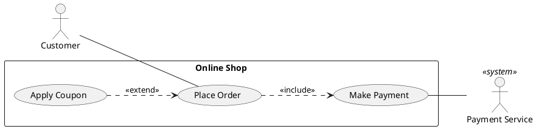
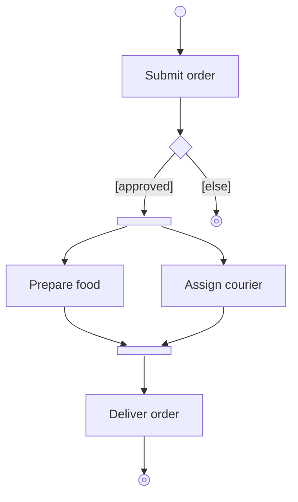
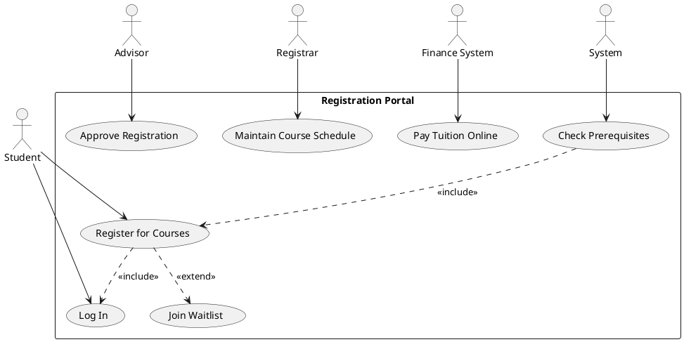
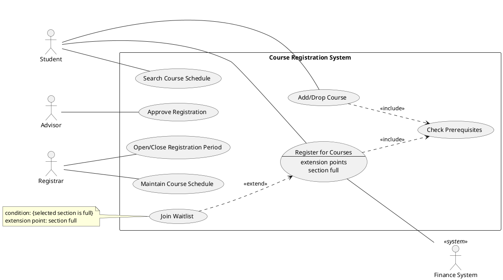
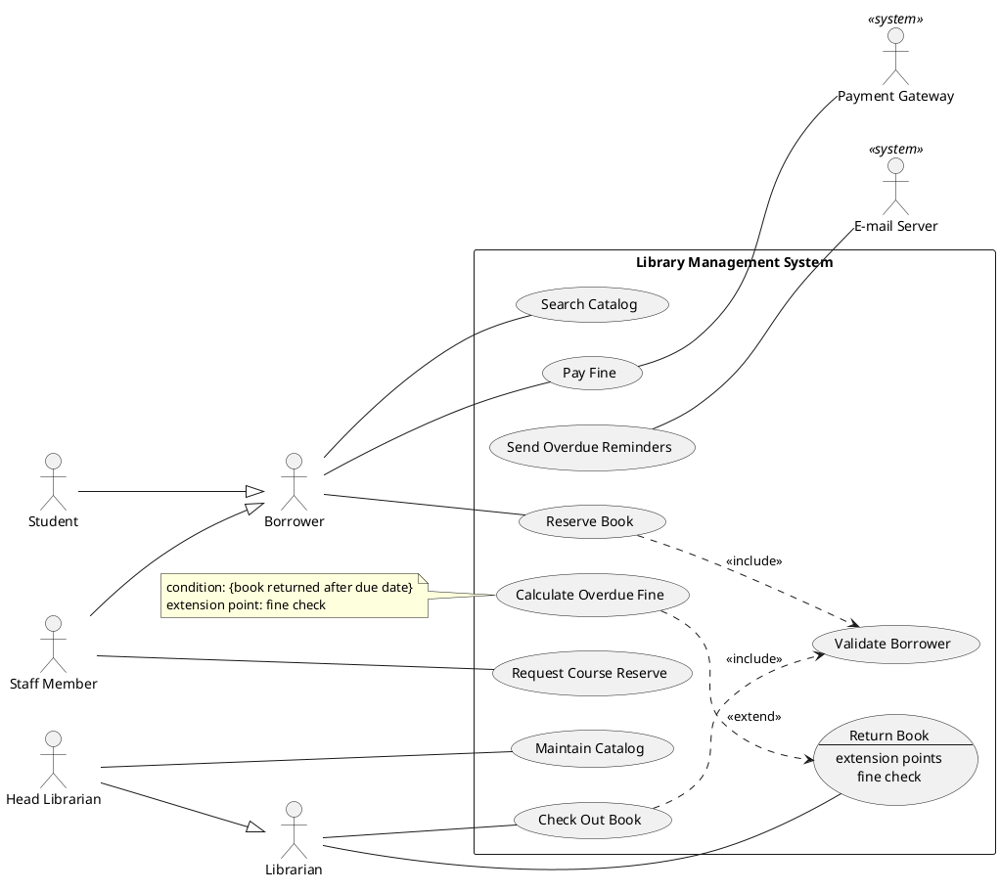
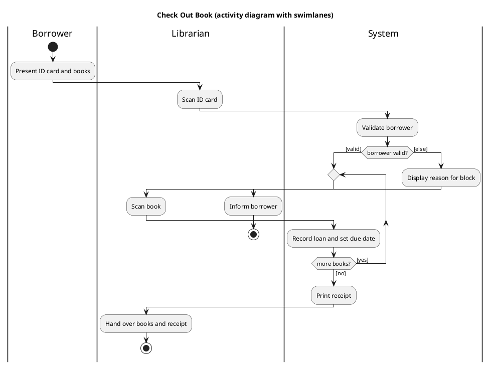
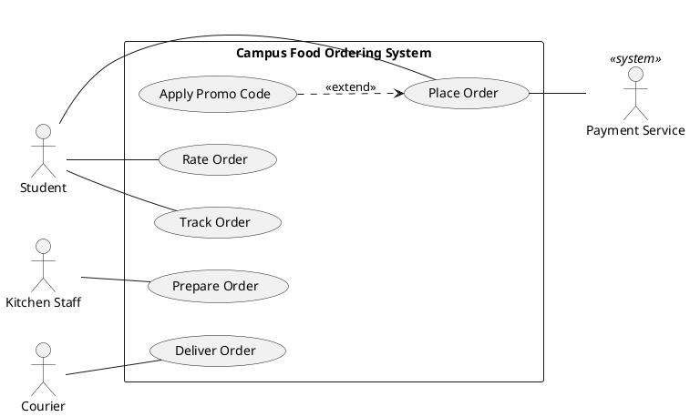
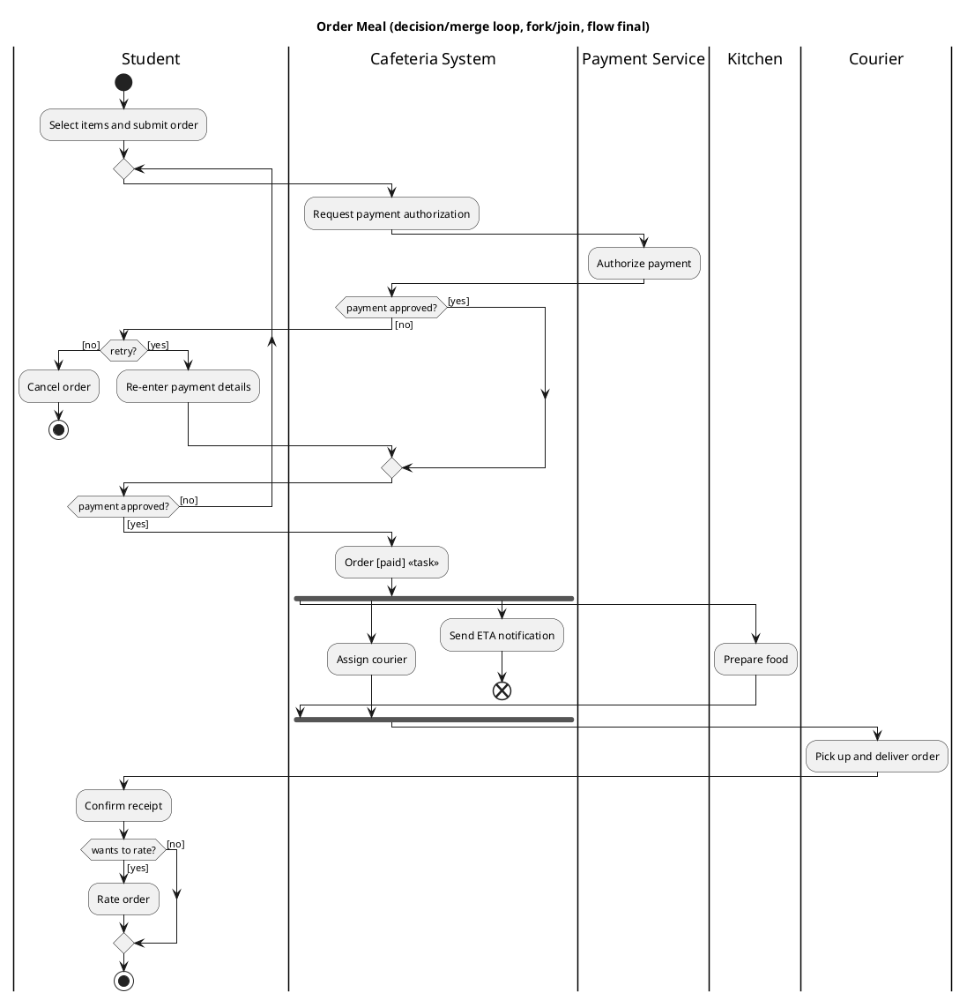
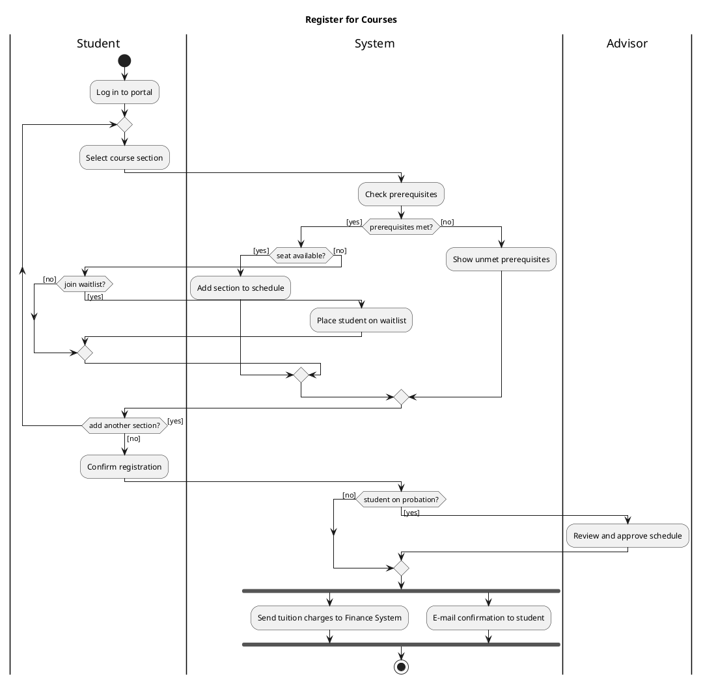
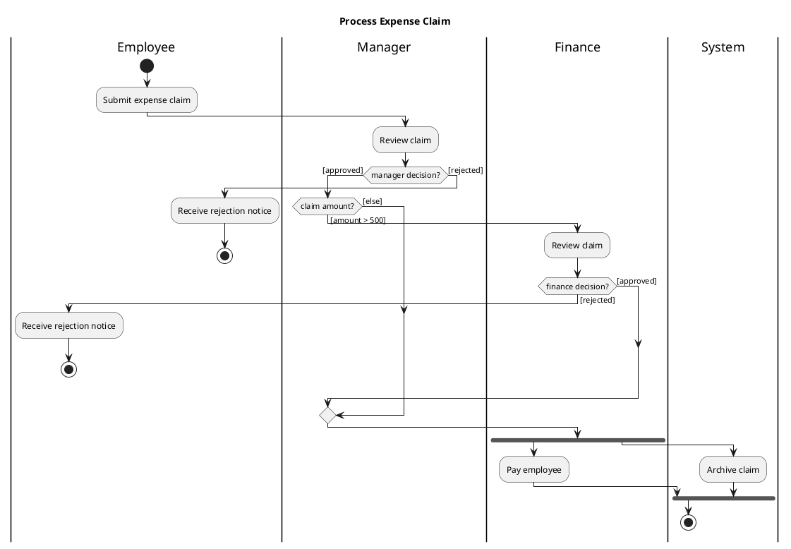

# UML Use Cases & Activity Diagrams: Dennis, Wixom & Roth, *Systems Analysis and Design* 8th ed. (Wiley 2021), Ch. 4 (use cases), and Dennis, Wixom & Tegarden, *SAD: An Object-Oriented Approach with UML*, Ch. 4 (business process & functional modeling). Exam-oriented outside notes (SOC3070-002, week 7; midterm week 8: 24–30 Oct 2026)

> **Source conventions.** All sources are outside/internet sources. I used no class slides. Several pirated textbook PDFs came up in searches; I did not use or link any of them. Everything was checked on 2026-10-19.
> - **UML 2.5.1**: OMG's normative standard (formal/2017-12-05, published December 2017). Page numbers refer to the official PDF at omg.org.
> - **DWR 8e TOC / Index**: Wiley's free table-of-contents and index excerpt PDFs for the course textbook. They show what Chapter 4 covers and on which pages. They do not give its wording.
> - **DWT 6e TOC / Index**: Wiley's free excerpt PDFs for Dennis, Wixom & Tegarden, *SAD: An Object-Oriented Approach with UML* 6th ed. (Wiley, 2020).
> - **DWT 4e Wiley slides (CSU)**: Wiley's official PowerPoint for DWT *SAD with UML* 4th ed. (© 2012), Chapter 4 "Business Process and Functional Modeling". It is posted on a Cleveland State University course page. Its section structure matches the 6e TOC, but the 6e wording may differ.
> - **IDS 405 notes**: a UIC instructor's lecture notes built on an older Dennis & Wixom edition.
> - **(illustrative)** marks a worked example I built by applying cited rules. It is not a quote from any source. I compile-checked **every PlantUML listing** on the official PlantUML server (v1.2026.9beta4) on 2026-10-19, and all of them compile. The Mermaid `usecase-beta` listing follows the official docs but could not be render-tested (see Q10).

---

## Q1. Scope check: what do the two Dennis textbooks cover on use cases and activity diagrams, and what is most testable?

### Takeaway
DWR 8e treats use cases as **structured text** inside a merged "use cases + DFD" chapter (Ch. 4, pp. 111–168). The chapter covers:
- the use-case concept;
- the casual format and its elements: actors, priority, external/temporal triggers, pre/postconditions, normal course, exceptions, inputs/outputs;
- use cases in sequence and essential use cases;
- a 4-step creation method, plus revising functional requirements;
- DFDs built from the use cases.

The DWR 8e index has **no entries** for UML use-case diagrams, «include»/«extend», or activity diagrams. Those come from the OO sister text by Dennis, Wixom & Tegarden (DWT), whose Ch. 4 "Business Process and Functional Modeling" runs: use-case diagrams → activity diagrams → use-case descriptions → walkthrough verification. That matches the week-7 title "UML use cases & activities".

Highest-yield items, in order:
1. «include» vs «extend» direction and meaning.
2. Drawing a use-case diagram from a scenario.
3. The DWT use-case description fields and its 7 writing guidelines.
4. The 7 activity-diagram control nodes (decision vs merge, fork vs join, activity final vs flow final), plus guards and swimlanes.
5. DWT's consistency rules between use-case descriptions and activity diagrams.
6. For the AI part of week 7: the typical errors LLMs make.

### Cited Findings
- **DWR 8e book details.** Alan Dennis, Barbara Haley Wixom, Roberta M. Roth, *Systems Analysis and Design*, 8th ed., Wiley, November 2021, paperback ISBN 978-1-119-80378-2. New in this edition: "The coverage of use cases and data flow diagramming was merged into a single chapter that emphasizes the way these two tools reinforce the analyst's understanding of processes." There is also a new Chapter 13 on Agile/Scrum, and a running case about a fictitious company called DrōnTeq. — [Wiley DWR 8e page](https://www.wiley.com/en-us/Systems+Analysis+and+Design,+8th+Edition-p-9781119803782)
- **DWR 8e Ch. 4 "Understanding Processes with Use Cases and Process Models" (p. 111):**
  - What Is a Use Case? 113 (The Use Case Concept in a Nutshell 113; Use Case Formats and Elements 114; Casual Use Case Format 114; Use Cases in Sequence 117; Applying Use Cases 118; Use Case Practical Tips 118; Use Cases and Functional Requirements 119; Use Cases and Testing 119).
  - Creating Use Cases 120 (Identify the Major Use Cases 120; Identify the Major Steps for Each Use Case 122; Identify Elements within Steps 125; Confirm the Use Case 128; Revise Functional Requirements Based on Use Cases 129).
  - DrōnTeq 129–130 (Identifying the Major Use Cases; Elaborating on the Use Cases).
  - Data Flow Diagrams 134 (Creating the Context Diagram 145; Creating DFD Fragments 146; Level 0 148; Level 1 and below 149; Validating 152).
  - Chapter Review 161.

  — [DWR 8e TOC (Wiley excerpt)](https://media.wiley.com/product_data/excerpt/80/11198037/1119803780-53.pdf)
- **DWR 8e index entries:**
  - Actors in use cases 115, 124; Primary actor 130; Priority (in use cases) 115.
  - Triggers 113, 116; External triggers 116; Temporal triggers 116.
  - Preconditions 116–117; Postconditions 116–117; Normal course 116, 118, 119, 122; Exceptions 112, 116–117; Inputs/Outputs for use cases 116, 125.
  - Essential use case 118; Use case package 122; Role-play in use case analysis 128, 130; Visualization for use cases 130.
  - Use cases "and data flow diagrams, 134–144"; "and testing, 119"; "defined, 112".

  My text search of this index found no entry for use-case diagram, include, extend, activity diagram, UML, or swimlane. — [DWR 8e index (Wiley excerpt)](https://media.wiley.com/product_data/excerpt/80/11198037/1119803780-35.pdf)
- **DWT 6e book details.** Dennis, Wixom & Tegarden, *SAD: An Object-Oriented Approach with UML*, 6th ed. (Wiley, 2020). New in 6e: sections on "using activity diagrams with swimlanes". — [Wiley DWT 6e page](https://www.wiley.com/en-us/Systems+Analysis+and+Design:+An+Object+Oriented+Approach+with+UML,+6th+Edition-p-9781119561217)
- **DWT 6e Ch. 4 "Business Process and Functional Modeling" (p. 126):**
  - Business Process Identification with Use Cases and Use-Case Diagrams 128 (Types of Use Cases 129; Elements of Use-Case Diagrams 130; Identifying the Major Use Cases 134; Creating a Use-Case Diagram 135).
  - Business Process Modeling with Activity Diagrams 138 (Elements 139; Guidelines 143; Creating 145).
  - Business Process Documentation with Use-Case Descriptions 148 (Elements 149; Guidelines 152; Creating 153).
  - Verifying and Validating … 160 (Walkthroughs 160; Functional Model V&V 161).
  - Patterson Superstore case 163.

  — [DWT 6e TOC (Wiley excerpt)](https://media.wiley.com/product_data/excerpt/1X/11195599/111955991X-83.pdf)
- **DWT 6e index page references:**
  - Actors: in use-case diagrams 129–131; specialized 131; primary actor 149.
  - Subject boundary 132–133.
  - Relationships: Include 132, 151; Extend 132, 151; Generalization 132, 151.
  - Use-case types 129–130 (Essential 130; Real 130; Detail 130).
  - Activity diagrams 139–143: decision, final-activity, final-flow, fork, join, merge and initial nodes 140, 142; guard condition 142; swimlanes 142–143; object nodes/flows 139–141.
  - Use-case descriptions: SVDPI 152–153; Stakeholders 151; External/Temporal trigger 151; Exceptional flows 152; Importance level 149; Use-case ID number and name 149.

  — [DWT 6e index (Wiley excerpt)](https://media.wiley.com/product_data/excerpt/1X/11195599/111955991X-91.pdf)
- **DWT 4e chapter objectives:**
  - identify business processes and use cases;
  - create use-case diagrams;
  - model business processes with activity diagrams;
  - know the "rules and style guidelines" for activity diagrams and for use-case descriptions;
  - create functional models from all three.

  — [DWT 4e Wiley slides Ch. 4 (CSU)](https://cis.csuohio.edu/~sschung/CIS433/ch04.pdf)

### Inferences
- Week 7 ("UML use cases & activities") follows the DWT Ch. 4 structure. The course textbook (DWR 8e) supplies the text side: casual format, triggers, pre/postconditions, steps, and the DFD link. Expect a mixed question such as: "From this scenario, identify actors and use cases, draw the use-case diagram, write a description for one use case, and draw its activity diagram."
- DWR's terms map onto DWT's terms, so be fluent in both. **Normal course ≈ normal flow of events; alternative courses/exceptions ≈ alternate/exceptional flows; priority ≈ importance level.** DWR's "inputs/outputs with sources/destinations" have no DWT equivalent; they bridge to DFDs.
- A study order for a 1-week window:
  1. Q3 (include/extend) and Q7 (activity nodes): pure notation, cheap points.
  2. Q12 case studies and Q14 practice.
  3. Q5 template and Q6 guidelines.
  4. Q11 (AI), which is also on the syllabus.

### Gaps
- I could not read the exact DWR 8e wording of the "casual use case format" (pp. 114–117) or its "practical tips" (p. 118) legitimately. The field list here comes from the index plus older Dennis & Wixom notes.
- The week-7 slides are not uploaded yet. I can't tell whether the professor uses DWT, DWR's DrōnTeq examples, or their own material. Check the slides when they appear.

---

## Q2. Use-case fundamentals: definition, actors (primary vs secondary, human vs system, actor generalization), the system (subject) boundary, associations, and how to draw each

### Takeaway
A **use case** is one complete unit of useful functionality that the system ("subject") offers. It must yield an observable result of value to an actor or stakeholder (UML 2.5.1). DWT puts it simply: "each use-case describes 1 and only 1 function".

An **actor** is a role, not a person, played by something **outside** the subject: a human user, external hardware, or another system.
- The **primary** actor initiates the use case to reach a goal.
- **Secondary** (supporting) actors help during it, and are often other systems.

How to draw the elements:

| Element | Drawing |
|---|---|
| Use case | Ellipse with a verb–noun name |
| Subject (system) boundary | Named rectangle around the use cases |
| Actor | Stick figure outside the rectangle (or a box labelled «actor») |
| Association (actor–use case) | Solid line |
| Generalization | Hollow-triangle arrow pointing at the parent |
| Actor-to-actor | Only generalization; never a plain line |
| Use case-to-use case | Only «include», «extend» or generalization; never a plain line |

### Cited Findings
- **Definition of use case:**
  - "UseCases are a means to capture the requirements of systems, i.e., what systems are supposed to do." A use case "specifies a set of behaviors performed by that subject, which yields an observable result that is of value for Actors or other stakeholders of the subject." — [UML 2.5.1 §18.1.1/18.1.3.1, p. 639](https://www.omg.org/spec/UML/2.5.1/PDF)
  - "Each UseCase specifies a unit of useful functionality that the subject provides to its users … This functionality must always be completed for the UseCase to complete." — [UML 2.5.1, p. 639](https://www.omg.org/spec/UML/2.5.1/PDF)
  - Use cases define the subject's behaviors "without reference to its internal structure". — [UML 2.5.1, p. 639](https://www.omg.org/spec/UML/2.5.1/PDF)
  - A use case's behavior "can be described by … Interactions, Activities, and StateMachines, as well as by pre-conditions, post-conditions and natural language text". — [UML 2.5.1, p. 640](https://www.omg.org/spec/UML/2.5.1/PDF)
- **Actors:**
  - "An Actor models a type of role played by an entity that interacts with the subjects of its associated UseCases … Actors may represent roles played by human users, external hardware, or other systems." — [UML 2.5.1 §18.1.3.1, p. 640](https://www.omg.org/spec/UML/2.5.1/PDF)
  - NOTE: "a single physical instance may play the role of several different Actors and, conversely, a given Actor may be played by multiple different instances." — [UML 2.5.1, p. 640](https://www.omg.org/spec/UML/2.5.1/PDF)
  - Constraints: "An Actor can only have Associations to UseCases, Components, and Classes. Furthermore these Associations must be binary." "An Actor must have a name." — [UML 2.5.1 §18.2.1.4, p. 647](https://www.omg.org/spec/UML/2.5.1/PDF)
- **No links between use cases:** "Two UseCases specifying the same subject cannot be associated as each of them individually describes a complete usage of the subject." The constraint list repeats this ("no_association_to_use_case") and adds that use cases need a name and allow only binary associations. — [UML 2.5.1, p. 640 and §18.2.5.6, p. 650](https://www.omg.org/spec/UML/2.5.1/PDF)
- **Multiplicity:** a multiplicity >1 on the actor end means more than one actor instance takes part. The spec's example is two separate actors acting at the same time "in launching a nuclear missile". — [UML 2.5.1, p. 640](https://www.omg.org/spec/UML/2.5.1/PDF)
- **Notation:**
  - Use case: an ellipse with the name inside or below it.
  - Subject: "a subject for a set of UseCases (sometimes called a system boundary) may be shown as a rectangle with its name in the top-left corner". The rectangle "does not imply that the subject classifier owns the contained UseCases".
  - Actor: a "stick man" icon, or a rectangle with keyword «actor», or "a separate icon for non-human Actors".

  — [UML 2.5.1 §18.1.4, pp. 641–642](https://www.omg.org/spec/UML/2.5.1/PDF)
- **Arrowheads on associations:** "An open arrowhead on the end of an Association indicates the end is navigable." So arrowheads on actor–use-case lines are legal UML but not required. — [UML 2.5.1 §11.5.4, p. 202](https://www.omg.org/spec/UML/2.5.1/PDF)
- **DWT's elements of use-case diagrams:**
  - "Actors: users or other interacting systems";
  - "Associations: lines to connect actors and use-cases";
  - "Use-case: a major process in the system that gives a benefit to the users";
  - "Subject boundary: a named box that depicts the scope of the system".

  DWT also says "Each use-case describes 1 and only 1 function". — [DWT 4e Wiley slides Ch. 4 (CSU)](https://cis.csuohio.edu/~sschung/CIS433/ch04.pdf)
- **Primary vs secondary (Cockburn):** "The use case is initiated by the primary actor; secondary actors may come into play while the use case is executing … other computer systems may serve as secondary actors." — [Anderson, CU Boulder lecture on Cockburn](https://home.cs.colorado.edu/~kena/classes/6448/s05/lectures/lecture07-08.pdf). The primary actor "calls on the system to deliver its services". — [Eichberg, TU Darmstadt lecture (Cockburn/Larman)](http://stg-tud.github.io/eise/WS15-SE-06-Requirements_Engineering-Use_Cases.pdf)
- **Actor generalization:** "We can define abstract or concrete actors and specialize them using generalization relationship … rendered as a solid directed line with a large arrowhead (same as for generalization between classes)". Abstract actor names are shown in italics. — [uml-diagrams.org: Actor](https://www.uml-diagrams.org/use-case-actor.html)
- **Linking actors (Visual Paradigm):** "Each Actor must be linked to a use case, while some use cases may not be linked to actors." Participation "is shown by connecting an actor to a use case by a solid link." — [Visual Paradigm: use case diagram](https://www.visual-paradigm.com/guide/uml-unified-modeling-language/what-is-use-case-diagram/)
- **Actor-finding questions (Schneider & Winters, 1998):** Who uses, installs, starts up, maintains, or shuts down the system? What other systems use it? Who gets information from it, or provides information to it? "Does anything happen automatically at a present time?" — [Visual Paradigm: use case diagram](https://www.visual-paradigm.com/guide/uml-unified-modeling-language/what-is-use-case-diagram/)
- **Dennis & Wixom's event-driven view:** "a use case is a set of end-to-end activities that start with a trigger event and continues through many possible paths until some output has been produced, and the system is at rest again". Triggers are "external or temporal". — [IDS 405 notes (Dennis & Wixom)](http://legacy2.oyibo.com/notes/IDS405/5UseCaseAnalysis.htm). DWR 8e still indexes "External triggers, 116" and "Temporal triggers, 116". — [DWR 8e index](https://media.wiley.com/product_data/excerpt/80/11198037/1119803780-35.pdf)

### Inferences
- **Exam-ready drawing recipe (illustrative):**
  1. Draw a big rectangle and write the system name at the top-left, e.g. "Library Management System".
  2. Put one ellipse per user goal inside it. Name each with a strong verb + noun: "Check Out Book", not "Book" or "Checkout process".
  3. Put actors outside, named by **role** in the singular ("Librarian", not "Mr. Karimov" or "Staff dept."). By convention, primary actors go on the left and secondary/system actors on the right.
  4. Draw non-human actors as a box with «actor» or a stereotype such as «system». A stick figure is also accepted.
  5. Join actors to use cases with solid lines; no arrowheads are needed.
  6. Add «include»/«extend»/generalization only where justified (Q3).
- **Primary vs secondary in practice.** In "Pay Fine", the Borrower is primary (starts it to reach a goal) and the Payment Gateway is secondary (the system calls it). UML has no special notation for the difference, so say it in the use-case description ("Primary actor:") and, optionally, by position on the diagram.
- **Time-triggered work.** UML does not require a "Time" actor. DWR/DWT record it as **trigger type: temporal** in the description. Some instructors also draw a "Time"/"Scheduler" actor. In an exam, do whichever the slides show and always state "temporal trigger" in the description.
- **Actor generalization means inheritance.** The child actor can do everything the parent can, plus more. Use it only when the child has **extra or different use cases** (e.g., Head Librarian also "Maintain Catalog"). Don't use it when the difference is only a data condition, such as "student on probation"; model that as a decision or alternate flow.
- **What is NOT an actor:**
  - the system itself;
  - its database;
  - its internal modules;
  - data items ("invoice", "credit card");
  - a specific person's name.

  A database is only an actor if it is a separate, external system that your system talks to.

### Gaps
- I could not read DWR 8e's own definition of "use case" (p. 112) or DWT 6e's exact actor wording legitimately.
- Whether this instructor wants a "Time" actor for temporal triggers is unknown.

---

## Q3. «include» vs «extend» vs generalization: arrow direction, notation, when to use each (the classic trap)

### Takeaway

| Relationship | Meaning | Line and arrow | Label | Example |
|---|---|---|---|---|
| **«include»** | Mandatory behavior the base cannot complete without, usually shared by several use cases (or pulled out of a huge one) | Dashed, open arrowhead, **from base → to included** | «include» | Withdraw → Card Identification |
| **«extend»** | Optional or conditional add-on to a base that is complete and meaningful on its own | Dashed, open arrowhead, **from extension → to base** | «extend»; the condition and extension point go in a note | On-line Help → Perform ATM Transaction |
| **Generalization** | "Is a kind of" | Solid line, hollow triangle, from child → parent | none | Pay by Card → Pay |

**Mnemonic grounded in the spec:** the dashed arrow always runs from the use case that depends on the other **to the one that stands on its own**.
- With «include», the base depends on the included use case.
- With «extend», the base is "defined independently" and the extension depends on it.

### Cited Findings
- **Include, definition:** "Include is a DirectedRelationship between two UseCases, indicating that the behavior of the included UseCase (the addition) is inserted into the behavior of the including UseCase … The included UseCase must be available for the behavior of the including UseCase to be completely described." — [UML 2.5.1 §18.1.3.3, p. 641](https://www.omg.org/spec/UML/2.5.1/PDF)
- **Include, purpose and direction:** "The Include relationship is intended to be used when there are common parts of the behavior of two or more UseCases … what is left in a base UseCase is usually not complete in itself but dependent on the included parts to be meaningful. This is reflected in the direction of the relationship, indicating that the base UseCase depends on the addition but not vice versa." Also: "All of the behavior of the included UseCase is executed at a single location … before execution of the including UseCase is resumed." — [UML 2.5.1, p. 641](https://www.omg.org/spec/UML/2.5.1/PDF)
- **Extend, definition:** "An Extend is a relationship from an extending UseCase (the extension) to an extended UseCase … that specifies how and when the behavior defined in the extending UseCase can be inserted into the behavior defined in the extended UseCase. The extension takes place at one or more specific extension points". It is "intended to be used when there is some additional behavior that should be added, possibly conditionally". — [UML 2.5.1 §18.1.3.2, p. 640](https://www.omg.org/spec/UML/2.5.1/PDF)
- **Extend, independence of the base:** "The extended UseCase is defined independently of the extending UseCase and is meaningful independently … the extending UseCase typically defines behavior that may not necessarily be meaningful by itself." The same extension can extend several use cases, and can itself be extended. — [UML 2.5.1, p. 640](https://www.omg.org/spec/UML/2.5.1/PDF)
- **Extend, conditions:** "If the condition of the Extend is missing or evaluates to true at the time the first ExtensionPoint is reached …, then all of the appropriate behavior fragments of the extending UseCase will also be executed. If the condition is false, this does not happen." — [UML 2.5.1, p. 641](https://www.omg.org/spec/UML/2.5.1/PDF)
- **Notation:**
  - "An Extend relationship … is shown by a dashed arrow with an open arrowhead pointing from the extending UseCase towards the extended UseCase. The arrow is labeled with the keyword «extend». The condition of the Extend as well as references to the ExtensionPoints are optionally shown in a note symbol … attached to the corresponding arrow."
  - "An Include relationship … is shown by a dashed arrow with an open arrowhead pointing from the base UseCase to the included UseCase. The arrow is labeled with the keyword «include»."

  — [UML 2.5.1 §18.1.4, p. 642](https://www.omg.org/spec/UML/2.5.1/PDF)
- **Extension points:** listed in a compartment of the ellipse headed "extension points", using the syntax `<name> [: <explanation>]`. — [UML 2.5.1, p. 642](https://www.omg.org/spec/UML/2.5.1/PDF). The spec's examples are: "Withdraw" includes "Card Identification"; "Perform ATM Transaction" (extension point "Selection") is extended by "On-Line Help" with condition `{customer selected HELP}`. — [UML 2.5.1 §18.1.5, Figs 18.3–18.4, pp. 643–644](https://www.omg.org/spec/UML/2.5.1/PDF)
- **Cannot include yourself:** "A UseCase cannot include UseCases that directly or indirectly include it." — [UML 2.5.1 §18.2.5.6, p. 650](https://www.omg.org/spec/UML/2.5.1/PDF)
- **uml-diagrams.org on include:**
  - Include can be used "to simplify large use case by splitting it into several use cases" and "to extract common parts".
  - The included use case "is required and not optional".
  - There are no "inclusion points"; extension points exist only for extend.
  - Execution is "analogous to a subroutine call".

  — [uml-diagrams.org: Include](https://www.uml-diagrams.org/use-case-include.html)
- **uml-diagrams.org comparison table (from the UML 2.4 spec):**

  | | Generalization | Extend | Include |
  |---|---|---|---|
  | Base use case | Abstract or concrete | Complete (concrete) by itself | Incomplete (abstract) |
  | The other use case | Specialized use case required if base is abstract | Extending use case is "optional, supplementary" | Included use case "required, not optional" |
  | Location | None | At least one explicit extension location | No explicit inclusion location |
  | Condition | None | Optional extension condition | No inclusion condition |

  — [uml-diagrams.org: Include](https://www.uml-diagrams.org/use-case-include.html)
- **uml-diagrams.org on the limits of all three:** none fits *partial* payment (part cash, part card). Generalization implies one payment form at a time. Extend needs a complete base. Include makes every inclusion mandatory. — [uml-diagrams.org: Include](https://www.uml-diagrams.org/use-case-include.html)
- **Use-case generalization:** "a child use case inherits the behavior and meaning of the parent use case. The child may add or override the behavior of the parent." It is drawn as "a directed arrow with a triangle arrowhead"; the child sits at the base and the tip touches the parent. — [Visual Paradigm: use case diagram](https://www.visual-paradigm.com/guide/uml-unified-modeling-language/what-is-use-case-diagram/)
- **Older labels in tools:** the same Visual Paradigm page still labels extend "<<extends>>" and calls include an "include or uses relationship". — [Visual Paradigm: use case diagram](https://www.visual-paradigm.com/guide/uml-unified-modeling-language/what-is-use-case-diagram/). The UML 2.5.1 keywords are «include» and «extend». — [UML 2.5.1, p. 642](https://www.omg.org/spec/UML/2.5.1/PDF)
- **DWT's wording:** "Extend: Extends the functionality of a use case"; "Include: Includes another use case"; "Generalization: Allows use cases to support inheritance". — [DWT 4e Wiley slides Ch. 4 (CSU)](https://cis.csuohio.edu/~sschung/CIS433/ch04.pdf)
- **Larman/Cockburn-based guidance:**
  - For include: "The primary purpose is to avoid repetition or to decompose extremely long use cases".
  - For extend: "Focus on the textual description. (They are rarely used in practice.)"
  - "Organizing use cases into relationships has no impact on the behavior or requirements of the system."

  — [Eichberg, TU Darmstadt lecture](http://stg-tud.github.io/eise/WS15-SE-06-Requirements_Engineering-Use_Cases.pdf)
- **Cockburn on extensions:** an extension "interrupts" the base when a condition comes true. It typically appears when "an extension has gotten too big" for the base text. — [Anderson, CU Boulder lecture on Cockburn](https://home.cs.colorado.edu/~kena/classes/6448/s05/lectures/lecture07-08.pdf)

### Inferences
- **Decision procedure (illustrative)** for a candidate piece of behavior X related to use case B:
  1. Does every run of B need X, and does X recur in ≥2 use cases (or is B too long without pulling X out)? → **B «include» X** (arrow B → X).
  2. Is X optional or conditional, and is B a complete, meaningful use case without X? → **X «extend» B** (arrow X → B). Name the condition and the extension point.
  3. Is X a specialised *kind* of B (same goal, different way)? → **generalization** (hollow triangle at B).
  4. Is X just a short variation inside one use case with no reuse? → **don't draw it.** Write it as an alternate/exceptional flow in B's description. This is the default for error handling.
- **Wording cues in a scenario.** These are hints, not rules; always apply step 2's "is the base complete?" test.
  - "every time / must / always / first, the system …" → «include»
  - "may / optionally / if the customer wants / only when / in case of" → «extend» or an alternate flow
  - "types of / kinds of / either … or … (one at a time)" → generalization
- **Classic trap.** Students reverse «extend» because the extension "comes after" the base in time. The arrow does not show time order. It shows dependency: the add-on knows the base, the base doesn't know the add-on.
- **Second trap: optional ≠ extend.** A behavior the actor does later as **its own goal** (e.g., "Rate Order" after delivery) is a separate use case with its own actor association, not an «extend».
- **Third trap: «include» used as functional decomposition** ("Enter Name", "Enter Address" included into "Register"). That turns the use-case diagram into a flowchart. Include should carry meaningful shared or extracted behavior.
- **Exceptions may be drawn as «extend».** UML allows it ("possibly conditionally"), and Visual Paradigm shows "Invalid Password" extending "Login Account". Most textbook-style answers keep errors as exceptional flows in the description and save «extend» for business-meaningful optional behavior.

### Gaps
- I did not see DWT 6e's own include/extend example (pp. 132, 151). Check the class slides for which example the professor uses, e.g. a library or Patterson Superstore.
- I found no authoritative quantitative data on how often «extend» is used in practice beyond the TU Darmstadt slide's "rarely used" remark.

---

## Q4. Use-case levels and formats: overview vs detail and essential vs real (DWT); brief / casual / fully dressed and goal levels (Cockburn); DWR 8e's "casual" format

### Takeaway
DWT classifies a use case on **two independent axes**:
- **Amount of information:** overview (high level) vs detail.
- **Purpose:** essential (technology-independent issues needed to understand the required functionality) vs real (the specific steps performed on the implemented system).

So a description's "Type" field reads, e.g., **"Detail, Essential"**.

Cockburn adds two more ideas:
- **Formality:** brief (one paragraph, main success scenario), casual (several informal paragraphs covering scenarios), or fully dressed (all steps and variations plus supporting sections).
- **Goal level:** summary → **user goal** → subfunction. The rule of thumb is that a user goal can be completed "in one sitting".

DWR 8e explicitly covers formats and elements, the **casual** format, and **essential** use cases.

### Cited Findings
- **DWT "Types of Use Cases" table:**

  | | Overview | Detail |
  |---|---|---|
  | **Essential** | "High-level overview of issues essential to understanding required functionality" | "Detailed description of issues essential to understanding required functionality" |
  | **Real** | "High-level overview of a specific set of steps performed on the real system once implemented" | "Detailed description of a specific set of steps performed on the real system once implemented" |

  — [DWT 4e Wiley slides Ch. 4 (CSU)](https://cis.csuohio.edu/~sschung/CIS433/ch04.pdf). DWT 6e indexes "Types of use cases 129–130", "Essential use case, 130, 370", "Real use case, 130, 370" and "Detail use case, 130". — [DWT 6e index](https://media.wiley.com/product_data/excerpt/1X/11195599/111955991X-91.pdf)
- **DWT on the description's "Type" field:** step 1 of creating a description includes "Determine its type (overview or detail; essential or real)". DWT also says models are "logical; i.e., independent of how they are implemented (manual or computerized)". — [DWT 4e Wiley slides Ch. 4 (CSU)](https://cis.csuohio.edu/~sschung/CIS433/ch04.pdf)
- **DWR 8e:** "Use Case Formats and Elements, 114", "Casual Use Case Format, 114", "Essential use case, 118". — [DWR 8e TOC](https://media.wiley.com/product_data/excerpt/80/11198037/1119803780-53.pdf); [DWR 8e index](https://media.wiley.com/product_data/excerpt/80/11198037/1119803780-35.pdf)
- **Cockburn's formats:**
  - **Brief:** "Terse one-paragraph summary, usually of the main success scenario".
  - **Casual:** "Informal paragraph format. Multiple paragraphs that cover various scenarios".
  - **Fully dressed:** "All steps and variations are written in detail, and there are supporting sections, such as preconditions and success guarantees".

  Advice: "Focus on the accuracy of use cases before you focus on the precision" — first identify all use cases at a high level (low precision, high accuracy), then add detail. Levels: "summary goals → user goals → subfunction". — [Eichberg, TU Darmstadt lecture](http://stg-tud.github.io/eise/WS15-SE-06-Requirements_Engineering-Use_Cases.pdf)
- **Cockburn's goal levels:** "very high summary", "summary", "user goal", "sub-function", "too low". "A user goal is one that can be completed in one sitting at a computer". A summary goal "cannot be completed in one sitting, and may require multiple people, organizations, and systems". The format depends on the project's "ceremony level": high-ceremony → formal templates; low-ceremony → paragraphs. — [Anderson, CU Boulder lecture on Cockburn](https://home.cs.colorado.edu/~kena/classes/6448/s05/lectures/lecture07-08.pdf)
- **Sea-level metaphor:** Cockburn visualizes goal levels "by thinking in terms of the sea". A use-case **diagram** is "often used for a higher-level view of the system". — [Visual Paradigm: use case diagram](https://www.visual-paradigm.com/guide/uml-unified-modeling-language/what-is-use-case-diagram/)
- **Larman's tests for a valid use case:**
  - the elementary business process (EBP) test: "a task performed by one person in one place at one time, in response to a business event, which adds measurable business value and leaves the data in a consistent state";
  - the value test;
  - the size test ("Is it just a single step?").

  Worked answers: "Negotiate a supplier contract" is "much broader and longer than an EBP". "Handle returns" "achieves value; seems like an EBP; size is ok". "Log in" "does not achieve" value. — [Eichberg, TU Darmstadt lecture](http://stg-tud.github.io/eise/WS15-SE-06-Requirements_Engineering-Use_Cases.pdf)

### Inferences
- **How the frameworks map (illustrative):**
  - DWT **overview** ≈ Cockburn **brief**. Both are used early to list and prioritise.
  - DWT **detail** ≈ Cockburn **fully dressed**.
  - DWR's **casual** sits in between: structured fields with prose-like steps.
  - Essential vs real is a different axis: whether UI or technology appears in the steps.
- **Essential vs real example:**
  - Essential: "The customer identifies himself; the system validates the identity."
  - Real: "The customer inserts the card into the slot, types the 4-digit PIN on the keypad and presses Enter."

  Analysis-phase use cases should be essential. Real use cases belong to UI design: both DWT index entries also point to p. 370, in the interface chapter.
- **Exam definitions to memorise (one line each):**
  - **Overview:** name, ID, primary actor, type, brief description; used early.
  - **Detail:** everything needed, including flows.
  - **Essential:** implementation-independent.
  - **Real:** implementation-specific.
  - **Brief / casual / fully dressed:** paragraph / multi-paragraph / full template.
  - **User-goal level:** one sitting, measurable value.
  - **Subfunction:** a step inside a goal. These are candidates for «include» only if reused.

### Gaps
- The Cockburn icons often reproduced (cloud/kite = summary, wave = user goal, fish/clam = subfunction/too low) are only described, not reproduced, in the pages I fetched. Treat the icon list as my recollection.
- I could not see DWR 8e's exact definition of "essential use case" (p. 118).

---

## Q5. The use-case description template, field by field (DWT), with DWR and Cockburn equivalents

### Takeaway
DWT's use-case description has four blocks:
1. **Overview:** Name, ID number, Type, Primary actor, Brief description, Importance level, Stakeholders (and interests), Trigger(s) with trigger type external or temporal.
2. **Relationships:** Association, Extend, Include, Generalization.
3. **Flow of events:** Normal flow, Sub-flows, Alternate/exceptional flows.
4. **Optional characteristics.**

DWR adds or renames:
- **Preconditions / Postconditions**;
- **Normal course / Exceptions**;
- **Priority**;
- **Inputs & outputs** with their sources and destinations, which bridge to DFDs.

Cockburn's fully dressed template adds Scope, Level, Stakeholders & Interests, **Minimal guarantees**, **Success guarantee**, Main success scenario, Extensions, and Technology & data variations.

For an exam, write a merged template (see Inferences); it satisfies all three.

### Cited Findings
- **DWT "Elements of a Use Case Description":**
  - **Overview:** "Name, ID Number, Type, Primary Actor, Brief Description, Importance Level, Stakeholder(s), Trigger(s)".
  - **Relationships:** "Association: Communication between the use case and the actors"; "Extend: Extends the functionality of a use case"; "Include: Includes another use case"; "Generalization: Allows use cases to support inheritance".
  - **Flow of events:** "Normal flow: the usual set of activities"; "Sub-flows: decomposed normal flows to simplify the use-case"; "Alternate or exceptional flows: those not considered the norm".
  - **Optional characteristics** (complexity, time, etc.).

  — [DWT 4e Wiley slides Ch. 4 (CSU)](https://cis.csuohio.edu/~sschung/CIS433/ch04.pdf)
- **DWT 6e index locations:** "Overview use case section, 149–151", "Detail use case section, 151–152", "Use-case ID number, 149", "Use-case name, 149", "Importance level (use-cases), 149", "Primary actor, 149", "Brief description (use cases), 149", "Stakeholders, 52, 151", "External trigger, 151", "Temporal trigger, 151", "Normal flow of events, 151", "subflows, 151", "Exceptional flows, 152". — [DWT 6e index](https://media.wiley.com/product_data/excerpt/1X/11195599/111955991X-91.pdf)
- **DWT "Creating Use-Case Descriptions":**
  1. Pick a high-priority use case and create an overview: list the primary actor; determine its type; list all stakeholders and their interests; determine its level of importance; briefly describe it; list what triggers it; list its relationships to other use cases.
  2. Fill in the steps of the normal flow.
  3. Ensure steps are not too complicated or long and are consistent in size.
  4. Identify and write the alternate or exceptional flows.
  5. Review and confirm.
  6. Iterate over the entire set of steps again.

  — [DWT 4e Wiley slides Ch. 4 (CSU)](https://cis.csuohio.edu/~sschung/CIS433/ch04.pdf)
- **Dennis & Wixom's elements:**
  - "Basic Information — name, number, brief description; trigger (external or temporal)".
  - "Inputs and Outputs (also called data flows) — along with their sources and destinations".
  - "Details — of individual steps … listed in the order in which they are performed and any conditional steps are clearly noted".

  The form fields are: Use case name; ID No; Short description; Trigger; Type: External or Temporal; Major Inputs (Description, Source); Major Outputs (Description, Destination); Major Steps Performed; Information for Steps. — [IDS 405 notes (Dennis & Wixom)](http://legacy2.oyibo.com/notes/IDS405/5UseCaseAnalysis.htm)
- **DWR 8e** indexes Priority 115, Preconditions 116–117, Postconditions 116–117, Normal course 116 ff., Exceptions 116–117, and Inputs/Outputs 116, 125. — [DWR 8e index](https://media.wiley.com/product_data/excerpt/80/11198037/1119803780-35.pdf)
- **Cockburn's fully dressed template (with purposes):**
  - Use Case Name ("Start with a verb"); Scope ("The system under design"); Level; Primary Actor.
  - Stakeholders and Interests ("Who cares about this use case, and what do they want?").
  - Preconditions ("What must be true on start, and worth telling the reader?").
  - Minimal Guarantees ("The fewest promises the system makes to the stakeholders"); Success Guarantee.
  - Main Success Scenario ("A typical path scenario of success"); Extensions ("Alternate scenarios of success or failure").
  - Special Requirements; Technology and Data Variation List; Frequency of Occurrence; Miscellaneous.

  A precondition "announces what the system will ensure is true before letting the use case start. Since it is enforced by the system and known to be true, it will not be checked again during the use case execution; e.g. user has logged in." — [Eichberg, TU Darmstadt lecture](http://stg-tud.github.io/eise/WS15-SE-06-Requirements_Engineering-Use_Cases.pdf)
- **More Cockburn fields:** Goal in Context, Trigger, Priority, Releases, Response Time, Frequency of Use, Channel to Primary Actor, Secondary Actors, Open Issues. "Extensions" describe how the main success scenario can "1) still succeed or 2) fail". A use case "contains all and only the behaviors related to satisfying stakeholder interests". — [Anderson, CU Boulder lecture on Cockburn](https://home.cs.colorado.edu/~kena/classes/6448/s05/lectures/lecture07-08.pdf)

### Inferences
- **Merged exam template (illustrative).** Write the field names exactly like this; it covers DWT, DWR and Cockburn:

| Field | What to write | Typical mistake |
|---|---|---|
| Use case name / ID | Verb–noun ("Check Out Book"), UC-05 | Noun only ("Checkout") |
| Primary actor | The role that initiates it | Listing the system |
| Type | e.g. "Detail, Essential" | Leaving it blank |
| Importance level / Priority | High/Medium/Low | — |
| Stakeholders and interests | Each stakeholder + what they want (including off-stage ones such as management or finance) | Only listing actors |
| Brief description | 1–2 sentences: goal + result | Steps instead of a summary |
| Trigger (type) | The event that starts it; **external** (an actor's action) or **temporal** (a time or date) | Confusing trigger with precondition |
| Preconditions | What is already true and won't be re-checked ("Librarian logged in") | Writing the trigger here |
| Relationships | Association: …; Include: …; Extend: …; Generalization: … | Relationships here that are not on the diagram |
| Normal flow | Numbered **SVDPI** steps ("The Librarian scans the ID card.") | UI details; passive voice |
| Sub-flows | Named sub-sequences (S-1 …) that simplify the normal flow | — |
| Alternate/exceptional flows | Numbered by the step they branch from (2a, 3a …) + how they end or rejoin | Missing the "ends/returns to step n" |
| Postconditions / Success guarantee | What is true after success | Restating the goal vaguely |
| Minimal guarantee (Cockburn, optional) | What is true even on failure (e.g. "attempt is logged") | — |
| Inputs/outputs (DWR, optional) | Data in and out + source/destination | — |

- **Why the merge is needed.** The DWT 4e slide list doesn't show pre/postconditions, but DWR 8e indexes them and Cockburn requires them. Include them in exam answers unless told otherwise.
- **Trigger vs precondition, in one line.** The trigger is the event that starts the use case ("Borrower presents books at the desk"). The precondition is a state already true before it can start ("Librarian is logged in").

### Gaps
- I could not see DWT 6e's own sample description (Patterson Superstore) or DWR 8e's casual-format figure. Field order and the exact labels on the professor's slides may differ slightly; for example, DWR may say "Priority" where DWT says "Importance level".

---

## Q6. Guidelines for good use cases, how many use cases, and a step-by-step method from a requirements text to a use-case model

### Takeaway
DWT's seven writing guidelines:
1. Subject–verb–direct object (SVDPI) sentences.
2. A clear initiator for each step.
3. Written from an independent observer's view.
4. The same level of abstraction throughout.
5. A sensible set of steps.
6. KISS.
7. Repeat instructions written **after** the steps they repeat.

Cockburn adds:
- a bird's-eye view;
- intent, not UI movements;
- "validate", not "check whether";
- show the process moving forward.

**How many use cases?** The Dennis & Wixom rule is that more than ~8–9 major use cases suggests either a complex system or the wrong level of detail; group them into **packages**. DWR 8e still indexes "use case package" on p. 122, inside "Identify the Major Use Cases".

### Cited Findings
- **DWT "Use Case Writing Guidelines":**
  1. "Write in the form of subject-verb-direct object";
  2. "Make sure it is clear who the initiator of the step is";
  3. "Write from independent observer's perspective";
  4. "Write at about the same level of abstraction";
  5. "Ensure the use case has a sensible set of steps";
  6. "Apply the KISS principle liberally";
  7. "Write repeating instructions after the set of steps to be repeated".

  — [DWT 4e Wiley slides Ch. 4 (CSU)](https://cis.csuohio.edu/~sschung/CIS433/ch04.pdf). DWT 6e indexes the full form "SVDPI" (subject–verb–direct object–preposition–indirect object) at pp. 152–153. — [DWT 6e index](https://media.wiley.com/product_data/excerpt/1X/11195599/111955991X-91.pdf)
- **DWT "Identifying Major Use-Cases":**
  1. Review the requirements definition.
  2. Identify the subject's boundaries.
  3. Identify the primary actors and their goals.
  4. Identify the business processes and major use cases.
  5. Carefully review the current set: "Split or combine some to create the right size; Identify additional use-cases".

  **"Create a Use-Case Diagram":** place and draw the use cases; place and draw the actors; draw the subject boundary; add the associations. — [DWT 4e Wiley slides Ch. 4 (CSU)](https://cis.csuohio.edu/~sschung/CIS433/ch04.pdf)
- **Dennis & Wixom "Building Use Cases":**
  1. **Identify the major use cases.** "If we discover more than 8 or 9 use cases, this suggests that the system is complex (or that the use cases are not defined at the right level of detail). If there are really more than 8 or 9 use cases, we can group them into packages".
  2. **Identify the major steps.** Focus on what the process or system does; list them in order; "each step should be about the same size".
  3. **Identify elements within steps.** "Each step should have at least one input and at least one output".
  4. **Confirm the use case.** "Ask the user to role-play".

  — [IDS 405 notes (Dennis & Wixom)](http://legacy2.oyibo.com/notes/IDS405/5UseCaseAnalysis.htm). DWR 8e keeps the same four steps plus "Revise Functional Requirements Based on Use Cases" (pp. 120–129). — [DWR 8e TOC](https://media.wiley.com/product_data/excerpt/80/11198037/1119803780-53.pdf). Its index has "Use case package, 122" and "Role-play in use case analysis, 128, 130". — [DWR 8e index](https://media.wiley.com/product_data/excerpt/80/11198037/1119803780-35.pdf)
- **Cockburn's action-step guidelines:**
  - **#3 Write from a bird's-eye view.** "Get ATM Card and PIN" is bad; "The customer inserts the card" is good.
  - **#4 Show the process moving forward.** "If a use case has 17 or more steps, it may indicate that the scope of each step is too small". Ask "Why is the actor doing this?"
  - **#5 Show the actor's intent, not the movements.** "User enters name and address" instead of separate prompt/enter/click steps.
  - **#6 Include a "reasonable" set of actions** (Jacobson's transaction): actor sends request and data, the system validates, alters its state, and responds.
  - **#7 "Validate", do not "check whether".**
  - **#10** Put repetition after the steps, e.g. "Customer repeats steps 3 and 4 until done".
  - **Cockburn's writing process:** name the system scope and boundaries; brainstorm primary actors; list user goals; capture summary use cases; revise. Then, per use case: stakeholders and interests, preconditions and guarantees; main success scenario; brainstorm extension conditions; write extension handling; extract complex flows into sub use cases.

  — [Anderson, CU Boulder lecture on Cockburn](https://home.cs.colorado.edu/~kena/classes/6448/s05/lectures/lecture07-08.pdf)
- **Larman/Cockburn guidance:** "During early requirements work keep the user interface out (Focus on intent!)"; "Write terse use cases"; "Write black-box use cases", e.g. "The system records the sale", not "The system writes the sale to a database"; "Take an actor or actor-goal perspective". — [Eichberg, TU Darmstadt lecture](http://stg-tud.github.io/eise/WS15-SE-06-Requirements_Engineering-Use_Cases.pdf)
- **Questions for finding use cases** once actors are known: "What functions will the actor want from the system?" "Does the system store information? What actors will create, read, update or delete this information?" "Does the system need to notify an actor about changes in the internal state?" "Are there any external events the system must know about?" Tips: organise from the actors' perspective, and focus on "what" not "how". — [Visual Paradigm: use case diagram](https://www.visual-paradigm.com/guide/uml-unified-modeling-language/what-is-use-case-diagram/)
- **DWT 6e** indexes "Package(s) … in use-case diagram, 135". — [DWT 6e index](https://media.wiley.com/product_data/excerpt/1X/11195599/111955991X-91.pdf)

### Inferences
- **A 9-step method from requirements text to use-case model (illustrative, combining DWT, DWR and Cockburn):**
  1. **Read and mark the text.** Underline role nouns (candidate actors), external systems, and goal verbs (candidate use cases). Circle time phrases ("every night", "on the 1st") as temporal triggers.
  2. **Fix the subject boundary.** What exactly are we building? Everything else (people, banks, e-mail servers, other university systems) is outside.
  3. **List actors.** Classify each as primary or secondary and human or system. Add actor generalization only if a sub-role has **extra** use cases.
  4. **List user goals per primary actor.** Name each verb–noun. Apply the EBP / one-sitting test. Merge create/update/delete of one thing into "Maintain X" when the text treats them as one job, as DWT's "split or combine … to create the right size" allows. Drop UI steps and "Log In" (usually a precondition).
  5. **Count.** More than ~8–9 major use cases for one system? Check the level, or group into packages.
  6. **Add relationships sparingly** using the Q3 decision procedure.
  7. **Draw** in DWT order: use cases → actors → boundary → associations → relationships.
  8. **Write descriptions** for the high-priority use cases with the Q5 template and DWT's seven guidelines.
  9. **Validate.** Role-play or walk through the model (DWR p. 128; DWT p. 160), then revise the functional requirements (DWR p. 129).
- **"How many" in practice.**
  - For a midterm scenario of ~10 sentences, expect about 4–9 use cases.
  - A diagram with 20+ ellipses almost always means steps were modelled as use cases.
  - A diagram with 1–2 ellipses ("Use System") means the level is too high.

### Gaps
- The DWR 8e text for "Use Case Practical Tips" (p. 118) was not accessible.
- I could not confirm whether the 8e version of the "8 or 9 use cases" rule uses exactly those numbers. The IDS 405 notes are based on an older edition. The 8e index confirms "use case package" on p. 122, which suggests the rule survives, but this is unconfirmed.

---

## Q7. Activity diagrams: precise semantics and notation of every element (how to draw it, what it means)

### Takeaway
An activity diagram is a flowchart with precise **token semantics**:
- control tokens move along **control flows**;
- object tokens move along **object flows**.

The notation is small:
- rounded rectangles for actions/activities;
- a solid dot for the start;
- a bull's eye for the activity final, which **kills the whole activity**;
- a circle with an X for the flow final, which **ends only that path**;
- diamonds for **decision** (one in, many out, exactly one path taken via guards) and **merge** (many in, one out, no waiting);
- bars for **fork** (one in, many concurrent out) and **join** (many in, waits for all, one out);
- swimlanes (partitions) that show **who** does what without changing the flow.

The two deadlock traps:
- joining paths that came from a decision;
- pointing two alternative paths straight into one action (an implicit join).

### Cited Findings
- **Activity and Action, defined:**
  - "An Activity is a Behavior specified as sequencing of subordinate units, using a control and data flow model." — [UML 2.5.1 §15.2.1, p. 373](https://www.omg.org/spec/UML/2.5.1/PDF)
  - "An Action is a fundamental unit of executable functionality … simple from the point of view of the Behavior containing it but may be complex in its effect and not atomic." — [UML 2.5.1 §16.2.3.1, p. 443](https://www.omg.org/spec/UML/2.5.1/PDF)
  - DWT: actions and activities are "Something performed for some specific business reason", "Named with a verb and a noun (e.g., Get Patient Information)". "Activities can be further sub-divided; actions cannot." — [DWT 4e Wiley slides Ch. 4 (CSU)](https://cis.csuohio.edu/~sschung/CIS433/ch04.pdf)
- **Control flow vs object flow:**
  - "A ControlFlow is an ActivityEdge that only passes control tokens … the target ActivityNode cannot receive a control token and start execution until the source ActivityNode completes".
  - "An ObjectFlow is an ActivityEdge that can have object tokens passing along it. ObjectFlows model the flow of values between ObjectNodes."

  — [UML 2.5.1 §15.2.3.3, p. 376](https://www.omg.org/spec/UML/2.5.1/PDF). DWT: "Control Flows: model execution paths"; "Object Flows: model the flow of objects"; "Object Nodes: represent the flow of information from one activity to another". — [DWT 4e Wiley slides Ch. 4 (CSU)](https://cis.csuohio.edu/~sschung/CIS433/ch04.pdf)
- **Edges and guards:** "An ActivityEdge (whether a ControlFlow or ObjectFlow) is notated by an open arrowhead line … Guards are shown as text in square brackets near tail of the line." — [UML 2.5.1 §15.2.4, p. 380](https://www.omg.org/spec/UML/2.5.1/PDF). Object nodes "are notated as rectangles" with the name inside. — [UML 2.5.1 §15.4.4.1, p. 399](https://www.omg.org/spec/UML/2.5.1/PDF)
- **Initial node:**
  - It is the starting point. "An Activity may have more than one InitialNode", in which case invoking it "starts multiple concurrent control flows".
  - It "shall not have any incoming ActivityEdges", and its outgoing edges "must all be ControlFlows".

  — [UML 2.5.1 §15.3.3.1, p. 387](https://www.omg.org/spec/UML/2.5.1/PDF)
- **Final nodes:**
  - "A FlowFinalNode is a FinalNode that terminates a flow. All tokens accepted by a FlowFinalNode are destroyed. This has no effect on other flows in the Activity."
  - "An ActivityFinalNode is a FinalNode that stops all flows in an Activity … If an Activity owns more than one ActivityFinalNode, then the first one to accept a token (if any) terminates the execution of the Activity".
  - NOTE: "If it is not desired to abort all flows in an Activity, use a FlowFinalNode, not an ActivityFinalNode."

  — [UML 2.5.1 §15.3.3.2, p. 388](https://www.omg.org/spec/UML/2.5.1/PDF)
- **Fork:** "A ForkNode is a ControlNode that splits a flow into multiple concurrent flows. A ForkNode shall have exactly one incoming ActivityEdge". Tokens are copied to all outgoing edges. If an edge out of a fork has a guard, "the modeler should ensure that no downstream JoinNodes depend on the arrival of tokens passing through the guarded edge". — [UML 2.5.1 §15.3.3.3, p. 388](https://www.omg.org/spec/UML/2.5.1/PDF)
- **Join:** "A JoinNode is a ControlNode that synchronizes multiple flows. A JoinNode shall have exactly one outgoing ActivityEdge". With no joinSpec, the default is "and", i.e. "at least one token offered on each incoming ActivityEdge". A joinSpec is written `{joinSpec = …}` next to the bar. — [UML 2.5.1 §15.3.3.4/15.3.4.2, pp. 389, 391](https://www.omg.org/spec/UML/2.5.1/PDF)
- **Merge:** "A MergeNode is a control node that brings together multiple flows without synchronization. A MergeNode shall have exactly one outgoing ActivityEdge". In the spec's example, if both Buy Item and Make Item complete, "Ship Item is executed twice". — [UML 2.5.1 §15.3.3.5, p. 389; §15.3.5.3, p. 393](https://www.omg.org/spec/UML/2.5.1/PDF)
- **Decision:**
  - "A DecisionNode is a ControlNode that chooses between outgoing flows". Each token "shall traverse at most one outgoing edge. Tokens are not duplicated."
  - The order of guard evaluation "is not defined". "In order to avoid non-deterministic behavior, the modeler should arrange that at most one guard evaluate to true for each incoming token."
  - "A predefined guard 'else' … may be used for at most one outgoing edge."

  — [UML 2.5.1 §15.3.3.6, p. 390](https://www.omg.org/spec/UML/2.5.1/PDF)
- **Control-node notation:**
  - Initial node: "a solid circle".
  - Activity final: "a solid circle within a hollow circle … 'bull's eye'".
  - Flow final: "a circle with an 'X' cross inside it".
  - Fork and join: "simply a line segment" (any orientation).
  - Merge and decision: "a diamond-shaped symbol".
  - A combined join/fork bar and a combined merge/decision diamond are both allowed.

  — [UML 2.5.1 §15.3.4, pp. 391–392](https://www.omg.org/spec/UML/2.5.1/PDF)
- **Implicit join and implicit fork:**
  - "An ExecutableNode shall not execute until all incoming ControlFlows (if any) are offering tokens. That is, there is an implicit join on the incoming Control Flows."
  - On completion, "control tokens are offered on all outgoing ControlFlows … there is an implicit fork".

  — [UML 2.5.1 §15.5.3.1, p. 403](https://www.omg.org/spec/UML/2.5.1/PDF)
- **Partitions (swimlanes):**
  - They identify nodes "that have some characteristics in common … They often correspond to organizational units in a business model." "ActivityPartitions do not affect the token flow of the model."
  - Notation: "two, usually parallel lines, either horizontal or vertical, and a name labeling the partition in a box at one end … colloquially known as a swimlane". Partitions can be hierarchical or multidimensional.

  — [UML 2.5.1 §15.6.3.1, p. 406; §15.6.4.1, p. 408](https://www.omg.org/spec/UML/2.5.1/PDF)
- **DWT's seven control nodes:**
  - "Initial node: the beginning of the set of actions/activities";
  - "Final-activity node: stops all actions/activities";
  - "Final-flow node: stops one execution path but allows others to continue";
  - "Decision node: represents a test to determine which path to use to continue (based on a guard condition)";
  - "Merge node: rejoins mutually exclusive execution paths";
  - "Fork node: separates a single execution path into one or more parallel paths";
  - "Join node: rejoins parallel execution paths".

  DWT on swimlanes: "Used to assign responsibility to objects or individuals who actually perform the activity … Can be drawn horizontally or vertically". — [DWT 4e Wiley slides Ch. 4 (CSU)](https://cis.csuohio.edu/~sschung/CIS433/ch04.pdf)
- **uml-diagrams.org on merges:** "Merge should not be used to synchronize concurrent flows. For example, if a decision is used after a fork, the two flows coming out of the decision need to be merged into one before going to a join; otherwise, the join will wait for both flows, only one of which will arrive." Flow final and activity final were introduced in UML 2.0. — [uml-diagrams.org: Activity diagram controls](https://www.uml-diagrams.org/activity-diagrams-controls.html)

### Inferences
- **"Token game" for reading any activity diagram (illustrative).** Put one token on the initial node and push it along. Then:
  - At a **decision**, the token takes exactly one guarded edge.
  - At a **fork**, it is copied onto every outgoing edge.
  - A **join** fires only when **every** incoming edge holds a token.
  - A **merge** passes each token straight through, so two tokens mean two runs downstream.
  - A **flow final** destroys only the token that reaches it.
  - An **activity final** destroys all tokens everywhere.

  Most exam questions ("can X start before Y?", "how many times does Z run?", "will this deadlock?") are answered by this game.
- **Pairing rules of thumb:**
  - Decision ↔ merge, and fork ↔ join.
  - After a fork, end each branch at the join **or** at a flow final.
  - After a decision, end each branch at a merge **or** at a final node.
  - Never use a join to close a decision.
- **Guards.**
  - Write them as **[condition]** on the edges leaving the diamond. They should be mutually exclusive and complete; [else] is the easiest way to guarantee completeness.
  - A question written inside the diamond is a flowchart habit. It's harmless as a label, but the guards are what make the diagram correct.
- **Swimlanes and actors.** In an analysis-level diagram, each lane is normally an actor from the use-case diagram or "System". That makes the activity diagram ↔ use case cross-check (Q8) mechanical.

### Gaps
- DWT 6e's exact figure of activity-diagram symbols (p. 140) was not visible. Whether the professor draws the object node "Order [paid]" with state brackets is unknown; UML allows it.
- I did not cover the advanced UML features unlikely in a systems-analysis midterm: interruptible regions, pins, expansion regions, «decisionInput».

---

## Q8. Step-by-step method for activity diagrams from a business-process description; how activity diagrams relate to use cases, DFDs and BPMN

### Takeaway
DWT's 5 guidelines:
1. Set the scope.
2. Identify the activities and connect them with flows.
3. Identify decisions.
4. Identify parallelism.
5. Draw (minimise crossing lines).

Activity diagrams model the **business process** behind or across use cases. DWT then **cross-checks** them against the use-case descriptions with explicit rules: every action has a matching event, every object is mentioned, and the sequences match.

DWR 8e pairs use cases with **DFDs** instead. A DFD shows *data* moving between processes, stores and external entities, with no control flow or concurrency.

**BPMN** is OMG's de-facto standard for business-process diagrams. It is a richer business-oriented cousin of the UML activity diagram: lanes/pools ≈ partitions, gateways ≈ decision/fork nodes.

### Cited Findings
- **DWT "Guidelines for Activity Diagrams":** "1. Set the scope of the activity being modeled 2. Identify the activities; connect them with flows 3. Identify any decisions that must be made 4. Identify potential parallelism in the process 5. Draw the activity diagram". — [DWT 4e Wiley slides Ch. 4 (CSU)](https://cis.csuohio.edu/~sschung/CIS433/ch04.pdf)
- **DWT "Creating an Activity Diagram":**
  1. Choose a business process identified previously; review the requirements definition, the use-case diagram and other documentation.
  2. Identify the set of activities.
  3. Identify the control flows and nodes.
  4. Identify the object flows and nodes.
  5. "Lay out & draw the diagram (minimize crossing lines)".

  — [DWT 4e Wiley slides Ch. 4 (CSU)](https://cis.csuohio.edu/~sschung/CIS433/ch04.pdf)
- **DWT's framing:** "Develop activity diagrams from the use-cases. These model the business processes or how a business operates. Used to illustrate the movement of objects (data) between activities." Activity diagrams "model behavior independent of objects" and "can be used for any type of process". — [DWT 4e Wiley slides Ch. 4 (CSU)](https://cis.csuohio.edu/~sschung/CIS433/ch04.pdf)
- **DWT "Rules for Verification & Validation" (functional model):**
  1. "Ensure one recorded event in the flows of the use-case description for each action/activity on the activity diagram";
  2. "All objects in an activity diagram must be mentioned in an event of the use-case description";
  3. "The sequence of the use-case description should match the sequence in the activity diagram";
  4. "One and only one description for each use-case";
  5. "All actors listed in a use-case description must be shown on the use-case diagram";
  6. stakeholders "may be shown … (check local policy)";
  7. "All relationships in the use-case description must be depicted on the use-case diagram";
  8. "All diagram-specific rules must be enforced".

  The walkthrough roles are facilitator, presenter, and recorder (scribe). — [DWT 4e Wiley slides Ch. 4 (CSU)](https://cis.csuohio.edu/~sschung/CIS433/ch04.pdf)
- **When to use activity diagrams:** to "identify candidate use cases, through the examination of business workflows", to "identify pre- and post-conditions (the context) for use cases", to "model workflows between/within use cases", and to "model in detail complex activities in a high level activity diagram". A swimlane "group[s] activities performed by the same actor". — [Visual Paradigm: activity diagram](https://www.visual-paradigm.com/guide/uml-unified-modeling-language/what-is-activity-diagram/)
- **UML on the link:** a use case's behaviors can be described by Activities. — [UML 2.5.1, p. 640](https://www.omg.org/spec/UML/2.5.1/PDF). Partitions "often correspond to organizational units in a business model". — [UML 2.5.1, p. 406](https://www.omg.org/spec/UML/2.5.1/PDF)
- **DWR 8e merged use cases and DFDs** "into a single chapter that emphasizes the way these two tools reinforce the analyst's understanding of processes". — [Wiley DWR 8e page](https://www.wiley.com/en-us/Systems+Analysis+and+Design,+8th+Edition-p-9781119803782). Its sequence is: context diagram (p. 145) → "Creating Data Flow Diagram Fragments" (p. 146) → level 0 (p. 148) → level 1 and below (p. 149) → validating (p. 152). — [DWR 8e TOC](https://media.wiley.com/product_data/excerpt/80/11198037/1119803780-53.pdf). The index has "Use cases … and data flow diagrams, 134–144". — [DWR 8e index](https://media.wiley.com/product_data/excerpt/80/11198037/1119803780-35.pdf)
- **Dennis & Wixom on use-case data:** a use case's "Inputs and Outputs (also called data flows)" are recorded "along with their sources and destinations". — [IDS 405 notes (Dennis & Wixom)](http://legacy2.oyibo.com/notes/IDS405/5UseCaseAnalysis.htm)
- **BPMN:** "Business Process Model and Notation has become the de-facto standard for business processes diagrams. It is intended to be used directly by the stakeholders who design, manage and realize business processes … BPMN has an easy-to-use flowchart-like notation". Current formal version 2.0.2, January 2014. — [OMG BPMN 2.0.2 About](https://www.omg.org/spec/BPMN/2.0.2/About-BPMN/)

### Inferences
- **Activity-diagram method from a process text (illustrative, extending DWT's five steps):**
  1. **Scope.** Name the process and its start and end events. Decide the level: one use case (system-level) or a whole business process across use cases.
  2. **Lanes.** List the performers (actors from the use-case diagram, plus "System"). Make one swimlane each.
  3. **Actions.** Turn each verb clause into a verb–noun action ("Check stock") and put it in the performer's lane.
  4. **Sequence.** Connect actions with control flows in text order. Use a single initial node.
  5. **Decisions.** "if / whether / approved or rejected / when X exceeds Y" → a decision diamond with **complete, mutually exclusive** guards ([approved] / [else]). Close each branch with a merge before the paths rejoin, or end it at a final node.
  6. **Loops.** "repeat / for each item / until / retry" → a merge before the repeated part and a decision after it, looping back.
  7. **Parallelism.** "meanwhile / at the same time / in parallel / while … also / both … and" → a fork bar. Rejoin with a join bar only where the text says "when both are done". Branches that need not rejoin end in a **flow final**.
  8. **Objects (optional).** Important documents or data ("Order [paid]", "Invoice") become object nodes connected by object flows.
  9. **Ends.** An activity final where the whole process stops; flow finals for side branches.
  10. **Verify.** Run the token game (Q7). Then apply DWT's V&V rules against the use-case description: one event per action, the same sequence, all objects mentioned.

- **Text cue → element cheat-sheet (illustrative):**

| Cue in text | Element |
|---|---|
| "The process starts when…" | Initial node (+ first action) |
| verb + object ("ships the order") | Action (rounded rectangle) |
| "if / whether / otherwise / approved?" | Decision + guards ([yes]/[else]) |
| "then continues as normal / either way" | Merge |
| "at the same time / in parallel / meanwhile" | Fork |
| "once both/all are done" | Join |
| "for each / repeat until / retry" | Merge (loop entry) + decision (loop test) |
| "the clerk / the system / the warehouse does…" | Swimlane |
| "the signed form / the invoice is passed to…" | Object node + object flows |
| "this branch simply ends (others continue)" | Flow final |
| "the process ends / is cancelled" | Activity final |

- **Activity diagram vs use case vs DFD vs BPMN (illustrative comparison):**

| | Use-case diagram | Activity diagram | DFD (DWR) | BPMN |
|---|---|---|---|---|
| Question answered | *What* goals does the system serve, for *whom*? | *In what order / who / in parallel?* | *What data moves where, and where is it stored?* | Same as activity diagram, in business-standard notation |
| Shows sequence/decisions? | No | Yes | No (no control flow) | Yes |
| Shows parallelism? | No | Yes (fork/join) | No | Yes (parallel gateway) |
| Shows data stores? | No | Only as object nodes | Yes (data stores) | Data objects/stores |
| Responsibility | Actors | Swimlanes | External entities | Pools/lanes |
| Standard | UML 2.5.1 | UML 2.5.1 | Not standardised (Gane-Sarson / DeMarco) | OMG BPMN 2.0.2 |

- **DWR's DFD link in practice.** Each use case's *inputs/outputs + sources/destinations* become the data flows and external entities of that use case's DFD fragment. An activity diagram of the same use case shows the *control* view. On the exam, say which question each diagram answers.

### Gaps
- I could not see how DWR 8e (pp. 146–149) maps use-case *steps* to DFD processes in detail. The usual Dennis approach is one DFD fragment per use case and level-1 processes from its major steps, but I could not confirm 8e's wording.
- I found no peer-reviewed comparison of BPMN and UML activity diagrams within the remaining search budget. The mapping table above is my own synthesis.

---

## Q9. UML 2.5.1 compliance checklist for the notation (OMG)

### Takeaway
UML 2.5.1 (December 2017) is the current formal UML. The 20 rules in the Inferences below cover nearly every notation mark-down on a midterm diagram. The ones students break most are arrow directions, links between actors or between use cases, guards, and the join/merge choice.

### Cited Findings
- UML 2.5.1 is the formal version, publication date December 2017. — [OMG UML 2.5.1 About](https://www.omg.org/spec/UML/2.5.1/About-UML/)
- The spec groups use cases under "supplementary concepts": "Clauses 18 – 20 cover supplementary concepts including UseCases, Deployments, and InformationFlows". — [UML 2.5.1, p. 16](https://www.omg.org/spec/UML/2.5.1/PDF)
- Diagram frames may be headed `use case`/`uc` and `activity`/`act`. Annex A lists "Activity Diagram – Activities" and "Use Case Diagram – Use Cases" among the diagram types. — [UML 2.5.1 Annex A, pp. 684–685](https://www.omg.org/spec/UML/2.5.1/PDF)
- Use case diagrams are "usually referred to as behavior diagrams". UML 2.0–2.4 also described them as a specialization of class diagrams, and 2.5 "moved use cases out of behavior modeling to UML supplementary concepts". — [uml-diagrams.org: Use case diagrams](https://www.uml-diagrams.org/use-case-diagrams.html)
- All the rule sources are cited in Q2, Q3 and Q7: [UML 2.5.1](https://www.omg.org/spec/UML/2.5.1/PDF) pp. 202, 376, 380, 387–393, 399, 403, 406, 408, 639–642, 647, 650.

### Inferences
**Checklist (each rule is from the UML 2.5.1 pages cited in Q2/Q3/Q7):**

*Use-case diagrams*
1. Use case = ellipse with its name inside or below (p. 641). Actor = stick man, «actor» box, or custom icon (p. 642).
2. Subject/system boundary = rectangle, name at **top-left** (p. 641). Actors are **outside** it.
3. Actor ↔ use case = solid association line. Arrowheads are optional and mean navigability, not "who starts" (p. 202).
4. **No associations between two use cases** of the same subject (pp. 640, 650). Use only «include», «extend» or generalization.
5. **No associations between actors.** Actors may associate only with use cases, components and classes (p. 647). Actor-to-actor allows generalization only.
6. «include»: dashed, open arrowhead, **base → included** (p. 642).
7. «extend»: dashed, open arrowhead, **extension → base**. The condition and extension point go in an attached note; extension points go in an "extension points" compartment (p. 642).
8. Keywords are «include» and «extend». Never write «uses», «extends», «includes», or arrows without labels.
9. A use case may not include itself, even indirectly (p. 650). Every use case and actor must have a name (pp. 647, 650).

*Activity diagrams*

10. Initial = solid circle; no incoming edges; outgoing edges are control flows (pp. 387, 391).
11. Activity final = bull's eye, ends **everything**. Flow final = circled X, ends **one path** (pp. 388, 391).
12. Fork and join = bar. Fork has exactly **one** incoming edge; join has exactly **one** outgoing edge (pp. 388–389, 391).
13. Decision and merge = diamond. Decision has one incoming and several guarded outgoing edges; merge has several incoming and **one** outgoing (pp. 389–392).
14. Guards go in **[square brackets]** on the edge (p. 380). They should be mutually exclusive (p. 390). Use **[else]** at most once per decision (p. 390).
15. Don't point several alternative flows straight into an action. An action with multiple incoming control flows has an **implicit join** and waits for all of them (p. 403). Use a merge first.
16. Never close a decision with a join (it deadlocks). Never close a fork with a merge (it duplicates execution). See p. 393 and uml-diagrams.org.
17. Object node = rectangle; object flows connect object nodes (pp. 376, 399).
18. Swimlanes = parallel lines with a name box. They don't change the flow (pp. 406, 408).
19. Several initial nodes or activity finals are legal (pp. 387–388). In exam diagrams, prefer one initial node.
20. Name actions verb + noun, as DWT recommends.

### Gaps
- I didn't verify whether this course's grading follows strict UML 2.5.1 or DWT's simplified syntax. DWT's names "final-activity node"/"final-flow node" match UML's "activity final"/"flow final".

---

## Q10. Tools: draw.io / diagrams.net, PlantUML (with syntax), Mermaid, Lucidchart, StarUML, Visual Paradigm

### Takeaway
- **Best free choice for hand-quality diagrams:** draw.io/diagrams.net. It is free, needs no sign-up, and is Apache-2.0 licensed.
- **Best "diagram-as-text" choice** (works well with AI and gives exact notation): **PlantUML**. It supports use cases with `rectangle` boundaries and «include»/«extend» labels, and activities with lanes, `if`, `repeat`, `fork`, `stop`, and `end` = flow final.
- **Mermaid** added a native **use-case diagram (`usecase-beta`, v12.0.0+)** and a beta **swimlane** diagram (v11.16.0+). It still has **no dedicated UML activity diagram**; a flowchart with expanded shapes can imitate one.
- **StarUML** is a paid desktop UML tool with an educational discount.
- **Visual Paradigm Community Edition** is free for UML.

### Cited Findings
- **draw.io:** "Free forever • No sign-up required • No lock-in"; "Apache 2.0 Licensed source code"; a desktop app; storage "where you want"; integrations with Google Drive, Microsoft, Confluence/Jira, GitHub, VS Code, Notion. The online app is at app.diagrams.net. — [draw.io](https://www.drawio.com/)
- **PlantUML use-case syntax:**
  - Actors are declared with `actor` or `:Name:`; use cases with `(Name)` or `usecase`.
  - `rectangle Name { … }` draws a boundary box; `package` groups elements.
  - `-->` links actors and use cases; more dashes make a longer arrow; `: label` adds a label.
  - `left to right direction` changes the layout.
  - Notes, stereotypes `<< >>`, and business use cases/actors with `/` are supported.
  - The docs say "If one actor/use case extends another one, you can use the symbol `<|--`". That arrow is **generalization**, not UML «extend».

  — [PlantUML: Use case diagram](https://plantuml.com/use-case-diagram)
- **PlantUML activity (new) syntax:**
  - `start`/`stop`/`end`; `if (…) then (…) … else (…) endif`; `elseif`; `switch`/`case`.
  - `repeat … repeat while (…) is (…) not (…)`; `break`.
  - `fork`/`fork again`/`end fork` (or `end merge`); `split`.
  - Swimlanes are written `|Lane|`.
  - `kill`/`detach` stop a flow at an action.

  — [PlantUML: Activity diagram (new syntax)](https://plantuml.com/activity-diagram-beta)
- **My render tests (PlantUML server, v1.2026.9beta4, 2026-10-19):**
  - `stop` renders the bull's-eye activity final.
  - `end` renders a circle with an X (flow final).
  - `kill` and `detach` render no final symbol.
  - The deprecated SDL action terminator `]` (e.g. `:Order]`) **failed to parse**: it swallowed the next lines and caused "Cannot find fork". The stereotype form `:Order <<task>>;` works.

  — tested via the [PlantUML online server](https://www.plantuml.com/plantuml/uml/SyfFKj2rKt3CoKnELR1Io4ZDoSa70000) (illustrative test)
- **Mermaid diagram list:** "Use case diagram" sits in the intro's diagram-type list. The syntax index lists pages such as flowchart, sequence, class, state, ER, swimlanes, requirement, timeline and use case; it has **no activity-diagram page**. The live editor is at mermaid.live. — [Mermaid intro](https://mermaid.js.org/intro/)
- **Mermaid use-case diagrams:** "Use case diagrams (12.0.0+) … Start a diagram with the `usecase-beta` keyword". The syntax:
  - `actor Name`, `actor Id("Label")`;
  - use cases as `Id("Label")` (ellipse) or `Id[Label]` (rectangle);
  - `systemBoundary … end` blocks;
  - plain association `--` and arrowed `-->`;
  - `Checkout ..> : include Payment`, `ApplyCoupon ..> : extend Checkout`, generalization `--|>`.

  "A label containing include or extend is still an ordinary association", so use the explicit `..> : include` form. — [Mermaid: Use case diagrams](https://mermaid.js.org/syntax/usecase.html); [docs source on GitHub](https://github.com/mermaid-js/mermaid/blob/develop/packages/mermaid/src/docs/syntax/usecase.md)
- **Mermaid swimlanes:** "Swimlanes Diagram (v11.16.0+) … This is a new diagram type in Mermaid. Its syntax may evolve", written `swimlane-beta LR` with `subgraph` lanes. — [Mermaid: Swimlanes](https://mermaid.js.org/syntax/swimlanes.html)
- **Mermaid flowchart shapes:** "Expanded Node Shapes in Mermaid Flowcharts (v11.3.0+)" include `sm-circ` (small-circle start), `framed-circle` (stop) and `fork` (fork/join bar). — [Mermaid: Flowchart](https://mermaid.js.org/syntax/flowchart.html)
- **StarUML:** supports "most of the UML 2 diagrams, including … use case, sequence, …", "Instant diagram generation using Mermaid syntax", and "AI integration via MCP server". — [StarUML](https://staruml.io/). Pricing: V7 Standard $129 per device (one-time; UML, ERD, flowchart, DFD, Mermaid), Professional $199 per device (adds SysML, BPMN …), and a "30% educational discount for students" with proof of enrolment. — [StarUML pricing](https://staruml.io/pricing)
- **Visual Paradigm** offers "Visual Paradigm Community Edition, a free UML software" and advertises AI tools for identifying actors and use cases. — [Visual Paradigm: use case diagram](https://www.visual-paradigm.com/guide/uml-unified-modeling-language/what-is-use-case-diagram/)

### Inferences
- **PlantUML use-case template (compiles; adapt names):**


  (`A ..> B : <<include>>` puts the arrowhead at B. `Child --|> Parent` draws generalization. `--` is a plain association line.)

- **PlantUML activity cheat-sheet (the full validated diagrams are in Q12):**
  - `|Lane|` switches swimlane.
  - `:Action;` draws an action.
  - `if (q?) then ([yes]) … else ([no]) endif` makes a decision with an automatic merge.
  - `repeat … repeat while (more?) is ([yes]) not ([no])` makes a loop.
  - `fork … fork again … end fork` makes fork + join.
  - `end` inside a branch gives a flow final; `stop` gives an activity final.
- **Mermaid "activity-like" flowchart.** It rendered on mermaid.ink without syntax errors during my test:


  This only *looks* like UML. Mermaid has no flow-final, join-semantics or partition checks, so the rules in Q9 are on you.
- **Picking a tool for this course.**
  - draw.io for neat submitted diagrams. Its shape panel includes a UML library; see Gaps.
  - PlantUML when generating or iterating with an LLM: text is easy to diff, review and fix, and the server tells you about syntax errors.
  - Mermaid `usecase-beta` only if your renderer runs Mermaid ≥ 12. mermaid.ink, which runs an older engine, returned "Unknown diagram error" in my test.

### Gaps
- **Lucidchart:** the pricing page is rendered by JavaScript and I couldn't read the current free-plan limits (number of editable documents and shapes) or education terms. Check lucid.app/pricing before relying on it.
- **StarUML:** whether an unlicensed evaluation mode exists, and its limits (e.g. watermark), was not on the pages I could read.
- **draw.io:** its UML shape library and its PlantUML/Mermaid import menu items are from my own knowledge, not verified on the fetched page.

---

## Q11. Using AI (LLMs) to generate use-case and activity diagrams from natural language: evidence on accuracy and limits, a worked prompt-and-output example, and how to verify and correct

### Takeaway
The evidence so far is small-sample but consistent:
- LLMs are **good at finding use cases** (≈89% correct in a 45-student study) and at linking actors to use cases.
- They are **weak at relationships**: actor generalization (≈18% correct), «include»/«extend» direction and usage, and complete actor lists (≈31%).
- They also hallucinate requirements, especially when the text is ambiguous.

A **semi-automated, step-by-step workflow** works best:
1. LLM proposes actors; the human checks.
2. LLM proposes use cases; the human checks.
3. LLM generates the PlantUML.

Eisenreich et al. report this cut modeling time by ~60% at comparable quality. Treat LLM output as a **draft to verify** against the requirements text and the UML rules in Q9.

### Cited Findings
- **Wang et al. (2024), the most relevant to a student course.**
  - Setup: 45 software-engineering undergraduates (Wuhan University) built use case, class and sequence models for an order-processing case with LLM help.
  - Use-case results:

    | Criterion | Correctness rate |
    |---|---|
    | Complete identification of actors | **31.11%** |
    | Complete identification of use cases | **88.89%** |
    | Relationships among actors (Customer/Gold Customer generalization) | **17.78%** |
    | Actor–use-case relationships | **100%** |
    | Average | 59.44% |

  - Conclusion: "LLMs generally excel in recognizing specific objects (such as classes or use cases) from natural language text. However, extracting and analyzing relationships is not LLM's strong suit."
  - Output format: "hybrid-created" diagrams (LLM text, human-drawn) were the most used (25 of 45 reports) and scored highest (average 8.26). PlantUML-based diagrams averaged 6.94 and wireframes 5.5.
  - Limitation: "identical inputs may lead to different outputs".

  — [Wang et al., IEEE SSE 2024, arXiv:2404.17739](https://arxiv.org/abs/2404.17739)
- **Eisenreich, Friedlaender & Wagner (2025).**
  - Tool: an open-weight LLM (Llama 3.1 70B) that extracts actors and then use cases, and generates PlantUML.
  - They chose "a semi-automated modeling workflow, as an automated process frequently resulted in the model hallucinating and inaccurate PlantUML syntax". Users validate the results between steps.
  - Results: with 5 professional engineers, modeling was "roughly 60% faster" at comparable quality. Use-case precision/recall/F1 was 0.83/0.76/0.79 for manual vs 0.79/0.96/0.86 for LLM-assisted (the LLM had higher recall).
  - Scope limits: the quality score covered actors and use cases only, and excluded relationships "because their interpretation is more context-dependent". The authors warn about the small sample and the lack of counterbalancing.

  — [Eisenreich et al., ISE@ASE 2025, arXiv:2511.09231](https://arxiv.org/abs/2511.09231)
- **Krishnan G S, Ambadi S & Thushara M G (2025).**
  - Setup: six small open models (Gemma2 9B, Qwen2.5-coder 7B, Mistral-NeMo 12B, Llama3 8B, CodeLlama 7B, Aya-Expanse 8B) generated PlantUML use-case diagrams from 10 functional-requirement sets.
  - Scoring: syntax, actor count, use-case correspondence, include/extend correctness and hallucination, with LLM-judged G-Eval scores. Gemma2 scored best on average.
  - Recurring errors: "misuse of <include> and <extend> relationships, logical inconsistencies in connecting actors and use cases", "inclusion of unnecessary text and comments that compromises syntax", "missing or misrepresented requirements", and "hallucinated content".
  - Scores per application ranged from 0.003 to 0.889.

  — [Krishnan et al., INCOFT 2025 (SCITEPRESS)](https://www.scitepress.org/Papers/2025/135947/135947.pdf)
- **Ferrari, Abualhaija & Arora (2024).** ChatGPT generated sequence diagrams for 28 requirements documents. The models "generally conform to the standard and exhibit a reasonable level of understandability", but "their completeness and correctness with respect to the specified requirements often present challenges … particularly pronounced in the presence of requirements smells, such as ambiguity and inconsistency". — [Ferrari et al., arXiv:2404.06371](https://arxiv.org/abs/2404.06371)
- **Kourani, Berti, Schuster & van der Aalst (2024).** For business-process models (the closest evidence to activity diagrams), they built an LLM framework for "automated generation and iterative refinement of process models starting from textual descriptions", with prompting strategies and "an error-handling mechanism", exporting BPMN and Petri nets. Results are "preliminary". — [Kourani et al., arXiv:2403.07541](https://arxiv.org/abs/2403.07541)
- **Mermaid version risk.** Mermaid's native use-case diagram is new: it is marked "12.0.0+" and uses the `usecase-beta` keyword. — [Mermaid: Use case diagrams](https://mermaid.js.org/syntax/usecase.html)

### Inferences
**A. Prompt template for a use-case model (illustrative; copy and fill):**

> You are a systems analyst. From the requirements text below, build a **UML 2.5 use-case model**.
> Rules:
> (1) Actors are external roles (people or external systems). Never the system itself, its database, or a data item.
> (2) Each use case is a user-goal-level function, named verb + noun, that gives an actor an observable result of value. "Log in" is a precondition, not a use case.
> (3) Use «include» only for mandatory behavior shared by ≥2 use cases: arrow **from base to included**.
> (4) Use «extend» only for optional/conditional behavior whose base is complete without it: arrow **from extension to base**. Give the condition and the extension point.
> (5) Use actor generalization only if a sub-role has extra use cases.
> (6) Do **not** invent requirements. For every actor and use case, quote the sentence that justifies it.
> (7) List ambiguities and assumptions separately.
>
> Output, in this order:
> (a) Actor table: name, primary/secondary, human/system, quote.
> (b) Use-case table: name, primary actor, quote.
> (c) Relationship table with justification.
> (d) PlantUML only, between `@startuml` and `@enduml`: a `rectangle` boundary, `--` for associations, and `..> : <<include>>` / `..> : <<extend>>`. No other text inside the code.
>
> Requirements text: """ … """

**B. Worked example (Case C text from Q12).** The "raw" output below is *illustrative*: I constructed it to reproduce the error types the studies above report. It compiles in PlantUML, which shows that **compiling ≠ correct**.



**Review (verification checklist applied):**

| # | Problem found | Rule violated | Fix |
|---|---|---|---|
| 1 | `actor System` | Actors must be external (UML p. 639–640) | Delete. "Check Prerequisites" is done *by* the subject. |
| 2 | "Log In" use case + «include» | Fails EBP/value test (TU Darmstadt). Login is a precondition. | Delete. Write "Student is logged in" as a precondition. |
| 3 | `R ..> W : <<extend>>` | «extend» arrow goes extension → base (p. 642) | `W ..> R : <<extend>>` + condition {section is full} |
| 4 | `CP ..> R : <<include>>` | «include» arrow goes base → included (p. 642) | `R ..> CP` and `AD ..> CP` (shared by Register and Add/Drop) |
| 5 | "Pay Tuition Online" | Hallucinated: the text only says charges are *sent* to the Finance System | Delete. Associate FS with "Register for Courses" as a secondary actor. |
| 6 | Missing "Search Course Schedule", "Add/Drop Course", "Open/Close Registration Period" | Incomplete recall (Wang; Krishnan) | Add, each traced to a quote |
| 7 | `-->` arrowheads everywhere | Legal (navigability) but unnecessary (p. 202) | Use `--` |
| 8 | Boundary named "Registration Portal" | Should name the subject being specified | "Course Registration System" |

**Corrected model (compiles; this is the Case C diagram):**



The same model in **Mermaid ≥ 12**. This follows the official syntax but is not render-tested, because mermaid.ink runs an older engine:

```mermaid
usecase-beta
direction LR
actor Student
actor Advisor
actor Registrar
actor FS("Finance System")
systemBoundary CRS["Course Registration System"]
  S("Search course schedule")
  R("Register for courses")
  AD("Add/drop course")
  CP("Check prerequisites")
  W("Join waitlist")
  A("Approve registration")
  M("Maintain course schedule")
  O("Open/close registration period")
end
Student -- S
Student -- R
Student -- AD
Advisor -- A
Registrar -- M
Registrar -- O
R -- FS
R ..> : include CP
AD ..> : include CP
W ..> : extend R
```

**C. Activity-diagram prompt (illustrative):** "Convert the process below into a PlantUML activity diagram (new syntax) with one swimlane per performer. Use `if` with **guards in square brackets** that are mutually exclusive (use `[else]`), `repeat` for loops, `fork`/`end fork` **only** for things the text says happen at the same time, `end` for a branch that simply finishes, and `stop` where the whole process ends. Do not add steps that are not in the text; list any assumptions after the code."

Then check the output with the Q7 token game and Q9 rules 10–20. The validated result for Case C is in Q12.

**D. Verification protocol before you trust or submit AI output (illustrative, grounded in the studies above):**
1. **Compile it.** Use the PlantUML server or mermaid.live. Remove stray prose, which breaks the syntax (Krishnan et al.).
2. **Trace every element.** Each actor and use case needs a quoted sentence in the requirements. Delete anything without one (hallucination: Krishnan; Ferrari).
3. **Check recall.** Re-read the text for missed roles, external systems, time-triggered jobs and sub-roles. Actors and actor generalization are the weakest areas (Wang: 31%/18%).
4. **Check each relationship's semantics** against Q3: base vs addition, arrow direction, "is the base complete without it?".
5. **Check levels.** Ask of each use case: user-goal level? verb–noun? Does it give value? No UI steps, no "Log In", no "Database" actor.
6. **Run it twice or with a second model.** Differences point to ambiguity in the text; resolve them with the "user" (Wang: nondeterminism; Ferrari: requirement smells).
7. **Prefer the hybrid workflow.** Let the LLM propose tables of actors, use cases and relationships; check them; then generate or draw the diagram. This matches Wang's best-scoring "hybrid" format and Eisenreich's semi-automated pipeline.
8. **Cross-check the activity diagram** against the use-case description with DWT's V&V rules (Q8).

**E. Why these errors happen (my interpretation).**
- The word "extends" is overloaded: PlantUML's own docs use "extends" for the `<|--` generalization arrow, while UML «extend» is a different relationship. LLMs trained on both can mix them up. This is a plausible mechanism, not tested in the cited papers.
- Mermaid's `usecase-beta` is recent, so models with older training data may output invalid Mermaid. Ask for PlantUML instead.

### Gaps
- Within my search budget I found **no peer-reviewed study measuring LLM accuracy specifically for UML activity diagrams** generated from text. The closest are BPMN/process-model work (Kourani et al., preliminary) and the sequence-diagram study (Ferrari et al.).
- Cámara et al. (2023, *Software and Systems Modeling*), a frequently cited ChatGPT + UML experience report, was behind a bot challenge, so I could not verify its findings.
- All the studies are small: 45 students, 5 engineers, 10 requirement sets, 28 documents. They use different models, and models change quickly. Treat the percentages as indicative only.
- A side note on checking sources: Eisenreich et al.'s related-work section says Wang et al. covered "class, use case, and activity diagrams". Wang et al.'s paper actually studies use case, class and **sequence** diagrams. This is an example of why cited claims should be checked. — [Eisenreich et al.](https://arxiv.org/abs/2511.09231) vs [Wang et al.](https://arxiv.org/abs/2404.17739)

---

## Q12. Three fully worked case studies (text → actors → use cases → diagram in words → use-case descriptions → activity diagram)

### Takeaway
All three cases apply the rules above:
- **A (Library)** focuses on the use-case diagram: include, extend and actor generalization.
- **B (Campus food ordering)** focuses on the activity diagram: decision/merge loop, fork/join, flow final vs activity final, and an object node.
- **C (Course registration)** focuses on the description and V&V. It is also the AI example's text.

Every PlantUML listing below compiles on the official PlantUML server.

### Cited Findings
- These worked cases apply rules cited above: use-case semantics and notation — [UML 2.5.1 pp. 639–650](https://www.omg.org/spec/UML/2.5.1/PDF); DWT's description elements, writing guidelines, activity guidelines and V&V rules — [DWT 4e Wiley slides Ch. 4 (CSU)](https://cis.csuohio.edu/~sschung/CIS433/ch04.pdf); Dennis & Wixom building steps — [IDS 405 notes](http://legacy2.oyibo.com/notes/IDS405/5UseCaseAnalysis.htm); Cockburn step style — [Anderson, CU Boulder lecture](https://home.cs.colorado.edu/~kena/classes/6448/s05/lectures/lecture07-08.pdf); PlantUML syntax — [PlantUML use case](https://plantuml.com/use-case-diagram), [PlantUML activity](https://plantuml.com/activity-diagram-beta).

### Inferences

#### Case A: Campus Library Management System (illustrative; focus: use-case diagram)

**1. Requirements text.**
- The university library wants a Library Management System.
- Students and staff members (**borrowers**) can search the online catalog and reserve a book that is currently on loan. Staff members can also place course-reserve requests.
- At the circulation desk, a **librarian** checks out books. The librarian scans the borrower's ID card and the books, and the system **validates the borrower** (account active, fewer than 5 books on loan, no unpaid fines) before recording each loan with a due date. Reservations also require a valid borrower.
- When books are returned, the librarian scans them. **If a book is overdue, the system calculates a fine.** Borrowers can pay fines online through the university's **payment gateway**.
- **Every night at 02:00** the system e-mails overdue reminders through the campus **e-mail server**.
- The **head librarian** maintains the catalog.

**2. Actors.**

| Actor | Kind | Why |
|---|---|---|
| Borrower (abstract) | Primary, human | Searches, reserves, pays fines |
| Student, Staff Member | Specialize Borrower | Staff has an extra goal (course reserve), which justifies generalization |
| Librarian | Primary, human | Check out / return at the desk |
| Head Librarian | Specializes Librarian | Extra goal: maintain catalog |
| Payment Gateway | Secondary, system | Used by Pay Fine |
| E-mail Server | Secondary, system | Used by Send Overdue Reminders |
| *(Time)* | — | A temporal trigger, recorded in the description (draw a "Time" actor only if your instructor does) |

**3. Use cases (verb–noun, user-goal level):** Search Catalog; Reserve Book; Pay Fine; Request Course Reserve; Check Out Book; Return Book; Maintain Catalog; Send Overdue Reminders.

Plus two relationship use cases:
- **Validate Borrower**, «include»d by Check Out Book **and** Reserve Book (mandatory and shared).
- **Calculate Overdue Fine**, which «extend»s Return Book at extension point "fine check" with condition {book returned after due date}. Return Book is complete without it.

**4. Diagram in words.**
- A rectangle titled "Library Management System".
- Left side: Borrower, with Student and Staff Member below it. Hollow-triangle arrows go Student→Borrower and Staff Member→Borrower.
- Further left: Librarian, with Head Librarian→Librarian (hollow triangle).
- Right side: «system» actors Payment Gateway and E-mail Server.
- Solid lines:
  - Borrower–Search Catalog, Borrower–Reserve Book, Borrower–Pay Fine;
  - Staff Member–Request Course Reserve;
  - Librarian–Check Out Book, Librarian–Return Book;
  - Head Librarian–Maintain Catalog;
  - Pay Fine–Payment Gateway; Send Overdue Reminders–E-mail Server.
- Dashed arrows:
  - Check Out Book→Validate Borrower «include»;
  - Reserve Book→Validate Borrower «include»;
  - Calculate Overdue Fine→Return Book «extend», with a note: condition {book returned after due date}, extension point: fine check.
- Return Book's ellipse has an "extension points: fine check" compartment.



**5. Use-case description: Check Out Book** (DWT fields + DWR/Cockburn additions):

- **Name / ID / Importance:** Check Out Book / UC-05 / High.
- **Primary actor:** Librarian. **Type:** Detail, essential.
- **Stakeholders and interests:**
  - Librarian: fast, error-free desk service.
  - Borrower: leaves with the books and correct due dates.
  - Library management: loan limits and fine rules enforced; accurate stock status.
- **Brief description:** How a librarian lends one or more books to a validated borrower.
- **Trigger:** A borrower brings books and an ID card to the circulation desk. **Type: external.**
- **Preconditions:** The librarian is logged in at a circulation workstation.
- **Relationships:** Association: Librarian. Include: Validate Borrower. Extend: none. Generalization: none.
- **Normal flow of events:**
  1. The Librarian scans the Borrower's ID card.
  2. The system validates the Borrower (performs *Validate Borrower*).
  3. The Librarian scans a book.
  4. The system records the loan and sets the due date.

     *Repeat steps 3–4 for each book.* (DWT guideline 7: the repeat instruction goes after the steps.)
  5. The system prints a receipt listing the due dates.
  6. The Librarian gives the books and the receipt to the Borrower.
- **Alternate/exceptional flows:**
  - **2a.** The Borrower is blocked (expired card, unpaid fine, or 5 books already on loan). The system displays the reason; the Librarian informs the Borrower; the use case ends.
  - **3a.** The book is reserved for another borrower. The system rejects that book; continue at step 3 (next book) or step 5.
  - **4a.** The loan limit is reached during this visit. The system refuses further books; continue at step 5.
- **Postconditions (success guarantee):** Each loan is recorded with a due date; each book's status is "on loan".
- **Minimal guarantee (Cockburn):** No loan is recorded for a blocked borrower; all scans are logged.

Every step is SVDPI with a clear initiator, written from an observer's viewpoint, and uses "validates", not "checks whether" (Cockburn #7).

**6. Activity diagram: Check Out Book.** Lanes: Borrower | Librarian | System.
- Initial node (Borrower) → Present ID card and books → (Librarian) Scan ID card → (System) Validate borrower → **decision**:
  - **[valid]** → loop entry (**merge**) → (Librarian) Scan book → (System) Record loan and set due date → **decision** [more books: yes] back to the merge / [no] → Print receipt → (Librarian) Hand over books and receipt → **activity final**.
  - **[else]** → (System) Display reason for block → (Librarian) Inform borrower → **activity final**.



**V&V check (DWT rules).**
- Rule 1: every action has a description event (steps 1–6; the block path is 2a).
- Rule 3: the sequences match.
- The 3a and 4a flows are not drawn. To satisfy the stricter reading, add decisions inside the loop.

#### Case B: Campus Food Ordering (illustrative; focus: activity diagram)

**1. Requirements text.**
- Students order meals from the cafeteria app. A **student** selects items and submits the order. The system asks the bank's **payment service** to authorize payment.
- If payment is declined, the student may re-enter payment details or cancel.
- When payment is approved, the **kitchen staff** prepare the food. **At the same time**, the system assigns a **courier** and sends the student an estimated-time (ETA) notification.
- When the food is ready **and** a courier is assigned, the courier picks up and delivers the order, and the student confirms receipt.
- Students may enter a promo code when ordering, can track their order, and may rate the order afterwards.

**2. Actors:** Student (primary), Kitchen Staff (primary for Prepare Order), Courier (primary for Deliver Order), Payment Service (secondary, system).

**3. Use cases:** Place Order, Track Order, Rate Order, Prepare Order, Deliver Order, and **Apply Promo Code «extend» Place Order** (optional; Place Order is complete without it).
- **Trap:** Rate Order is optional but it is the student's **own later goal**, so it is a separate use case, *not* an extension.
- Payment stays inside Place Order: it is not reused elsewhere, so no «include».

**4. Diagram in words.**
- Rectangle "Campus Food Ordering System".
- Student linked to Place Order, Track Order and Rate Order. Kitchen Staff linked to Prepare Order. Courier linked to Deliver Order.
- Place Order linked to the «system» actor Payment Service.
- Dashed arrow Apply Promo Code → Place Order «extend».



**5. Descriptions in two formats** (shows brief vs casual):
- **Brief:** "The student selects meals and pays; the system confirms the order and forwards it to the kitchen."
- **Casual:** "The student browses the menu, selects items and submits the order. The system shows the total (applying a promo code if one is entered) and asks the Payment Service to authorize payment. If payment is approved, the system confirms the order and sends it to the kitchen. If it is declined, the student may re-enter payment details or cancel the order."

**6. Activity diagram: Order Meal** (business process across several use cases). Lanes: Student | Cafeteria System | Payment Service | Kitchen | Courier.
- Initial → *Select items and submit order* → **merge** (loop entry) → *Request payment authorization* → *Authorize payment* → **decision**:
  - [no] → (Student) **decision** retry? → [no] *Cancel order* → **activity final** / [yes] *Re-enter payment details* → back through the loop;
  - [yes] → **object node** *Order [paid]* → **fork** into three branches:
    1. (Kitchen) *Prepare food*;
    2. (System) *Assign courier*;
    3. (System) *Send ETA notification* → **flow final**. Only this branch ends; the others continue.
- The **join** waits for *Prepare food* **and** *Assign courier* → (Courier) *Pick up and deliver order* → (Student) *Confirm receipt* → **decision** wants to rate? [yes] *Rate order* / [no] → **merge** → **activity final**.



**Why each node (exam reasoning):**
- **Flow final on the ETA branch.** An *activity* final there would kill the kitchen and courier flows (UML p. 388). Leaving the branch to the join would be fine too, but it isn't needed.
- **Join, not merge, after Prepare food and Assign courier.** A merge would start delivery **twice**, once per token (UML p. 393).
- **Merge before the loop body.** Without it, the retry flow and the first flow would point straight into "Request payment authorization", an **implicit join** that deadlocks on the first pass (UML p. 403).
- **"Order [paid]".** In PlantUML this is drawn as a rectangle (a `<<task>>` shape), because PlantUML has no true UML object node. On paper, draw a plain rectangle connected by object flows.

#### Case C: University Course Registration (illustrative; focus: description + V&V; also the AI example's text)

**1. Requirements text.**
- At the start of each semester, students register for courses through the university portal (they must be logged in).
- A **student** searches the course schedule and selects sections. For each section, the system checks prerequisites and seat availability. **If a section is full, the student may join its waitlist.**
- When the student confirms, the system sends the tuition charges to the university's **Finance System** and e-mails a confirmation. If the student is on academic probation, an **advisor** must approve the schedule before it is final.
- During the first week of classes, students may **add or drop** sections; the same prerequisite check applies.
- The **registrar** maintains the course schedule and opens and closes the registration period.

**2. Actors:** Student (primary), Advisor (primary for Approve Registration), Registrar (primary), Finance System (secondary, system).
- Not actors: "the portal", "the database", "student on probation". Probation is a data condition, so it becomes a decision, not an actor.

**3. Use cases:** Search Course Schedule; Register for Courses; Add/Drop Course; Approve Registration; Maintain Course Schedule; Open/Close Registration Period.
- **Check Prerequisites** is «include»d by Register for Courses and Add/Drop Course: mandatory and shared, as the text says "the same prerequisite check applies".
- **Join Waitlist** «extend»s Register for Courses at "section full" with condition {selected section is full}.
- "Log In" is a precondition, not a use case.

**4. Diagram:** the corrected PlantUML/Mermaid listing in Q11.B. In words:
- Student linked to Search Course Schedule, Register for Courses and Add/Drop Course.
- Advisor linked to Approve Registration.
- Registrar linked to Maintain Course Schedule and Open/Close Registration Period.
- Register for Courses linked to the «system» Finance System.
- Two «include» arrows into Check Prerequisites; one «extend» arrow from Join Waitlist into Register for Courses, plus the condition note.

**5. Use-case description: Register for Courses:**
- **ID / Importance:** UC-02 / High. **Primary actor:** Student. **Type:** Detail, essential.
- **Stakeholders and interests:**
  - Student: gets a valid schedule quickly.
  - Registrar: rules and capacity enforced.
  - Finance: correct charges.
  - Advisor: at-risk students reviewed.
- **Brief description:** A student builds and confirms a semester schedule.
- **Trigger:** The student chooses "Register" during the open registration period (external).
- **Preconditions:** The student is logged in; the registration period is open.
- **Relationships:** Association: Student; Finance System (secondary). Include: Check Prerequisites. Extend: Join Waitlist (at "section full"). Generalization: none.
- **Normal flow:**
  1. The Student selects a course section.
  2. The system checks the prerequisites (performs *Check Prerequisites*).
  3. The system confirms that a seat is available.
  4. The system adds the section to the Student's schedule.

     *Repeat steps 1–4 for each section.*
  5. The Student confirms the registration.
  6. The system sends the tuition charges to the Finance System.
  7. The system e-mails a confirmation to the Student.
- **Alternate/exceptional flows:**
  - **2a.** Prerequisites not met: the system shows the unmet prerequisites; return to step 1.
  - **3a.** Section full: at extension point *section full*, *Join Waitlist* may run; return to step 1.
  - **5a.** Student on probation: the schedule is held as "pending approval" until the Advisor approves it in *Approve Registration*; then continue at step 6.
- **Postconditions:** The confirmed schedule is stored; charges are sent; a confirmation is e-mailed.

**6. Activity diagram: Register for Courses (business-process view, includes the advisor's step).**



**V&V against the description (DWT's 8 rules):**
- Rule 1 (one event per action): "Log in to portal" maps to the precondition. "Show unmet prerequisites" = 2a. "Place student on waitlist" = 3a/extension. "Review and approve schedule" = 5a. All other actions map to steps 1–7. ✔
- Rule 3 (sequence): steps 1–4 loop, then 5, then 6–7 (in parallel on the diagram; the description lists them in sequence). Acceptable, because the order between 6 and 7 is not significant. Some graders want "6–7 may occur in any order" written in the description.
- Rule 5 (all actors on the use-case diagram): Student, Advisor, Finance System. ✔
- Rule 7 (relationships depicted): include and extend. ✔

### Gaps
- These cases are my own, built to practise the rules. They are not taken from the textbooks' DrōnTeq or Patterson Superstore cases, which I could not access.

---

## Q13. Common mistakes (exam traps) and how to fix them

### Takeaway
Most lost marks come from:
- **direction and meaning** of «include»/«extend»;
- **wrong level** (steps or UI as use cases; one giant use case);
- **illegal lines** (actor–actor, use case–use case);
- **non-actors as actors** (the system, its database);
- in activity diagrams, **join/merge mix-ups**, missing or overlapping **guards**, **activity final** used for a side branch, and alternative flows aimed straight into one action.

### Cited Findings
- «include» base→included; «extend» extension→base — [UML 2.5.1 p. 642](https://www.omg.org/spec/UML/2.5.1/PDF).
- No use case–use case associations; actors associate only with use cases, components and classes — [UML 2.5.1 pp. 640, 647, 650](https://www.omg.org/spec/UML/2.5.1/PDF).
- EBP, value and size tests; "Log in" fails the value test — [Eichberg, TU Darmstadt lecture](http://stg-tud.github.io/eise/WS15-SE-06-Requirements_Engineering-Use_Cases.pdf).
- "Keep the user interface out"; "black-box use cases" — [Eichberg, TU Darmstadt lecture](http://stg-tud.github.io/eise/WS15-SE-06-Requirements_Engineering-Use_Cases.pdf).
- Bird's-eye view; intent, not movements; "validate", not "check whether"; 17+ steps = steps too small — [Anderson, CU Boulder lecture](https://home.cs.colorado.edu/~kena/classes/6448/s05/lectures/lecture07-08.pdf).
- More than 8–9 use cases → wrong level or packages — [IDS 405 notes](http://legacy2.oyibo.com/notes/IDS405/5UseCaseAnalysis.htm).
- Implicit join, p. 403; merge executes twice, p. 393; activity final kills all, p. 388; guard exclusivity and [else], p. 390; fork has one incoming edge, join one outgoing — [UML 2.5.1](https://www.omg.org/spec/UML/2.5.1/PDF).
- Decision after a fork must be merged before the join — [uml-diagrams.org: Activity controls](https://www.uml-diagrams.org/activity-diagrams-controls.html).
- LLM-specific errors: include/extend misuse, missed actors and generalizations, hallucinations — [Wang et al.](https://arxiv.org/abs/2404.17739); [Krishnan et al.](https://www.scitepress.org/Papers/2025/135947/135947.pdf).

### Inferences
**Use-case diagrams**

| # | Mistake | Why wrong | Fix |
|---|---|---|---|
| 1 | «include» arrow drawn from included to base | Spec direction is base → included | Reverse it; ask "who needs whom?" |
| 2 | «extend» arrow drawn from base to extension | Spec direction is extension → base | Reverse it; add the condition note |
| 3 | «extend» for something mandatory | Extension is optional; the base must be complete without it | Use «include» or put it in the normal flow |
| 4 | «include» for each step ("Enter Name", "Click Submit") | Functional decomposition; flowchart thinking | Steps go in the description |
| 5 | "Log In" included by every use case | Fails value/EBP; clutters the diagram | Make it a precondition (state your assumption) |
| 6 | System, "Database", "Server" drawn as actors | Actors are external roles | Remove, unless it's a separate external system |
| 7 | Lines between actors (e.g. Clerk—Manager) | Actors can't associate with actors | Remove; use generalization only for "is a kind of" |
| 8 | Plain lines between use cases, or arrows showing order | Use cases of one subject can't be associated; the diagram shows no sequence | Use an activity diagram for order |
| 9 | Actors inside the boundary | Actors are external | Move them outside |
| 10 | Use cases named with nouns ("Payroll") or as whole systems | Not a goal | Verb–noun ("Calculate Payroll") |
| 11 | Actor generalization for data conditions ("VIP customer" with no extra use cases) | Adds nothing | Use a decision or alternate flow |
| 12 | Missing secondary system actors (payment gateway, e-mail) | Incomplete model | Add them on the right with «system» |

**Use-case descriptions**

| # | Mistake | Fix |
|---|---|---|
| 13 | Trigger and precondition swapped | Trigger = starting event; precondition = state already true |
| 14 | UI detail in an essential use case ("clicks the blue button") | Show intent: "The customer submits the order" |
| 15 | Passive voice / unclear initiator ("The order is checked") | SVDPI: "The system validates the order" |
| 16 | "If … then … else" inside the normal flow | The normal flow is the happy path; branches go to alternate flows (2a, 3a …) that say where they rejoin or end |
| 17 | Relationships in the description that are absent from the diagram (or the reverse) | DWT V&V rule 7 |

**Activity diagrams**

| # | Mistake | Fix |
|---|---|---|
| 18 | Two alternative paths point straight into one action | Add a **merge** first (implicit join → deadlock) |
| 19 | A join closes a decision | Use a **merge** (a join waits forever) |
| 20 | A merge closes a fork, then a single action follows | Use a **join** (a merge runs the next action twice) |
| 21 | Activity final at the end of a side branch | Use a **flow final** |
| 22 | Guards missing, overlapping ([≥100] and [≤100]) or incomplete | Mutually exclusive + [else] |
| 23 | A fork with 2 incoming edges, or a join with 2 outgoing edges | One in / one out respectively |
| 24 | Decision diamond with a single outgoing edge | It's not a decision; remove it |
| 25 | Swimlanes that don't match the use-case actors | Align lanes with actors, plus "System" |
| 26 | Actions named as states or nouns ("Approved", "Invoice") | Verb–noun ("Approve claim"); things become object nodes |

### Gaps
- Instructor-specific conventions are unknown until the week-7 slides appear: whether "Log In" is accepted as a use case, and whether a "Time" actor is wanted.

---

## Q14. Practice questions with answers (20)

### Takeaway
The 20 questions cover every testable skill:
- identifying actors and use cases;
- include vs extend vs generalization;
- levels and formats;
- the description template;
- reading and drawing activity diagrams;
- finding errors;
- V&V;
- DFD/BPMN comparison;
- AI verification.

Answers cite the rules above.

### Cited Findings
- The answers rely on: [UML 2.5.1](https://www.omg.org/spec/UML/2.5.1/PDF) (pp. 202, 380, 388–393, 403, 639–650); [DWT 4e Wiley slides Ch. 4 (CSU)](https://cis.csuohio.edu/~sschung/CIS433/ch04.pdf); [IDS 405 notes](http://legacy2.oyibo.com/notes/IDS405/5UseCaseAnalysis.htm); [TU Darmstadt lecture](http://stg-tud.github.io/eise/WS15-SE-06-Requirements_Engineering-Use_Cases.pdf); [CU Boulder lecture](https://home.cs.colorado.edu/~kena/classes/6448/s05/lectures/lecture07-08.pdf); [Wang et al.](https://arxiv.org/abs/2404.17739); [Eisenreich et al.](https://arxiv.org/abs/2511.09231); [Krishnan et al.](https://www.scitepress.org/Papers/2025/135947/135947.pdf).

### Inferences
**Q1. (Identify)** Hotel system: "Guests book rooms online and pay by card through an external card processor. Front-desk clerks check guests in and out. Every day at 09:00 the system e-mails arrival reminders. Managers view occupancy reports." List the actors (primary/secondary, human/system) and use cases.
**A.**
- Primary human actors: Guest (Book Room), Front-Desk Clerk (Check In Guest, Check Out Guest), Manager (View Occupancy Report).
- Secondary system actors: Card Processor (Book Room; possibly Check Out Guest), E-mail Server (Send Arrival Reminders).
- Send Arrival Reminders has a **temporal** trigger (no human primary actor).
- Not actors: the hotel system, the database, "credit card".

**Q2. (Include/extend)** "Before withdrawing cash or transferring funds, the ATM must always authenticate the customer." Relationship and arrows?
**A.** «include». Withdraw Cash → Authenticate Customer and Transfer Funds → Authenticate Customer: dashed, open arrowhead, labelled «include» (UML p. 642). The behavior is mandatory and shared.

**Q3. (Include/extend)** "While placing an order, a customer *may* ask for gift wrapping." Relationship?
**A.** «extend». Request Gift Wrap → Place Order (dashed, «extend»), condition {customer requests gift wrap} in a note, extension point e.g. "delivery options". Place Order is complete without it (UML p. 640). Keeping it as an alternate flow is acceptable if it's tiny and not reused.

**Q4. (Find the error)** A diagram shows `Validate Card ..> Withdraw Cash` labelled «include». What's wrong?
**A.** The direction is reversed. «include» goes from the base (Withdraw Cash) to the included use case (Validate Card), because the base depends on the addition, "not vice versa" (UML p. 641).

**Q5. (Generalization)** "A customer pays either by card or by cash." How do you model Pay by Card and Pay by Cash?
**A.** Use-case generalization: Pay by Card → Pay and Pay by Cash → Pay, with solid lines and hollow triangles at Pay. The children inherit and specialise Pay's behavior (Visual Paradigm). Note the limit: generalization implies one form at a time, so split payments can't be modelled cleanly (uml-diagrams.org).

**Q6. (Level)** Which are valid use cases: "Negotiate a supplier contract", "Handle returns", "Log in", "Move piece on game board"?
**A.**
- Only **Handle returns** passes the EBP test (TU Darmstadt).
- Negotiate a supplier contract is far broader than an EBP (summary level).
- Log in gives no business value by itself (a precondition).
- Move piece is a single step, so it fails the size test. This last verdict is my application of the size test; the slide's answer is cut off.

**Q7. (Formats)** Define brief, casual and fully dressed.
**A.**
- Brief: a terse one-paragraph main success scenario.
- Casual: several informal paragraphs covering the scenarios.
- Fully dressed: all steps and variations in detail, plus supporting sections such as preconditions and success guarantees (TU Darmstadt/Cockburn).

**Q8. (Essential vs real)** Classify: (a) "The customer inserts the card and types the PIN on the keypad." (b) "The customer identifies himself to the system."
**A.** (a) Real: specific steps on the implemented system. (b) Essential: technology-free (DWT types table).

**Q9. (Template)** "On the 1st of every month the system generates account statements and mails them." Give the primary actor and the trigger type.
**A.** No human primary actor; DWT/DWR record **trigger type: temporal** ("1st of each month, 00:00"). The mail service is a secondary system actor. Some instructors draw a "Time" actor.

**Q10. (Write a description)** Write a DWT-style description for "Return Book" (Case A).
**A (model answer).**
- **Name/ID/Importance:** Return Book / UC-06 / High. **Primary actor:** Librarian. **Type:** Detail, essential.
- **Stakeholders:** Librarian (fast check-in); Borrower (loan closed, fair fine); Library (accurate stock, fines collected).
- **Brief description:** Records the return of borrowed books.
- **Trigger:** A borrower hands books to the desk (external).
- **Preconditions:** The librarian is logged in.
- **Relationships:** Association: Librarian. Extended by Calculate Overdue Fine (at "fine check", condition {returned after due date}).
- **Normal flow:**
  1. The Librarian scans a returned book.
  2. The system closes the loan. *(Extension point: fine check.)*
  3. The system marks the book "available" (or "on hold" if it is reserved).

     *Repeat 1–3 for each book.*
  4. The system displays a return summary.
- **Exceptions:**
  - 1a. The book is not on loan: the system warns the Librarian; continue with the next book.
  - 3a. The book is reserved: the system notifies the reserving Borrower.
- **Postconditions:** Loans are closed; book statuses are updated.

**Q11. (Read a diagram)** Initial → Receive Order → decision: [rejected] → Close Order; [accepted] → Fill Order → fork → Ship Order ∥ Send Invoice → join → Close Order → activity final. (a) Can Close Order start before the invoice is sent? (b) What changes if the join is replaced by a merge?
**A.** (a) No. The join waits for tokens from both Ship Order and Send Invoice (UML p. 389). (b) Close Order would run **twice**, once per arriving token (UML p. 393, the "executed twice" example). Note also that Close Order receives two alternative flows (from [rejected] and from the join). Draw a merge before it; otherwise, by the implicit-join rule (p. 403), it would wait for both and deadlock.

**Q12. (Finals)** In an order process, one parallel branch only sends an optional SMS. How should it end, and why?
**A.** With a **flow final** (circled X). It destroys only that branch's token. An activity final would stop all flows, including order fulfilment (UML p. 388).

**Q13. (Find errors in an activity diagram)** A loan-approval diagram has:
(i) [amount > 1000] and [amount < 1000] on the same decision;
(ii) the approve path and the reject path both point straight into "Notify applicant";
(iii) after a fork, one branch passes a decision whose [no] path ends in a flow final, and both fork branches go into a join;
(iv) a fork bar with two incoming arrows.
**A.**
- (i) Incomplete guards: amount = 1000 has no path. Use [amount > 1000] / [else] (p. 390).
- (ii) Implicit join means deadlock. Insert a merge (p. 403).
- (iii) The join waits forever when the [no] path is taken. Merge the decision's paths before the join, or redesign (uml-diagrams.org; UML p. 388 NOTE).
- (iv) A fork must have exactly one incoming edge. Add a merge or join before it (p. 388).

**Q14. (Draw)** "An employee submits an expense claim. The manager reviews it. If rejected, the employee is notified and the process ends. If approved and the amount exceeds 500, Finance must also review it; if Finance rejects it, the employee is notified and the process ends. Once fully approved, Finance pays the employee and, in parallel, the system archives the claim. The process ends when both are done."
**A (compiles):**

Key marks: 4 lanes; guards complete; the merge after the amount decision (drawn automatically by `endif`); fork + **join** before the final; activity finals on the rejection paths.

**Q15. (Find errors in a use-case diagram)** A student's ATM diagram has:
- an actor "ATM System" inside the boundary, linked to "Withdraw Cash";
- a line from Customer to Bank Clerk;
- use cases "Enter PIN" and "Press OK";
- a plain line from Withdraw Cash to Check Balance;
- «extends» on an arrow from Withdraw Cash to Print Receipt.

**A.**
- Remove "ATM System": it is the subject, not an actor.
- Remove the Customer–Bank Clerk line: actors can't associate with actors (p. 647).
- "Enter PIN" and "Press OK" are steps (UI). Fold them into an "Authenticate Customer" use case or the description.
- Remove the plain line between use cases (p. 650).
- The keyword is «extend», and the arrow must go from Print Receipt (the extension) to Withdraw Cash (the base) (p. 642). Better still, keep the receipt as an alternate flow if it's trivial.

**Q16. (V&V)** Your activity diagram has 7 actions but the use-case description has 5 steps. Which DWT rules apply, and what do you do?
**A.** Rule 1 (one recorded event per action) and rule 3 (same sequence). Add the missing events to the description (often alternate flows), or remove actions that don't belong to this use case. Also check rule 2 (every object node is mentioned in an event).

**Q17. (How many)** Your first draft for a small clinic system has 23 use cases. What does Dennis advise?
**A.** More than ~8–9 major use cases suggests the use cases are at too low a level (steps) or the system is complex. Re-level them (merge steps into user goals), or group them into **packages** (Dennis & Wixom; DWR 8e "use case package", p. 122).

**Q18. (Compare)** Which diagram answers each of these? (a) Who does what, in which order, and what happens in parallel. (b) Where data is stored and how it flows between processes. (c) Which goals the system offers to which roles.
**A.** (a) An activity diagram with swimlanes, or BPMN. (b) A DFD. (c) A use-case diagram.

**Q19. (AI)** An LLM gave you a use-case diagram for your project. Name five checks before you submit it.
**A.**
1. It compiles/renders.
2. Every actor and use case traces to a sentence in the requirements; delete hallucinations.
3. Look for missing actors and generalizations (the weakest LLM area, 31%/18% in Wang et al.).
4. Verify each «include»/«extend» direction and that the extend base is complete.
5. Check level and naming: verb–noun user goals, no "Log In", no system or database actors.

Also run it twice to expose ambiguity, and prefer a step-by-step, human-in-the-loop workflow (Eisenreich et al.).

**Q20. (Concept)** Why does UML say the extended use case is "meaningful independently", and how does that decide arrow direction?
**A.** The base (extended) use case is defined and usable without the extension. The extension is only an increment inserted at extension points when its condition holds (UML p. 640–641). Dependency arrows point to the independent element, so the arrow runs extension → base. For «include», the base depends on the included use case, so the arrow runs base → included.

### Gaps
- None for the answers themselves. Point values and question style depend on the instructor.

---

## Q15. Best free resources and tools (ranked for a midterm one week away)

### Takeaway
For notation questions, use the **UML 2.5.1 spec chapters 15 and 18** and **uml-diagrams.org**. For the textbook's exact structure and terms, use the **DWT Ch. 4 Wiley slides** and the **DWR/DWT TOC and index PDFs**. For writing style, use the **CU Boulder (Cockburn)** and **TU Darmstadt (Larman/Cockburn)** lecture PDFs. For drawing, use **draw.io**. For AI-assisted drafts, use **PlantUML** (server or editor). All are free.

### Cited Findings
- **OMG UML 2.5.1 (free PDF).** Clause 18 Use Cases (pp. 639–650) and Clause 15 Activities (pp. 373–440, especially Control Nodes pp. 387–393). — [UML 2.5.1 PDF](https://www.omg.org/spec/UML/2.5.1/PDF); [About page](https://www.omg.org/spec/UML/2.5.1/About-UML/)
- **uml-diagrams.org.** Clear summaries of the spec with examples (include, extend, actor, activity controls). — [Include](https://www.uml-diagrams.org/use-case-include.html); [Extend](https://www.uml-diagrams.org/use-case-extend.html); [Actor](https://www.uml-diagrams.org/use-case-actor.html); [Activity controls](https://www.uml-diagrams.org/activity-diagrams-controls.html)
- **DWT Ch. 4 official Wiley slides (4e)** on a university course page. — [CSU CIS433 ch04.pdf](https://cis.csuohio.edu/~sschung/CIS433/ch04.pdf)
- **Textbook page maps.** — [DWR 8e TOC](https://media.wiley.com/product_data/excerpt/80/11198037/1119803780-53.pdf), [DWR 8e index](https://media.wiley.com/product_data/excerpt/80/11198037/1119803780-35.pdf), [DWT 6e TOC](https://media.wiley.com/product_data/excerpt/1X/11195599/111955991X-83.pdf), [DWT 6e index](https://media.wiley.com/product_data/excerpt/1X/11195599/111955991X-91.pdf)
- **Dennis & Wixom use-case steps.** — [IDS 405 notes](http://legacy2.oyibo.com/notes/IDS405/5UseCaseAnalysis.htm)
- **Cockburn-style writing.** — [Anderson, CU Boulder lecture 7–8](https://home.cs.colorado.edu/~kena/classes/6448/s05/lectures/lecture07-08.pdf); [Eichberg, TU Darmstadt lecture](http://stg-tud.github.io/eise/WS15-SE-06-Requirements_Engineering-Use_Cases.pdf)
- **Visual Paradigm guides** (with examples and a free Community Edition). — [Use case diagram](https://www.visual-paradigm.com/guide/uml-unified-modeling-language/what-is-use-case-diagram/); [Activity diagram](https://www.visual-paradigm.com/guide/uml-unified-modeling-language/what-is-activity-diagram/)
- **Tools.** — [draw.io / app.diagrams.net](https://www.drawio.com/); [PlantUML use case](https://plantuml.com/use-case-diagram) and [activity](https://plantuml.com/activity-diagram-beta) docs plus the [online server](https://www.plantuml.com/plantuml/uml/SyfFKj2rKt3CoKnELR1Io4ZDoSa70000); [Mermaid use case (v12+)](https://mermaid.js.org/syntax/usecase.html) and [mermaid.live](https://mermaid.live/)
- **Research on AI and UML.** — [Wang et al. 2024](https://arxiv.org/abs/2404.17739); [Eisenreich et al. 2025](https://arxiv.org/abs/2511.09231); [Krishnan et al. 2025](https://www.scitepress.org/Papers/2025/135947/135947.pdf); [Ferrari et al. 2024](https://arxiv.org/abs/2404.06371)

### Inferences
- **Suggested 5-day plan (illustrative):**
  - **Day 1:** Q3 + Q9, and redraw the UML spec Figs 18.3/18.4 from memory.
  - **Day 2:** Q7 token game, plus Q14 questions Q11–Q13.
  - **Day 3:** Case A and Case B from text only. Compare with Q12, then render your PlantUML to check.
  - **Day 4:** The Q5 template from memory; write Case C's description; apply the DWT V&V rules.
  - **Day 5:** Q11 AI workflow. Run your own prompt on a new scenario, then apply the D-checklist.
- uml-diagrams.org's TLS certificate chain failed automated verification during my fetch. It loads normally in browsers, and its content matched the spec wherever I compared them.

### Gaps
- I did not find a free, legitimate copy of the DWR 8e Ch. 4 text or of DWT 6e Ch. 4. The instructor's slides (week 7) will be the authoritative source for this course's exact wording.
